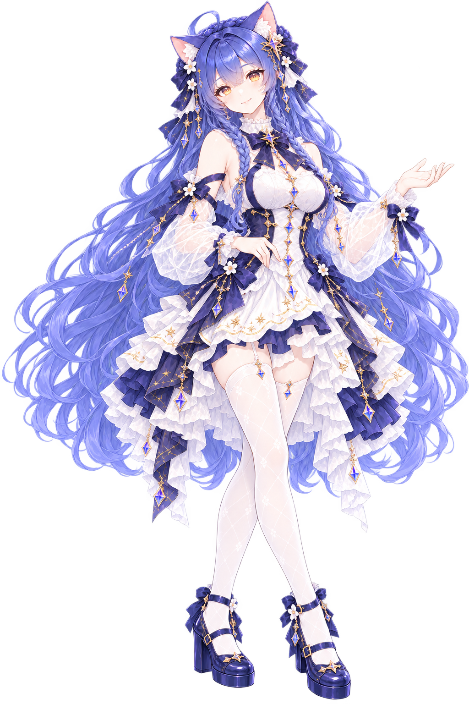
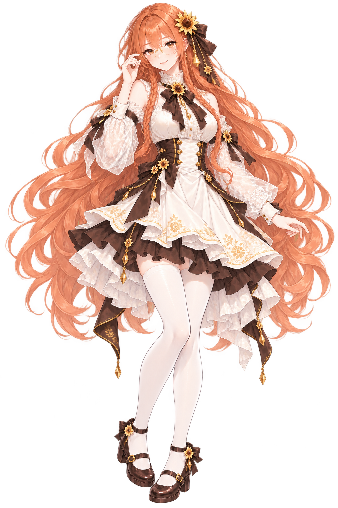
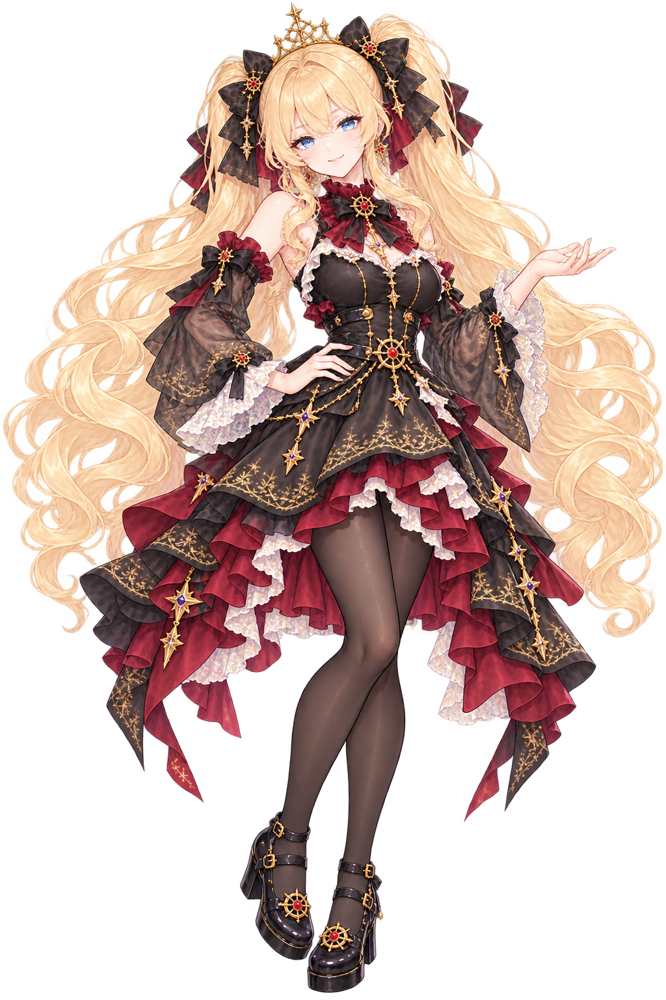
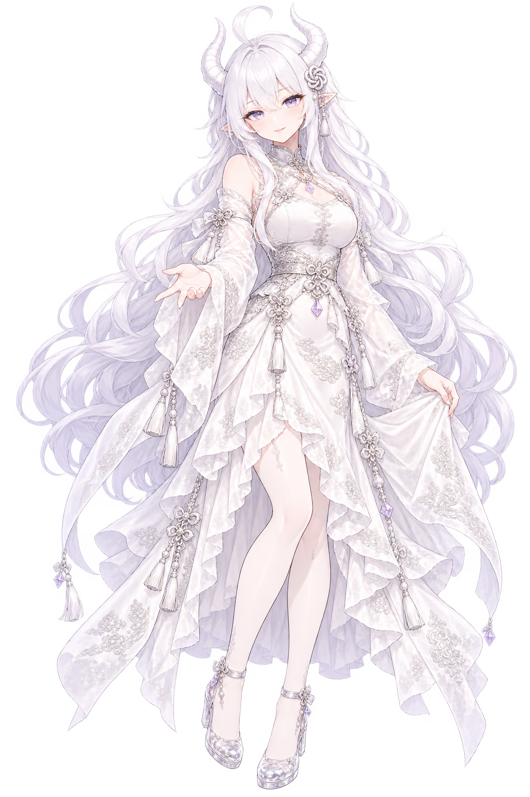

# 声伴 · Voira

**让每一次对话，都有一个鲜明的身影。**

一个正在构建的网页数字人项目，探索有形象、有声音、有个性的 AI 交流体验。

[认识角色](#认识五位角色) · [查看设计](https://www.figma.com/design/ZO9RS5jCJqDWBnAxB8yV2w) · [项目进展](#项目进展) · [参与共建](#参与共建)

> **当前阶段：静态人物页已运行，AI与数字人链路待接入。** 七位形象分别对应自己的AI服务；前五位已有正式图片，Kimi／Qwen仍在形象规划。第一阶段聚焦网页交流，直播后置。

## 认识五位角色

同一套细腻的插画风格，五种不同的交流气质。定稿立绘呈现各自的形象与个性，点击图片可查看原图。

### 01 · 蓝色大肥鱼

**温和 · 轻松 · 略带俏皮**

温柔耐心，也藏着一点小机灵。愿意听你慢慢说，再用轻松的话陪你理清思路。深蓝卷发与蓝瞳是她的辨识点，轻挥手和一点小得意让陪伴更自然。

*首张成女立绘见上方；她是早期网页 PoC 的基准角色，七位接入按各自就绪情况推进。*

### 02 · Gemini

**灵动 · 好奇 · 想象力**

对新鲜事充满好奇，总能联想到意料之外的点子。蓝紫长发、猫耳与星饰，搭配灵感手势和惊喜的表情，像随时准备分享一个新发现。

### 03 · Claude

**沉稳 · 细腻 · 克制**

习惯认真倾听，也愿意多想一步。铜橙长发、细框眼镜与向日葵饰物，配上轻扶眼镜的动作和会心微笑，呈现温和而专注的思考者气质。

### 04 · Grok

**腹黑 · 活泼 · 机智**

脑子转得快，嘴角总藏着一点坏笑。金色双马尾与黑红礼服，配上俏皮点颊和得意神态；喜欢机智的小玩笑，也懂得适时收住锋芒。

### 05 · ChatGPT

**知性 · 包容 · 清晰**

从容亲切，善于把零散想法整理成清晰表达。银白长发、淡紫瞳、对称龙角与银色结形发饰，搭配掌心轻展、倾听和鼓励的表情，让交流保持开放。

这些是项目中的角色视觉设定，不代表相关模型厂商的官方角色或合作关系，也不代表已接通七项AI。Kimi与Qwen的完整背景见[七人人设](docs/design/05-七位角色背景与人设.md)；当前造型、制作规则与正式资源见[角色资产规范](docs/design/04-人物三视图视觉设定.md)。

## 我们想做怎样的交流体验

**人物是画面的中心。** 用克制的黑白灰界面和简洁控件，让注意力留给角色、声音与对话。已有桌面、移动端和明暗主题的设计稿。

**对话有明确的节奏。** 首阶段计划支持文字提问、生成回答和人物播读，听完后由用户决定继续；设计保留最近三轮上下文。

**每一步都有清楚的反馈。** 开始、等待、播放、异常与结束分别设计，让用户知道当前发生了什么，并能主动结束会话。

这些是设计目标与待实现流程。查看[网页体验设计](docs/design/01-网页体验界面设计.md)和[产品验收标准](docs/prd/01-网页数字人PoC产品与验收标准.md)，了解具体范围。

## 项目进展

- **可运行：** 七位入口的静态人物选择页；前五位采用成女形象，DeepSeek五态可选，其余四位仅自然陪伴可选，支持主题与响应式。后端可查询Skill并准备素材任务。
- **已有设计：** 七人人设、Figma页面、七项AI绑定、Vidu协同、完整记录与验收契约。
- **待实现与验证：** 对应AI真实回答、数字人媒体、上下文隔离、异常恢复及结束核对。直播和评论继续后置。

本机启动见[前端](frontend/README.md)／[后端](backend/README.md)；真实服务尚未接通。具体任务与验证边界见[BLACKLOG](BLACKLOG.md)和[HANDOVER](HANDOVER.md)。

## 技术路线

| 层次 | 已选方向 |
| --- | --- |
| 网页界面 | Next.js · React · TypeScript |
| 组件与样式 | shadcn/ui（Radix UI）· Tailwind CSS |
| 业务接口 | Python · FastAPI · Pydantic |
| 接口协作 | OpenAPI · Umi OpenAPI · Axios |
| 首阶段回答与数字人 | 七位角色对应AI回答 + Vidu播读与驱动，待接入验证 |

应用与依赖已初始化，版本由各端锁文件维护；服务接入仍须实现与验证。完整分工见 [PROJECT](PROJECT.md)，视觉与可访问性约定见 [DESIGN](DESIGN.md)。

## 从这里开始

本地服务端目录为 `voira-server/`，对应本 GitHub 仓库 `StephenQiu30/voira`。网页前后端及知识库在本仓库维护；[Voira Pet](https://github.com/StephenQiu30/voira-pet) 是同级独立仓库，共享美术资源位于仓库外的 `../public/`。服务启动见 [前端](frontend/README.md) 与 [后端](backend/README.md)。

- **想看产品：** [Figma 设计稿](https://www.figma.com/design/ZO9RS5jCJqDWBnAxB8yV2w) → [网页体验设计](docs/design/01-网页体验界面设计.md)。
- **想参与设计：** [角色设定与素材](docs/design/04-人物三视图视觉设定.md) → [统一视觉规范](DESIGN.md)。
- **想参与开发：** [需求索引](docs/requirement/01-数字人MVP需求草案.md) → [功能设计](docs/design/00-功能设计索引.md) → [实施计划](docs/plan/02-网页PoC逐功能实现与验收计划.md)。
- **想研究技术：** [调研索引](docs/research/00-调研索引.md) → [网页 PoC 验证计划](docs/plan/01-网页数字人PoC验证计划.md)。

更多资料见[知识库导航](docs/00-知识库导航.md)。本地阅读时，可用 Obsidian 打开 `docs/` 文件夹。

## 参与共建

欢迎通过 [Issues](https://github.com/StephenQiu30/voira/issues) 分享角色反馈、交互建议或数字人技术经验。描述你遇到的具体场景，以及希望改善的体验，会帮助我们判断优先级。

准备贡献前，请先阅读 [AGENTS](AGENTS.md) 与[当前任务](BLACKLOG.md)，让改动与项目阶段保持一致。

如果你也期待这样的数字人交流体验，欢迎 **Star** 关注声伴 · Voira 的进展。
