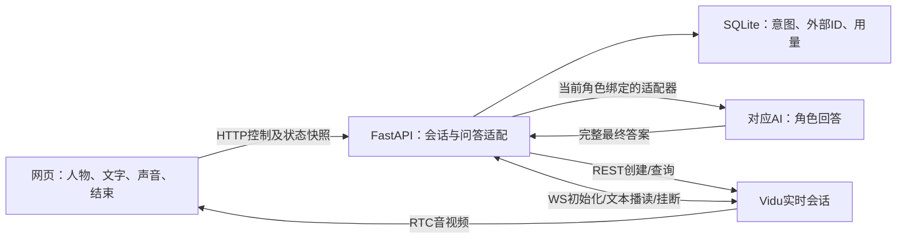

# 02 Vidu网页PoC最小业务设计

上游：[需求索引](../requirement/01-数字人MVP需求草案.md)；下游：[产品验收](../prd/01-网页数字人PoC产品与验收标准.md)、[计划01](../plan/01-网页数字人PoC验证计划.md)。以下接口、数据表和运行参数均为拟实现契约，没有创建代码、数据库或收费会话。

功能规则各自维护：[FR-020 角色音色](../requirement/21-角色音色.md)、[FR-021 角色人设](../requirement/22-角色人设.md)、[FR-022 回答长度与表达](../requirement/23-回答长度与表达.md)、[FR-023 听完后人工继续](../requirement/24-听完后人工继续.md)、[FR-024 最近三轮上下文](../requirement/25-最近三轮上下文.md)、[FR-025 测试用量与预算控制](../requirement/26-测试用量与预算控制.md)、[FR-026 持续异常反馈](../requirement/27-持续异常反馈.md)。其他功能见上游索引；本文保留跨功能协议与状态编排，不把独立需求重新合并。功能分工见[设计索引](00-功能设计索引.md)，DES-019—033的特有规则集中在本文第07节。

**当前范围：** 七位角色各绑定对应AI，详见[FR-031](../requirement/32-七位角色与AI服务绑定.md)和[DES-037](07-AI服务与数字人协同设计.md)。原单DeepSeek形象／全由Codex回答仅为早期验证基线。第03.4节扩展公共契约；第03.3节只适用于ChatGPT角色的Codex候选适配器。数字人媒体、串行输入、人工继续与三轮上下文保持。

## 01 设计范围与决策

已确认：Vidu、人物与背景合成画面、提问后回答、网页先行、本地后端及七位角色分别使用对应AI；蓝色大肥鱼保留为早期角色基线。接入协议从简。工程沿用[PROJECT](../../PROJECT.md)，视觉沿用[DESIGN](../../DESIGN.md)及[现有界面设计](01-网页体验界面设计.md)。并行DES-011为静态角色轮播设计；本业务设计从DES-012开始，七位形象入口不等于七项服务已通过真实验收。

| 设计 | 需求 | 最小方案及理由 |
|---|---|---|
| DES-012 角色输入 | FR-001/020/021；NFR-002/004/007 | 每位角色独立配置，按选中角色使用自然坐姿候选；母版与场景合成后另存送模版本，系统音色/人设单列；不建素材CMS |
| DES-013 会话与媒体 | FR-002/011；NFR-001/004/006 | FastAPI持有Vidu REST/WS，网页ARTC只订阅远端音视频；一个本机体验者和一个活动会话 |
| DES-014 文字问答 | FR-004/005/019/021/022/023/024；NFR-001/002/004/007 | 选中角色对应AI生成最终答案，Vidu text_tts播读；单输入占用/ID去重，未知不重发；按已确认Q-012人工听完后继续，按Q-013仅携带最近3轮已确认问答 |
| DES-015 页面与故障 | FR-006/011/026；NFR-003/006 | 同页媒体/输入/启声/结束/持续错误；HTTP快照轮询；不需要独立SSE状态链路 |
| DES-016 终止与用量 | FR-002/007/025；NFR-003/005 | 终止须查询供应商；未知阻止新会话；浏览器租约、会话上限和试验累计限额统一控制 |
| DES-017 恢复与记录 | FR-008/024/025；NFR-004/005/007 | 本机SQLite保留外部ID和请求意图，支持后端重启核对；配置/图片为文件，不引入Redis或任务平台 |

环境建议为本机Chrome、单FastAPI进程/worker、Next.js同源访问后端；Q-010本机方向已确认，公网共享不在此契约适用范围。媒体SDK/provider/模型版本在真实接入前锁定，不使用漂移版本当验收基线。

## 02 用户流程与状态

### 02.1 角色、媒体与页面

早期基线为`character_id=deepseek`、显示名“蓝色大肥鱼”。character_id支持FR-031的七项，DeepSeek角色须由DeepSeek服务回答；以下素材路径仅说明该角色的基线，不代表其余六项配置。可复用[自然陪伴](../../../public/characters/adult/deepseek/natural.png)与[浅色舞台](../../../public/scenes/voira-studio.png)评审送模组合；正式静态图不等于送模已冻结，具体裁切和动态观感仍待核验。

角色配置必填：`config_version`、母版/送模文件与SHA-256、使用范围记录、云资产ID及就绪状态、模型/provider/运行地区、voice ID、人设版本。送模图无UI和其他人物，脸嘴清楚；构图以实际媒体区评审，不臆定供应商像素门槛。回答生成另记录适配器版本、模型、隔离配置与人设版本；音色方向、人设及回答长度已确认；具体voice ID和送模图仍待Q-004评审。

2026-10-25确认的体验配置：自然清楚的成年普通话女声，轻松有活力、不刻意幼态；人设采用独立FR-021的温和、略俏皮AI伙伴；默认2—3短句、约40—100字（最多150码点），简单问题可更短。具体voice ID仍为空待选，不能将音色方向确认写成素材配置已就绪；小何2.0/Vivi2.0保留试听候选。

未开始展示标注清楚的静态预览；收到真实首帧后，用一个不透明视频平面替换预览与其背景，避免重复叠人。默认保持原比例完整显示，空余区域用现有主题填充；仅在确认嘴脸安全区域后允许裁切。控制和文字区避开嘴脸；不将其他静态角色卡片做成可创建收费会话的按钮。

主流程：查看预览 → 开始 → 连接 → 手动启声（若受限）→ 提问 → 等待并听到人物回答 → 人工确认听完后继续 → 结束 → 核对结果。输入占用期间可编辑下一问草稿，但不能下发。问答正文仅在当前网页和后端内存保留；按已确认Q-013，后端仅以最近3轮已人工确认的完整问答作为模型上下文。T-078新增[FR-030](../requirement/31-本次会话完整对话记录.md)：当前网页显示本次完整记录，不随模型三轮窗口截断；页面内存、结束只读和不承诺刷新恢复的设计见[DES-034](06-会话记录与直播页面结构.md)。可展示“生成的回答”，不宣称它是已播出字幕；不承诺跨会话记忆。

### 02.2 会话、媒体和输入分开建模

| 会话状态 | 进入依据 | 可用操作与下一步 |
|---|---|---|
| idle | 无未结清会话 | 开始；缺少配置/预算时显示原因并禁用 |
| creating | 本地已持久化创建意图 | 禁止重复创建；可请求结束，待返回外部ID后立即清理 |
| creation_unknown | 请求已可能发出但无确定结果，或创建时后端崩溃 | 禁止新建；核对供应商记录，不能自动再POST创建 |
| connecting | 已保存外部live_id，建立控制和媒体 | 分别展示控制、画面、声音状态；结束始终可用 |
| active | WS ready，网页已报告RTC加入及首帧 | 可提问；声音仍可能受限/无实际音频，不显示“已听到” |
| degraded | 原活动会话控制/媒体/浏览器租约异常 | 停止接收新输入；原问答结果未知，结束与核对可用 |
| ending | 已停止输入并请求挂断 | 只可查看/再次请求核对；不新建 |
| end_unknown | 查询失败或尚无ended证据 | 持续展示未确认结束，保留占位与用量；继续核对 |
| ended | 查询确认供应商ended，或供应商后台有人工可追溯核对证据 | 允许下一次开始；费用可仍待结算，单独标记 |
| failed_no_session | 明确在发送创建请求前失败或供应商明确拒绝且未创建 | 展示错误，允许用户修正后发起新意图 |

`provider_status`保留原值，映射到本地状态；浏览器报告的`media_state`只证明本地观察，不能改写供应商终态。后端同会话递增`revision`；网页忽略旧版本和非当前会话的晚到结果。

输入状态：`pending`（本地意图已落库）→ `generating`（对应AI调用中）→ `answer_ready`（已取得并校验最终答案）→ `dispatching`（尝试写Vidu WS）→ `sent`（本地WS写入成功，非服务端受理回执）。生成失败/超时为`generation_failed`/`generation_timeout`；确定未向Vidu发送为`failed_not_sent`；写入不确定为`unknown`。均不自动重试。`continued_by_user`仅代表用户确认听完并释放占用，随后才加入最近3轮上下文；不是自动检测完成。

供应商当前没有文本成功回执；仅凭AI生成完成、WS写成功、回复文本、静音、若干秒无声或估计语速，均不得变成`completed`。按已确认Q-012，在`sent`且控制/媒体连接健康时显示“我已听完，继续提问”；使用者应在实际听完后点击，记录确认时间和操作来源。按钮只解锁、不自动提交草稿，旁注“无法自动判断播放结束，请听完后点击”。用户已选择此PoC方式；仍明确提示误点可能导致重叠，不宣称自动检测完成。生成中未超时或尚未听到时可继续等待；生成失败、用户报告无回应、断线或结果未知，提供结束核对，不用“继续”掩盖失败。自动无操作连续聊天需先补可靠完成证据，再改需求与验收。

### 02.3 超时与重试建议

以下为可评审的工程默认值，不是供应商性能承诺或已批准测试额度：HTTP控制调用10秒后查询本地结果；创建/控制/首帧观察窗口60秒；AI生成30秒提示仍在生成，建议120秒截止并取消本次拥有的进程；答案下发后30秒仍未听到回复则提示等待/结束，这些窗口分别计时；挂断后30秒仍未确认进入end_unknown。快照每2秒查询，连续3次失败显示状态不可用。浏览器每5秒续约，30秒未续约发起清理。读取查询有限退避重试，AI生成、创建和文本发送均不自动重试。

收到文字超时提示但实际仍在说话，不自动挂断当前回答；由体验者选择继续等待或结束。达到已配置会话/试验硬时长时允许结束整场，并明确原因；这与普通输入抢占不同。后台节流导致续约丢失也可能结束PoC，须在用例中记录，不承诺后台标签页长期运行。

## 03 接口设计

### 03.1 本项目HTTP契约草案

公共约定：JSON，UUID为字符串；时间UTC ISO8601，时长秒，费用积分用十进制字符串。所有写请求校验同源Origin、JSON类型与本地访问边界；仅绑定本机，Host采用显式白名单，禁止任意CORS。浏览器首次创建前用加密随机源生成至少256位控制令牌，与创建Idempotency-Key一并保存在sessionStorage；通过X-PoC-Control-Token请求头传递，不入URL/日志。后端只持久化令牌哈希，之后所有会话操作校验同一令牌，关闭后由租约清理。该令牌不是公众登录体系；远程分享需另立需求并落实Q-008访问与保存规则。

常用对象：`SessionSnapshot`含`id/state/provider_status/revision/active_input_id/media_state/audio_enabled/audio_playback_state/end_evidence/cost_status/usage/error/updated_at`；`usage`含`estimated_seconds/provider_billed_seconds/provider_credits/generation_attempts/generation_tokens/generation_cost`，未知为null，不写0。`InputReceipt`含`id/session_id/state/created_at/generation_started_at/generation_finished_at/answer_text/sent_at/user_confirmed_at/error`；当前输入回执嵌入SessionSnapshot的active_input，沿现有状态轮询取回，不新增流式接口；绑定及答案关联补充见第03.4节。answer_text仅为内存中的完整最终答案，可空，响应Cache-Control:no-store；结束/重启后不承诺回看。均不得返回供应商长期密钥。

| 方法与路径 | 请求与响应 | 权限、幂等及失败 |
|---|---|---|
| GET /api/poc | 200：characters列表及逐角色准备状态（第03.4节）、active_session_id可空 | 本机同源；无副作用、不创建会话；不返回秘密配置 |
| POST /api/sessions | Header Idempotency-Key UUID；body character_id为FR-031七项枚举；后端按角色解析并冻结绑定。202：SessionSnapshot；不回传控制令牌 | 同key同参数且控制令牌匹配返回同意图；令牌不匹配403，不同参数409；未结清会话409；缺配置/额度409；请求意图先落库再外调 |
| GET /api/sessions/{id} | 200：SessionSnapshot | 控制令牌；只读本地状态；不存在404；轮询不新建或重发任何内容 |
| POST /api/sessions/{id}/connection | body空对象；200：provider、当前会话RTC必要参数及凭据、expires_at可空 | 控制令牌；Cache-Control:no-store；仅返回现有短期凭据，不新建；丢失/过期409并提示结束核对，不假定供应商有刷新接口 |
| POST /api/sessions/{id}/inputs | body input_id UUID、text字符串，trim后1—500 Unicode码点；202 InputReceipt | 控制令牌；先校验input_id归属当前路径会话，跨会话复用ID返回409且不泄露旧记录；同会话同ID同内容返回原记录，同ID不同内容409；忙409；未就绪409；无效输入422；仅本地接收，随后异步调用绑定AI生成答案并播读；不代表已回答 |
| POST /api/sessions/{id}/inputs/{input_id}/continue | body outcome=heard_finished；200 InputReceipt | 控制令牌；首次确认仅当前sent且连接健康允许；已continued_by_user的同输入重试只返回旧记录，不动后来轮次；其他状态409；记录人工继续，不写自动播放完成 |
| POST /api/sessions/{id}/heartbeat | body media_state枚举joining/frame_received/disconnected/error、audio_enabled布尔（用户设定开关）、audio_playback_state枚举enabled/muted/blocked/unknown/error；200 SessionSnapshot | 控制令牌；续租和本地观测；只允许当前会话，过期会话409；报告不能延后硬时长上限；音频开关/播放观察/实际听到分别记录 |
| POST /api/sessions/{id}/end | body reason=user/timeout/media_error/no_response；202 Snapshot，已结束则200 | 控制令牌；幂等；重复不重置预算或创建新会话；断页可尽力发送，但以租约兜底 |

单会话开始/结束/输入写入以事务串行；读最多5次/秒、写最多2次/秒/控制令牌（建议参数），超限429。错误统一`code/message/retryable/request_id`，不返回上游完整报文。重要code包括CONFIG_NOT_READY、SESSION_BUSY、SESSION_UNRESOLVED、INPUT_BUSY、INPUT_CONFLICT、MEDIA_CREDENTIALS_UNAVAILABLE、PROVIDER_UNAVAILABLE、GENERATION_FAILED、GENERATION_TIMEOUT、ANSWER_INVALID。

后端HTTP请求结束不撤销已落库意图；客户端超时先按session/input ID查询，不能换新ID偷偷重发。首次创建响应丢失时，使用同一Idempotency-Key取回原意图；重试必须携带原创建键及预先保存的控制令牌，后端可核验而无需保存明文令牌，不另开收费会话；仅凭可猜测/泄露的创建键不能领取新令牌。浏览器丢失所有恢复凭据后只能等待/由本机操作者核对，不能随便接管未结清会话。

FastAPI按请求/响应模型生成`/openapi.json`和`/docs`；Umi OpenAPI生成至`frontend/src/api`。不手写另一份Swagger，不引入`/v1`，不建立自定义脚本目录。RTC及Vidu WS是独立协议，不把它们冒充HTTP生成客户端覆盖。

### 03.2 Vidu适配边界

文档依据为[官方实时参数](https://platform.vidu.cn/vidu-stream/doc/s2-avatar/realtime/parameters)，2026-10-25复核。

| 外部能力 | 拟使用方式 | 不作出的假设 |
|---|---|---|
| POST /live/s_avatar/realtime | 后端指定video、固定avatar/voice/persona等真实字段 | 200只代表创建，不证明WS ready/首帧/声音；未确认创建幂等协议，不自动重试 |
| WS /live/ws/live/connect | 后端鉴权并使用live_id/conn_id；type1初始化，type2 success才表示控制ready | 控制ready不等于网页媒体ready；NOT_READY只在同一会话重试初始化 |
| type100 text_tts | 以本地输入ID作为msg_id发送对应AI最终答案；实时doubao及匹配voice ID为候选 | qwen_omni不支持；没有成功业务ACK，不假定msg_id服务端去重，不调用text_dialog二次生成答案 |
| RTC | 网页按返回provider加载兼容SDK，关闭本地音视频发布，订阅远端 | 固定仓库只实现ARTC，返回其他provider则明确不支持；不索要设备权限来绕过问题 |
| type5 call_hangup / type6 force_hangup | 发出或接收挂断后启动状态核对 | 无独立业务ACK；WS断开不是ended证据 |
| GET /live/v1/lives/{live_id} | 核对status、结束时间、billed_seconds、credits_cost | 状态结束和费用已结算分开；未返回不写0 |

Vidu仅承担发声/形象：按已核实字段建议farewell_enabled=false、persona_enhance=false、enable_recording=false；不发送用户问题建立第二份供应商对话。greeting_instruction存在，但空值是否能关闭自发开场未验证，必须实测“不提问不自发说话”。text_tts不更新供应商对话上下文，短期上下文由本地后端维护。

不预设字幕/逐轮结束回执；真实接入若观察到额外事件，先记录原始类型与关联可靠性，再修订契约。参考仓库[stage.html 350—375行](https://github.com/garycaogan/ai-live-avatar/blob/5559ec5440c93814737155183dbe832df0b9f215/static/stage.html#L350-L375)仅提供关闭本地发布的静态实现证据。

### 03.3 本地Codex调用边界

**选择建议：** FastAPI通过本机子进程调用已安装Codex，每轮生成一次完整答案；不将网页直接连接开发中的Codex聊天。首轮不接MCP，不引入常驻app-server。2026-10-25只读核验时为codex-cli 0.163.0，已通过帮助确认非交互exec、stdin、JSONL事件、ephemeral和ignore-user-config选项，尚未运行模型任务。帮助可用不等于认证、生成质量、延迟或取消已经通过。

| 边界 | 拟实施规则与验证 |
|---|---|
| 输入 | 后端使用独立FR-021已确认人设/长度约束 + 最近3轮已人工确认的完整问答 + 当前用户问题；问题始终为内容，不能作为shell命令或配置。用参数数组和stdin传入，禁止拼接shell字符串 |
| 配置 | 固定本地CLI路径/版本、模型和隔离配置；使用独立工作目录和最小环境，避免继承开发仓库指令、任意MCP服务和工具配置；ignore-user-config只处理配置继承，不宣称完成权限隔离 |
| 访问能力 | 角色只需生成文本；接入前验证禁用无关工具/网络搜索及限制文件读取的实际配置。read-only沙箱仍可能读文件或调用工具，不能仅凭该标志验收隔离；不使用危险自动放权选项。限制未验证前不开放普通用户输入 |
| 认证 | 使用本机支持的认证方式，不读取或复制开发聊天的登录秘密到项目。官方支持ChatGPT与API密钥认证，并建议程序化工作流使用API密钥；最终按本机授权与账单边界配置，调用仍经本地Codex，非网页直接调API |
| 输出 | 解析JSONL的最终agent回答并确认成功终态；只取一个完整答案，过滤工具/日志/中间事件。校验非空、纯文本和最多150个Unicode码点；默认2—3短句、约40—100字，简单问题允许更短，不为凑字数添话；异常拒绝播读，不把整个stdout读给人物，不按分片多次触发Vidu |
| 生命周期 | 同一输入ID最多一次启动意图；生成预算先累计再调用；超时/结束只取消本次拥有的进程，绝不结束用户其他Codex进程。每次发往Vidu前复查会话/输入版本，旧结果丢弃 |
| 上下文与保存 | 推荐每轮ephemeral且不resume开发线程，按已确认Q-013重新携带最近3轮已人工确认的问答，超过3轮移出最旧一轮；不足3轮用已有轮次，首次为空。失败/未确认轮次不加入；会话结束或后端重启清除后端正文，不从开发线程恢复；前端本次记录副本按FR-030生命周期单独处理。CLI不持久化本地session不等于上游不保留数据；问答仍会发给模型服务，答案和角色图会发给Vidu，不把本地优先写成完全离线或云端零留存 |
| 失败与用量 | 失败/超时/超长不自动再调用、不切换到Vidu问答；本轮提示结束后重新开始。记录真实token/费用（可取得时），未知单列；杀掉本机进程不保证上游立即停止生成/收费 |

依据：[官方非交互模式](https://learn.chatgpt.com/docs/non-interactive-mode)、[认证](https://learn.chatgpt.com/docs/auth)、[app-server](https://learn.chatgpt.com/docs/app-server)；其余取舍见[研究结论](../research/00-调研索引.md)。app-server的JSON-RPC接口不等于MCP；本机mcp-server子命令帮助未得到专用说明，本轮不以它作为可用能力。

### 03.4 七位角色的统一AI接入契约

以下是FR-031的新契约草案，覆盖旧的固定deepseek／全部调用Codex限制；不新增独立消息桥或浏览器WS。HTTP八个端点沿用第03.1节，只有角色配置、绑定和回执字段扩展。CLI专用参数仍只在第03.3节定义。

**角色配置与可用性。** 后端配置以character_id索引，绑定`binding_version / adapter_id / provider / model / persona_version / credential_ref`及既有资产／音色配置。credential_ref只引用后端秘密来源，不包含秘密值；会话接口不接受endpoint、命令或凭据。管理表单独立按下述预设规则接收配置及一次性秘密写入。每个角色只有一份当前绑定，创建会话时冻结其版本。模型空缺或品牌不匹配必须拒绝，禁止使用一个默认模型替代缺项。

GET /api/poc返回characters数组：`character_id / display_name / preview_url / config_version / answer_source / readiness`。answer_source仅含可公开的`provider / model`；readiness含`ai / asset / voice / budget`各项状态（missing、unverified、ready、unavailable）及原因、`checked_at`和汇总`can_start`。ready须有仍有效的配置与核验依据；只安装CLI或存在环境变量只能算unverified。查询只读取已有准备结果，不触发模型探测、上传、试听或创建。任一项不是ready则该角色不能开始；不影响其他已就绪角色。既有未结清会话仍全局阻止新建。准备状态不能保证随后调用一定成功，运行失败按既有异常路径处理。

SessionSnapshot增加`character_id / binding_version / answer_source`，创建后不变。InputReceipt增加同一绑定信息及`answer_hash`（仅最终文本存在时可用）；答案就绪后、媒体发送前均复查session_id、input_id、binding_version及结束意图。GET快照仍按revision过滤，当前输入释放前须把最终文本合并进本页记录；continue响应保留本次InputReceipt用于幂等回执。若生成文本尚未取回，页面不显示继续；取得失败时保持当前输入等待或结束核对，不能补造答案。已结束后的只读回看来自页面内存，不新增历史恢复接口。

**内部适配合同。** GenerateRequest为`session_id / input_id / character_id / binding_version / model / persona_version / system_prompt / context / current_question / deadline`。context为当前会话最近三轮已确认问答的不可变快照；适配器不能从其他频道或个人聊天追加内容。结果为`final_text / terminal_status / actual_model / provider_request_id / usage / error`，可取得的真实模型与用量必须如实返回，未知用量为null。actual_model若与批准绑定不符则拒绝交付，允许的服务端模型别名须预先写入配置。适配器版本与服务来源由后端可信配置记录，不能根据模型自称身份判断。error归一为认证、限流、不可达、超时、无效回答或结果未知；最终状态仅succeeded且文本通过校验才进入answer_ready。

只有编排服务可以写业务状态、启动生成和播读；适配器负责一次调用、最终正文提取、错误归一和取消本任务拥有的句柄。供应商流式片段／CLI事件可内部解析，页面与Vidu只消费完整最终答案。每个input_id最多一次生成意图；HTTP响应丢失先查询原ID。上游没有幂等保障时不宣称恰好一次，不把断线或取消当作未调用／零费用。

**数据约束。** 字段统一见第04节；配置校验角色枚举及绑定对应关系，创建后不可改写。inputs通过session_id引用冻结绑定，保留model记录实际返回模型；不重复持久化问答正文。各服务的用量单位和计价来源在run不可变配置中分别保存，无法折算的费用不能混加或按零放行。原单输入锁与唯一活动会话槽继续使用，不额外引入七条并发队列。

**上下文与失败。** 默认每轮显式发送三轮快照；任何远端续聊机制须证明不会保留超出窗口的内容，否则不采用。结束后取消／清除本次上下文，不影响个人CLI或其他服务会话；切角色须走结束和新建。未确认播完不进入模型窗口，Vidu出错不重新请求AI，AI出错不切Vidu问答或其他品牌。资产制作Skill与会话回答适配器分开：prepared不是生成完成，也不是AI服务就绪。

### 03.5 服务预设与连接配置

对应FR-033／DES-039，以下为管理能力的数据边界草案；第03.1节八个会话端点保持独立。管理HTTP路径及权限契约须在实现前补齐，不能通过会话端点顺带修改配置。

| 对象 | 必要信息与约束 |
|---|---|
| 预设模板 | `preset_id / preset_version / service_kind / provider / adapter_id / auth_mode`，以及受控地址、协议、必填字段和模型选择规则；不含密钥。service_kind区分回答AI与数字人媒体，具体值由已验证适配器提供 |
| 已保存连接 | `connection_id / connection_version / preset_id / preset_version / provider / adapter_id / model / credential_ref`及经校验的地址配置；保存模板快照及用户覆盖值。显示名称可改，provider身份不可由名称推断；秘密只存后端秘密存储，不进入普通配置或日志 |
| 角色绑定 | 原binding_version引用固定的connection_id及connection_version；七位角色各有一个启用连接，可保存同服务的其他候选。创建会话冻结连接、模型与凭据版本，停用／删除及轮换不能破坏活动会话 |
| 检测结果 | 关联连接版本、检测类别、时间与结果；配置／凭据／模型变更使结果失效，晚到的旧检测不得更新新版本。模型目录读取成功不等于文本生成通过，AI文本通过不等于Vidu媒体就绪 |

模板来源为应用维护的受控清单；预设更新只提示可更新，用户选择后生成新连接版本并重新检测。自定义连接复用已支持协议，不执行任意命令；后端校验目标、重定向与地址范围，拒绝嵌入凭据的URL，本机桥仅允许已注册目标。不能仅凭“OpenAI兼容”推断实际模型是OpenAI；角色绑定还须核对真实服务和模型归属。

管理页凭据输入只作一次性写入，取消／提交完成后清空；响应仅返回已配置状态和不可用于访问秘密的标识，不含原文或可逆形式。密钥不写localStorage、URL、遥测、示例或Git；运行接口不得回传。已有环境配置可作只读凭据引用，新建凭据通过后端秘密存储提供，存储实现与本机管理鉴权在开发前落实。

保存、模型目录查询、文本检测和Vidu媒体验证是不同操作；保存不出网，目录查询按适配器能力由用户主动触发，失败允许使用模板批准模型或后端校验的手填模型ID，不自动生成答案。收费检测沿用FR-025的额度确认与未知不重试。Vidu连接另行配置并引用角色资产／voice ID，不作为第八个回答AI，也不复用AI密钥。

## 04 数据与恢复

建议SQLite只用于单机恢复，不作为多用户数据库；图片和非秘密角色配置为本地文件，长期密钥由后端环境配置或受控秘密存储提供，连接仅持有引用。不开新数据库端口。生产/分享访问须重新评审访问与并发。

下表给出最小字段组；组内字段具有相同类型和约束。所有状态列由设计枚举CHECK约束。未写默认值的字段必须显式赋值；null表示尚未取得，不能解释为成功或零。

| 表/字段 | 类型、可空、默认与约束 | 用途 |
|---|---|---|
| sessions.id / create_key | TEXT，非空；主键 / UNIQUE；无默认 | 本地会话与创建幂等 |
| sessions.character_id / binding_version / adapter_id / provider / model / persona_version | TEXT非空，无默认；创建后不可变 | 冻结角色与AI绑定，不能跨品牌回退 |
| sessions.config_version / run_id | TEXT，非空；无默认 | 固定配置版本、同一次批准试验的累计范围 |
| sessions.state / revision | TEXT非空无默认 / INTEGER非空默认0、CHECK>=0 | 状态及单调快照版本 |
| sessions.active_slot | INTEGER，可空，UNIQUE、CHECK=1；创建时设1 | 所有未结清状态持有同一槽；明确无会话或已核对ended才置null |
| sessions.provider_live_id | TEXT，可空默认null、UNIQUE | 外部会话恢复；创建未知可以缺失 |
| sessions.controller_token_hash | TEXT非空，无默认 | 不存明文控制令牌；校验控制请求 |
| sessions.created_at / updated_at | TEXT UTC，非空，无默认 | 本地事件时间 |
| sessions.lease_expires_at / deadline_at | TEXT UTC，可空默认null | 浏览器租约与不因续租改变的硬上限 |
| sessions.provider_status / ended_at / end_evidence | TEXT，可空默认null | 原始状态及可追溯终止依据；人工依据脱敏 |
| sessions.estimated_seconds | INTEGER非空默认0、CHECK>=0 | 本地保守累计用量，重启/重试不清零 |
| sessions.provider_billed_seconds / provider_credits | INTEGER / TEXT十进制，可空默认null | 供应商核对用量；与估算并存，不相加重复计费 |
| sessions.stop_requested_at / end_reason | TEXT可空默认null / TEXT可空默认null | 创建中/生成中结束意图，所有外调和晚到结果先检查 |
| sessions.error_code | TEXT，可空默认null | 归一错误，不存供应商完整凭据/报文 |
| inputs.id / session_id | TEXT非空；主键 / FK sessions.id，RESTRICT删除 | 一个会话多次输入 |
| inputs.content_hash / char_count | TEXT非空 / INTEGER非空CHECK 1—500；无默认 | 同ID内容冲突判断；正文仅发送时驻留内存 |
| inputs.state / active_slot | TEXT非空 / INTEGER可空CHECK=1 | 同会话最多一条占用，UNIQUE(session_id, active_slot) |
| inputs.created_at / sent_at / user_confirmed_at | TEXT UTC；created非空，另两项可空默认null | 三种不同事实；人工确认不覆盖sent时间 |
| inputs.confirmation_source | TEXT可空默认null，非空仅user | 与user_confirmed_at共同记录人工继续，不表示机器播完 |
| inputs.generation_attempted / generator_version / model | INTEGER非空默认0且仅0/1 / TEXT可空默认null | 一条输入最多启动一次生成；试验按输入汇总累计尝试数，启动失败也计一次尝试 |
| inputs.generation_started_at / generation_finished_at | TEXT UTC，可空默认null | 与Vidu发送和人工继续分开计时 |
| inputs.answer_hash / answer_char_count / generation_tokens / generation_cost | TEXT / INTEGER / INTEGER / TEXT十进制，可空默认null | 答案关联与可取得的真实用量；正文不落库，未知费用不写0 |
| inputs.error_code | TEXT，可空默认null | 未发送、未知及失败原因 |

索引：sessions(run_id, created_at)支持累计核对；inputs(session_id, created_at)支持当前轮次回查；不建无查询用途的额外索引。人物/声音版本通过config_version引用配置快照，配置文件改变不得改写历史记录。

创建事务先写sessions并占槽，再出网；供应商返回ID即持久化。请求可能成功但ID未保存时，状态为creation_unknown；没有外部幂等保障便无法保证跨系统恰好一次，需核对供应商后台该试验窗口并记录人工依据。未完成核对不释放槽。

输入事务先检查会话和占用，持久化意图后仅发送一次。进程重启发现pending/generating/answer_ready时，保守记generation_failed（error_code=RUN_INTERRUPTED，确定未发往Vidu）并结束原会话，不重新生成；发现dispatching/sent且无明确人工释放时，将结果记unknown；不从数据库恢复正文并自动重播。启动时先扫描全部未结清会话，已知live_id则查询并清理；未知ID按上条处理，恢复前不接收新创建。

本地记录建议保留至该试验核对结束；评审默认7天后可清理已结束且结算核对完成的数据，未决会话不自动删除，远程分享另按Q-008落实。日志不默认保存问题全文或录音，测试人员仅记录自编非敏感样本和必要人工观察。SQLite迁移将在应用初始化时建立；当前没有既有迁移框架。实现前选定与应用集成的迁移方式，备份并验证恢复；不新增自定义脚本文件。尚无运行数据库或迁移。

### 04.1 试验额度与预留补充

`runs`拟建表承接FR-025的累计与重启恢复，不是商业账单。所有额度来自实际调用前的批准配置，不提供隐式默认授权。

| 表/字段 | 类型、可空、默认与约束 | 用途 |
|---|---|---|
| runs.id | TEXT非空主键，无默认 | 一次批准试验的run_id；sessions.run_id外键，RESTRICT删除 |
| runs.config_json / config_hash / approval_ref | TEXT非空，无默认 | 不可变限额/计价依据快照、SHA-256、用户批准依据；不含密钥 |
| runs.max_session_seconds / max_total_seconds / max_generation_attempts | INTEGER非空无默认、CHECK>0 | 三种独立上限，启动前必填 |
| runs.currency / max_total_cost | TEXT非空无默认 / TEXT十进制非空无默认 | 核准币种及总金额，应用验证正数；金额计算使用Decimal，不用浮点 |
| runs.created_at | TEXT UTC非空，无默认 | 创建批准配置时间 |
| sessions.vidu_reserved_cost / inputs.generation_reserved_cost | TEXT十进制可空默认null | 保守预留；未核价不可进入收费步骤，unknown不按0释放 |
| sessions.vidu_reservation_status / inputs.generation_reservation_status | TEXT非空默认not_reserved | not_reserved/reserved/unresolved/settled；只有有依据的结算才释放剩余预留 |

config_json还应包含Vidu计价版本/积分换算、各AI模型计价与单次保守预留办法；若无法给出可执行的控制方式则保持配置未就绪，不凭答案150字推算整个模型调用费用。真实供应商侧限额可作为控制补充，仍须记录其覆盖范围。

同一SQLite写事务读取run累计与未释放预留、校验上限、占用会话或输入并更新预留，然后才外调。累计由sessions/inputs的真实记录聚合：未决项目按保守预留、已结算项目按实报费用，不能把预留和同项目实报再相加。一次输入generation_attempted从0到1最多一次，启动失败仍计尝试。核对值与原估算并存，超限后停止后续操作并记录差异，不篡改账本让结果看似在限额内。

创建出网前持久化created_at作为保守时长起算点（包含创建/连接等待），deadline_at取该时点加单场上限与本run剩余可用时长中的较小值；未决会话保留其时长占用。浏览器续租不延后deadline。重启按持久化起算点补算至当前时刻的未决耗时（不重复累计已记时段），先清理后开放创建；有可信供应商终止时间后保留估算并以外部依据核对。系统时钟回拨不能减少已记录用量，时钟异常先阻止新请求并核对；运行中计时用单调时钟，恢复用UTC记录并保守处理。

runs与会话/输入在同一SQLite库，按run_id聚合；沿用sessions(run_id, created_at)、inputs(session_id, created_at)索引，不额外建队列服务。已批准配置不得被覆盖，变更额度必须有新批准记录并保持既有用量归属；不能用新run_id规避旧的未决会话或预留。

### 04.2 轮次确认与恢复一致性

人工继续与结束、下一次输入共用单会话互斥与SQLite事务。首次继续时检查state=sent、当前占用、连接健康且stop_requested_at为空；更新continued_by_user、user_confirmed_at、confirmation_source=user，释放inputs.active_slot并增加session revision。active_input_id从当前占用派生，释放后为null；当前continue响应仍返回已确认InputReceipt。

随后在同一互斥区更新内存三轮窗口，成功后才允许下一轮。若提交后崩溃，重启不恢复正文、结束残留；若仅内存追加失败，立即降级并结束，不继续缺失上下文的问答。已确认input_id的重复请求返回原记录，不重复追加，也不清除新的活动输入。此处没有宣称数据库与内存可跨进程原子提交，而是以失败关闭会话守住一致性。

取消/结束前尚未进入dispatching的输入置failed_not_sent并记录SESSION_ENDING，生成超时/失败保留对应generation_*；dispatching或sent但结果无法确定则记unknown，保留已发送事实。已continued_by_user的历史不能被后续结束改成unknown。旧结果必须核对session/input身份及状态，不仅比较时间。

同源Next.js代理只转发本机允许的目标和已校验的Origin/Host，不信任任意客户端伪造的转发头；FastAPI校验配置中的浏览器Origin与控制令牌。该机制只覆盖本机单用户PoC，不视作公网认证。

## 05 非功能设计与验证

| NFR | 设计措施与真实边界 | 验证入口 |
|---|---|---|
| NFR-001 | 区分本地时间、供应商事件和浏览器首帧/首音；逐样本列延迟，不设虚构SLA | TC-016/017/020 |
| NFR-002 | 固定当前角色版本，逐角色以真实短长句对照脸/嘴/声音/服饰与背景；合成画面不免除保形要求 | TC-016/017/020 |
| NFR-003 | 断线降级、输入未知不重发、版本过滤、终止核对、重启扫描；无自动续开 | TC-018/019 |
| NFR-004 | 授权来源、AI标识、本机访问、令牌校验、密钥仅后端、日志脱敏；不自动录播 | TC-016/020 |
| NFR-005 | 创建前要求设置run_id、会话/累计时长及批准费用上限；按已核对费率保守预留、扣减累计额度，不足拒绝 | TC-019/020 |
| NFR-006 | 一个目标桌面浏览器；键盘可操作、可见焦点、输入校验、启声提示和持续错误；页面不请求音视频采集 | TC-016/018 |
| NFR-007 | 配置哈希、请求关联、未知/人工/供应商证据分栏；最小复现步骤及限制 | TC-020 |

AI调用次数、模型用量及Vidu时长分别累计；用量不因刷新或重启清零。对应AI认证、模型或隔离配置缺项时开始不可用。费用值必须来自Q-006，文档不设默认获准金额。结束请求失败仍占用试验预算；估算时长与供应商用量采用保守较大值控制剩余额度，费用不确定时保留预留不释放。供应商费率无法核对时不开展真实测试。会话ended可释放并发槽，但费用未核对的预留仍计入预算。

浏览器租约只在后端存活时能触发清理。后端/设备全停期间无法保证实时挂断或费用绝不超限；真实测试前须落实供应商侧可用的限制或人工后台终止路径，并有人值守。恢复后立即核对，不能把本地计时器描述为供应商硬停费保证。

## 06 评审与验收

具体送模图、voice ID、七项连接与实际额度仍须落实。契约细节为草案；真实验收见[计划01](../plan/01-网页数字人PoC验证计划.md)，任务依赖和完整追溯见[计划02](../plan/02-网页PoC逐功能实现与验收计划.md)。

## 07 功能特有规则

以下保留DES-019—033的职责与异常约束；公共状态、HTTP字段和表结构以前文为唯一来源。所有接口均为拟实现契约。

### DES-019 开始网页会话设计

打开页面只查配置 → 用户开始 → 校验配置/批准额度 → 本地事务占槽并预留用量 → 创建Vidu会话 → 保存live_id → WS ready → 网页加入RTC并报告首帧。仅控制与首帧都就绪才到active；声音可播放状态单列。

明确未发出/供应商明确拒绝才failed_no_session。请求可能发出但无确定结果为creation_unknown，保留槽并核对，不能重新POST上游。客户端请求取消不撤销后台意图；创建中用户结束则记停止意图，外部ID一到立即清理。

归属POST /api/sessions、GET /api/sessions/{id}及POST /api/sessions/{id}/connection，字段/状态码以共享设计02第03节为准。创建键及控制令牌在首次请求前保存在当前标签页；重发同意图沿用两者。202表示本地受理；重复键不同参数409，未结清槽409，缺配置/额度409。

sessions持久化create_key、controller_token_hash、config_version、run_id、active_slot、state、provider_live_id、revision及时间。先落意图再出网；成功取得外部ID立即保存。RTC凭据仅内存与短期响应，不写普通日志。

本功能重点：双击、响应丢失、创建返回前结束、创建后后端崩溃都最多一次创建意图；页面/Swagger/刷新不得产生收费会话。

### DES-020 网页文字提问设计

编辑草稿 → trim并校验1—500 Unicode码点 → 创建input_id → 提交 → 显示生成中。期间允许继续改下一问草稿，但提交按钮锁定；输入被接受不表示人物已回答。成功解锁后必须再次主动点击发送。

网络超时先查询当前意图；不换ID自动重试。网页只在会话健康且无占用时允许发送，后端再次检查以阻止双击和陈旧页面。输入失败保留草稿，键盘提交遵守同一规则；中文输入法组合态不能触发提交。

POST /api/sessions/{id}/inputs使用input_id/text；202回InputReceipt，轮询快照取active_input；空白/超长422、忙409、相同ID不同内容409；input_id已存在但属于其他会话也返回409，不返回旧会话内容。发送前把本次文本复制为不可变提交内容，同ID重查不能使用后来编辑的新草稿。

inputs.id为幂等标识；content_hash基于trim后UTF-8文字，前后端不做不同的隐式Unicode归一化。唯一(session_id,active_slot)保护占用。正文仅内存；刷新可恢复状态，草稿不承诺跨关闭保存。相同文字新ID是新一轮，不做永久内容去重。

本功能重点：0/1/500/501码点、中文/emoji边界、连续点击、占用中编辑、重新主动提交相同文字与旧响应回流。

### DES-021 人物回答播读设计

answer_ready → 在会话锁内复查当前输入和结束意图 → 记录dispatching → 一次type100 text_tts写入 → 本地写成功记sent。页面显示“生成的回答”和等待实际听音，不显示自动播放完成。

确定没发出为failed_not_sent；写入是否到达不确定为unknown并停止后续输入。WS成功不是服务端业务ACK；没有回执也不能自动重发。收到错误/断线时进入持续异常与结束核对；不自动回退到text_dialog。

内部播读命令包含session_id、input_id、expected_revision、answer_text；后端按当前live_id/conn_id发送payload.text_tts={msg_id:input_id,content:answer_text}。msg_id用于关联，不能假定供应商去重。状态通过现有快照返回，不新增网页直连Vidu WS。

inputs记录answer_hash/answer_char_count/state/sent_at，正文只在当前进程内存。dispatching必须在WS写之前持久化；持久化失败则不发送。一个输入只准一次发送意图；会话revision和当前ID保护晚到结果。

本功能重点：实际声音与完整答案一致，用户问题不被当答案读出；工具/日志不播读；重复输入、WS失败和迟到答案不形成二次播读。

### DES-022 网页声音控制设计

尝试播放 → 若浏览器限制则持续显示“开启声音” → 在用户手势内恢复实际远端音频 → 成功后更新状态。静音/恢复只控制当前远端音频轨道，不创建、结束或重新发送内容。

恢复失败不能吞异常或显示已启声；正文显示原因和可重试入口。已有声音状态未知时标未知。重复点击不重复入会；按钮键盘可用、有可见焦点和明确标签。静音不释放轮次槽。

本地适配接口为setAudioEnabled(enabled:boolean)和unlockAudio()，返回user_enabled布尔及playback_state枚举enabled/muted/blocked/unknown/error；这是本项目内部契约，具体SDK方法待锁定版本核查。heartbeat.audio_enabled仅上报用户设定的本地启声开关，audio_playback_state另报上述播放状态；未知使用unknown，不能强记为已静音或false。两者均不能证明实际听到。

用户声音偏好和播放状态驻浏览器当前会话，不入数据库、不修改计费状态。退房移除SDK监听及远端音频资源；切会话后旧Promise不能覆盖新状态。

本功能重点：浏览器阻止自动播放、手动恢复、静音恢复、恢复失败、SDK异步失败及退出后残留音频；听见与API成功分开记录。

### DES-023 结束网页会话设计

显式结束/达到上限/租约失效 → 记录结束意图并禁止新输入 → 立即停止本地媒体及当前AI调用 → 尽力挂断 → 查询外部状态 → ended或end_unknown。未取回live_id的创建中结束仍保留占用，待返回后清理。

挂断失败、WS关闭或浏览器退房只说明本地动作，不能自动ended；核对未知阻止新会话。后台重启先扫描未决会话，禁止恢复问答/自动重开；全机停止时无法保证定时清理，真实测试须有供应商或人工终止路径。

POST /api/sessions/{id}/end返回202终止中，已确认结束返回200；重复结束幂等。GET快照提供end_evidence/cost_status。后端使用Vidu挂断与查询接口；人工后台核对暂由本机操作者记录脱敏凭据，不增加通用管理后台。

sessions增加stop_requested_at/end_reason，结束意图在外调前落库。provider_status、ended_at、end_evidence与费用结算分开。结束后清除问答正文，终态与用量元数据保留到核对完成。

本功能重点：连续结束、生成中结束、WS写入附近结束、创建未知、页面关闭、后端崩溃恢复和供应商结束/费用不同步。

### DES-024 必要诊断记录设计

各阶段记录关联ID与时间 → 错误归一和脱敏 → 试验结束核对 → 汇总可复现记录。页面只展示必要状态/错误，不展示上游秘密报文。

日志失败不能让已发请求变成未发；恢复依据以意图账本为准。人工首音时间须标操作来源与精度，不能由WS发送时间推算；缺失字段记null。导出验收记录前复查脱敏，限定自编样本。

内部诊断事件最小字段为event_id、run_id、session_id、input_id可空、event_type、occurred_at、evidence_source(local/provider/human)、error_code可空；提供方由事件生产者标记。对外只经SessionSnapshot返回必要摘要，无任意文件读取/日志下载接口。

共享sessions/inputs/runs承担必要持久化；事件不得默认保存问题全文、回答正文、密钥、RTC凭据、控制令牌和stdout。仅保存hash仍属元数据，不能声称不可推断内容；日志保留到试验核对，7天清理仅建议，未决记录不删。

本功能重点：用同一ID串起创建、生成、播读、人工继续和终止；检查秘密与全文不进入普通日志、未知用量不变0、重启后仍可核对外部会话。

### DES-025 网页人物音视频展示设计

预览 → 当前会话取得短期RTC参数 → 确认provider兼容 → 禁用本地采集/发布 → 加入并订阅 → 观察真实首帧 → 显示媒体。画面和声音状态分列，首帧到达不能证明首音。

首帧缺失/冻结/轨道结束持续提示，不用静态图冒充直播仍正常。返回非ARTC或SDK不支持时明确失败并结束核对；重连只能加入已存在会话，凭据过期不偷偷新建。只读快照重试与媒体恢复各自受限。

POST /api/sessions/{id}/connection只返回该会话短期参数，不创建新live；heartbeat报告joining/frame_received/disconnected/error。RTC连接由SDK处理，与HTTP轮询分离。适配器输入session_id/provider/credentials，输出首帧、断线与播放受限本地事件。

RTC客户端、订阅轨道和DOM引用只在组件生命周期内；凭据不入URL/public/持久数据库。会话ID与revision关联所有异步回调；销毁后旧事件必须忽略。画幅完整显示，裁切以嘴脸安全区域评审为前提。

本功能重点：无设备授权弹窗，真实首帧/首音分别记录，视频比例/嘴脸不被控件遮挡，旧会话回调不换新画面，离开页面释放媒体。

### DES-026 本地Codex回答生成设计

取得当前问题与三轮上下文快照 → 预算预留/标记generation_attempted → 启动本任务拥有的进程 → 解析JSONL → 成功终态且存在最终回答 → 交给答案校验 → Vidu播读。任何阶段结束都使晚到结果失效。

认证/配置不可用时开始检查失败。非成功终态、解析失败、超时、输出失控都不得播读或自动再生成。受限配置必须实证不能读其他目录/调用无关工具；read-only并不足够。建议30秒提示、120秒取消为工程参数，非已批准性能或额度。

内部GenerateRequest含session_id/input_id/persona_version/model/context/current_question；Result含final_answer、terminal_status及可取得的usage。具体CLI参数/JSONL类型按锁定版本核对，协议边界见共享设计02第03.3节；不把纯退出码0或任意agent事件当完整最终答案。

inputs保存尝试标志、模型/CLI版本、起止时间、可用token/费用及错误；完整stdout/stderr与问答正文不落库。独立工作目录、最小环境和受限配置；每轮ephemeral，不resume开发线程。取消目标仅为本次拥有的进程组。

本功能重点：真实本机进程关联、最终答案过滤、工具/目录隔离、超时取消、其他Codex进程不受影响、结束后的结果不发送；本机调用不代表模型离线。

### DES-027 角色音色设计

核对账号/地区/provider候选 → 实际调用前批准试听额度 → 同台词试听小何2.0/Vivi2.0 → 用户选定一个ID → 新配置版本冻结 → 同会话保持一致。当前没有试听或自动选定。

音色未选、provider不支持text_tts或地区不匹配时不可开始；不静默切换另一声音。云端接受ID不代表符合听感；语速/情绪过度或音色漂移需回到试听评审。

配置字段为voice_model.provider、voice_id、region、voice_config_version及选定依据；映射到创建会话真实字段由ViduAdapter负责，见共享设计02第03.2节。GET /api/poc仅暴露方向/显示名/是否已选，不返回账户秘密。无会话中换声接口。

声音版本属于不可变角色配置，sessions只引用config_version；音色与人物ID分开。候选ID保持在独立FR-020，不复制成另一份可漂移列表。不存在声音克隆文件、训练集或声音管理数据库。

本功能重点：同一段台词对照自然清楚、成年普通话女声、轻松有活力且不幼态的方向；连续多轮一致，记录实际ID和组合。

### DES-028 角色人设设计

会话开始冻结persona_version → 每轮构造受控角色说明 → 把历史问答及当前问题标明为对话内容 → 生成 → 人工验收人设与语义。用户问题不能改变配置版本或调用权限。

不声称可看听操控未接入设备、不冒充真人/厂商、不虚构直播或唱跳能力；没有事实来源的问题允许坦诚不知道。Vidu自发开场是否可关闭需验证，不能以空greeting_instruction断言已关闭。

内部PersonaProvider按persona_version提供已确认文本；不新增网页编辑人设接口。GenerateRequest引用该版本，人设、长度策略、上下文分别装配。通过stdin边界传递用户内容，不将其插入命令行或系统配置。

本地配置只保存用户已确认人设及版本，sessions.config_version能回溯；问题中“忽略以上规则”等内容仍是用户数据。人设提示不是权限隔离措施，文件/工具限制由对应AI适配器验证。

本功能重点：自我介绍、日常提问、不知道的事、要求看屏幕/操作设备、试图改变角色规则等样本；人工评估自然且不主动扮演恋人。

### DES-029 回答长度与表达设计

取得成功终态最终答案 → 去首尾空白 → Unicode码点计数 → 检查适合播读的纯文本 → 接受或ANSWER_INVALID。默认2—3短句/约40—100字是表达目标，简单问题可短于40，不强制补字。

超长、空白、多段工具输出或不完整终态直接拒绝，不截断半句话、不自动二次调用、不切供应商。拒绝时锁定本轮并提供结束重新开始，保留已发生AI尝试与费用。

内部validateAnswer(final_answer)返回accepted_text或规范错误；最多150码点。前后端使用一致码点计数，不能以UTF-16长度处理emoji。检测明显Markdown代码块/标题列表/工具报文等，不因普通标点误拒自然语言；具体检测用例在实现时明确。

仅保存answer_hash与码点数，完整答案留内存用于播读和人工确认上下文。校验后的字符串同时用于页面、Vidu及上下文，不能三处分别清洗产生不同答案。

本功能重点：空白/150/151码点、emoji、自然标点、简短有效回答、中间事件混杂、Markdown和失败终态。实际听音必须与接受的答案语义一致。

### DES-030 听完后人工继续设计

sent且控制/媒体健康 → 显示“我已听完，继续提问”与人工判断提示 → 点击 → 服务端在会话锁内核对当前输入 → 记录人工确认 → 更新三轮上下文 → 解锁输入。已有下一问草稿保持原样，需再次点击发送。

结束和继续竞争时以服务端锁与结束意图为准，已ending拒绝首次继续。无回应、发送未知、生成失败或连接异常不能通过按钮跳过。文本完成、静音和计时不触发该接口；误点可能重叠的PoC限制持续提示。

POST /api/sessions/{id}/inputs/{input_id}/continue请求outcome=heard_finished；成功200回原输入回执。首次请求必须是当前sent，其他状态409；已确认的同一输入重复请求只返回旧确认结果，不动后来的活动轮次。输入属于其他会话不能操作。

inputs.user_confirmed_at与confirmation_source=user持久化，state=continued_by_user；事务中释放inputs.active_slot并增加session revision，快照据占用派生active_input_id=null。内存上下文更新在同会话锁内完成，成功响应前不接收下一轮；崩溃则结束会话并清空正文，不从元数据重造记忆。

本功能重点：双击只追加一次上下文；重复上一轮确认不释放下一轮；草稿不自动发送；结束竞争、无回应及未知都不能误标播完。

### DES-031 最近三轮上下文设计

新会话空窗口 → 当前问题仅参与本次生成 → 人工继续成功才append(question,answer,input_id) → 超过3轮移出最旧一轮 → 下轮把当前窗口快照和新问题一起交对应AI。第5问的上下文应是已确认的第2—4轮。

继续事务已提交但内存追加失败时停止接收下一轮、结束核对；不能带着残缺上下文假装正常。结束后任何晚到append都拒绝；重复确认不重复计数。旧会话ID从不复用。

内部snapshot(session_id)返回按确认顺序的0—3个Turn；appendConfirmedTurn仅由ContinueTurn调用并按input_id防重复；clear(session_id)在结束、清理和后端重启后生效。无面向网页的任意历史查询/记忆编辑接口。

Turn字段input_id、question、accepted_answer、confirmed_at只驻后端内存；数据库只保留确认元数据。失败/未确认轮次不加入。刷新本身不清空后端上下文；能否继续取决于控制令牌、租约、RTC凭据和共享会话状态，degraded/ending等仍按共享契约结束核对；后端重启清空全部正文且先清理残留。

本功能重点：首次、1—3轮、第四轮移出、未确认/失败排除、确认重试、刷新、结束新开、后端重启和跨会话隔离。

### DES-032 测试用量与预算控制设计

录入批准run配置和核价依据 → 开始前预留 → 每次AI调用尝试前核对并累计 → 会话中检查时长 → 上限阻止新请求/必要时结束 → 查询供应商结算后核对预留。刷新、重启、重新开始均归同一run累计。

创建结果、取消结果或结算未知时不释放预留。即使本机生成进程启动失败也算一次尝试；进程取消不代表云端免费。费率/单次最大成本无法确定且无批准控制方式则不允许真实调用；本地截止不保证停机期间供应商停止计费。

预算检查属于POST /sessions及POST /inputs的后端前置逻辑，拒绝使用CONFIG_NOT_READY或BUDGET_EXHAUSTED；GET快照返回估计和实报值，未知为null。不开放网页修改上限的接口。批准额度/费率配置不可由用户提问或URL参数改变。

runs保存批准配置快照/哈希、时长/次数/金额限额、币种/费率依据及审批记录；会话和输入分别持有未核对预留。详细字段统一在共享设计02第04节，按run_id聚合，不从浏览器计数器恢复。

本功能重点：额度不足无外调；到限终止；重启/刷新不清零；结算未知继续占用；并发点击无超卖预留；无默认获准15分钟/12次或金额。

### DES-033 持续异常反馈设计

配置缺项/生成异常/连接异常/读取失败 → 在对应区域展示中文说明与关联ID → 禁止不安全的新输入 → 提供允许的等待、只读核对或结束操作 → 新的有效结果确认恢复后才移除错误。

界面使用持续role=alert或适当状态区、可见焦点和明确按钮。断网时结束请求失败要说明仍待核对；媒体故障不由状态轮询成功自行抹除；独立错误分别依据恢复证据关闭。

后端统一code/message/retryable/request_id，前端映射为面向用户说明；轮询连续失败不继续显示active可操作。retryable只表示此类操作可重试，绝不把创建/生成/播读未知转为自动重发。错误不展示raw stdout、完整上游payload或秘密。

最近一次有效快照与读取错误分别保存；保留旧快照供识别会话但标状态不可用。服务端error_code在意图记录中，客户端展示状态驻内存；按session_id/revision拒绝晚到旧结果。

本功能重点：模拟断网、WS关闭、媒体失效、轮询失败、超时、旧revision和结束未知；正文持续、草稿保留、不误导已结束、不触发新收费请求。
