# 02 五位角色素材生成记录

当前选用入口为[三状态素材](#13-t-026-三状态素材与自然坐姿校正)：自然坐姿、翘腿坐姿、侧斜坐姿，各五位角色。第01—12节保留生成历史，其旧public链接已改指版本归档；当前目录规则见[PROJECT](../../PROJECT.md#06-设计交付资产)。

最新候选：[独立CG设定卡与正常三视图](#20-t-071-五位详细描述与独立cg设定卡2026-10-25)；[五位CG文字档案](23-五位角色CG人设与描述.md)。

基础角色评审入口：[三视图设定卡](#15-t-058-五位角色三视图设定卡2026-10-25)。

最新单角色候选：[标准三视图、人物介绍与浅金雕花座椅配套样稿](#18-t-066-标准三视图人物介绍与座椅配套样稿2026-10-25)，待用户评估后再决定是否统一调整其他角色；第16—17节保留前次试样。

生成方式：内置 imagegen；以用户提供的五人截图为造型/画风参考。用户确认顺序：蓝色大肥鱼、Gemini、Claude、Grok、ChatGPT，没有第六位。抖音搜索页要求登录，未将未读取的视频内容当作已核对依据。

角色PNG为1024×1536 RGBA，保留生成的透明通道。背景为1586×992 RGB。只作为Figma与静态素材交付，未接入真实模型或前端应用。

## 01 deepseek

保存位置：[deepseek](assets/characters/history/v1/deepseek.png)

最终提示词：

```text
Use case: stylized-concept. Asset type: a single reusable character illustration for Voira digital companion webpage. Input image is CHARACTER DESIGN and ART STYLE reference, not a composition to copy. Create exactly ONE clearly adult woman, mature elegant anime features and adult proportions, seated upright facing the viewer on a very simple pale upholstered chair, both hands relaxed on lap, gentle warm welcoming expression, eyes looking to camera. Full body including complete shoes, no clipping, centered, vertical 2:3 canvas with 6% clear padding around the complete silhouette. Delicate premium 2D anime illustration, refined thin linework, soft painted shading, intricate but coherent clothing details like reference, high quality hands. Entire background truly transparent including around chair, no floor, no room, no white box, no checkerboard baked in. No text, no brand logo, no men, no additional people, no contact sheet. Outfit elegant and modest, no suggestive pose; preserve distinct hair/outfit traits specified below.
Character: based on the LEFTMOST woman of the reference: long wavy midnight blue hair, blue eyes, white ruffled maid headpiece with small blue ribbon, refined navy and ivory Victorian long dress with white layered ruffle apron, dark long sleeves and navy shoes. No whale logo. Maintain mature adult proportions.
```

## 02 gemini

保存位置：[gemini](assets/characters/history/v1/gemini.png)

最终提示词：

```text
Use case: stylized-concept. Asset type: a single reusable character illustration for Voira digital companion webpage. Input image is CHARACTER DESIGN and ART STYLE reference, not a composition to copy. Create exactly ONE clearly adult woman, mature elegant anime features and adult proportions, seated upright facing the viewer on a very simple pale upholstered chair, both hands relaxed on lap, gentle warm welcoming expression, eyes looking to camera. Full body including complete shoes, no clipping, centered, vertical 2:3 canvas with 6% clear padding around the complete silhouette. Delicate premium 2D anime illustration, refined thin linework, soft painted shading, intricate but coherent clothing details like reference, high quality hands. Entire background truly transparent including around chair, no floor, no room, no white box, no checkerboard baked in. No text, no brand logo, no men, no additional people, no contact sheet. Outfit elegant and modest, no suggestive pose; preserve distinct hair/outfit traits specified below.
Character: based on the SECOND woman from left of the reference: flowing indigo-violet hair, small cat ears, amber eyes, refined indigo and white fantasy dress with restrained gold trim and layered skirt, white ruffled cuffs, dark ribbon, elegant violet shoes. Covered midriff, adult sophisticated face, no childish proportions.
```

## 03 claude

保存位置：[claude](assets/characters/history/v1/claude.png)

最终提示词：

```text
Use case: stylized-concept. Asset type: a single reusable character illustration for Voira digital companion webpage. Input image is CHARACTER DESIGN and ART STYLE reference, not a composition to copy. Create exactly ONE clearly adult woman, mature elegant anime features and adult proportions, seated upright facing the viewer on a very simple pale upholstered chair, both hands relaxed on lap, gentle warm welcoming expression, eyes looking to camera. Full body including complete shoes, no clipping, centered, vertical 2:3 canvas with 6% clear padding around the complete silhouette. Delicate premium 2D anime illustration, refined thin linework, soft painted shading, intricate but coherent clothing details like reference, high quality hands. Entire background truly transparent including around chair, no floor, no room, no white box, no checkerboard baked in. No text, no brand logo, no men, no additional people, no contact sheet. Outfit elegant and modest, no suggestive pose; preserve distinct hair/outfit traits specified below.
Character: based on the MIDDLE THIRD woman: long copper-orange hair, thin round glasses, small sunflower hair ornament, warm brown eyes, flowing ivory and bronze floral robe over an elegant dark inner dress, long sleeves and layered long skirt, dark simple heels. Thoughtful gentle expression.
```

## 04 grok

保存位置：[grok](assets/characters/history/v1/grok.png)

最终提示词：

```text
Use case: stylized-concept. Asset type: a single reusable character illustration for Voira digital companion webpage. Input image is CHARACTER DESIGN and ART STYLE reference, not a composition to copy. Create exactly ONE clearly adult woman, mature elegant anime features and adult proportions, seated upright facing the viewer on a very simple pale upholstered chair, both hands relaxed on lap, gentle warm welcoming expression, eyes looking to camera. Full body including complete shoes, no clipping, centered, vertical 2:3 canvas with 6% clear padding around the complete silhouette. Delicate premium 2D anime illustration, refined thin linework, soft painted shading, intricate but coherent clothing details like reference, high quality hands. Entire background truly transparent including around chair, no floor, no room, no white box, no checkerboard baked in. No text, no brand logo, no men, no additional people, no contact sheet. Outfit elegant and modest, no suggestive pose; preserve distinct hair/outfit traits specified below.
Character: based on the FOURTH woman from left of the reference, identified by user as Grok: golden-blonde twin ponytails with black ribbons and delicate gold ornaments, clear blue eyes, sophisticated black and burgundy Victorian gothic dress with long layered skirt, restrained gold embroidery, black stockings and formal black shoes. Mature adult face, composed friendly smile.
```

## 05 chatgpt

历史版本：[chatgpt-v1](assets/chatgpt-v1.png)。下方为旧版生成提示词；当前public修正版与双坐姿见第07—08节。

最终提示词：

```text
Use case: stylized-concept. Asset type: a single reusable character illustration for Voira digital companion webpage. Input image is CHARACTER DESIGN and ART STYLE reference, not a composition to copy. Create exactly ONE clearly adult woman, mature elegant anime features and adult proportions, seated upright facing the viewer on a very simple pale upholstered chair, both hands relaxed on lap, gentle warm welcoming expression, eyes looking to camera. Full body including complete shoes, no clipping, centered, vertical 2:3 canvas with 6% clear padding around the complete silhouette. Delicate premium 2D anime illustration, refined thin linework, soft painted shading, intricate but coherent clothing details like reference, high quality hands. Entire background truly transparent including around chair, no floor, no room, no white box, no checkerboard baked in. No text, no brand logo, no men, no additional people, no contact sheet. Outfit elegant and modest, no suggestive pose; preserve distinct hair/outfit traits specified below.
Character: based on the RIGHTMOST woman of the reference, identified by user as ChatGPT: flowing silver-lilac hair, pale violet eyes, delicate silver and violet rose hair ornaments, elegant layered lavender-silver long gown with refined floral embroidery and sheer long sleeves, silver shoes. Mature adult proportions, hands resting politely on lap, serene intelligent expression.
```

## 06 lounge-background

保存位置：[lounge-background](../../frontend/public/scenes/voira-lounge.png)

最终提示词：

```text
Use case: stylized-concept. BACKGROUND ONLY: Generate a 16:10 panoramic softly painted 2D anime environment matching the reference illustration style, no characters. Warm refined quiet lounge, large window to left with diffuse afternoon city skyline, ivory walls, subtle beige curtains, pale wood floor, a restrained console and low plant on right. Center wide area EMPTY for a seated character overlay. No large central sofa, no chairs, no text, no UI. Quiet soft low-contrast edges for frosted UI overlays. Soft warm neutrals, not orange, delicate painterly finish, elegant visual novel background.
```

## 07 双坐姿修订（T-015）

2026-10-25按用户最新指令：每位各有端坐（A）与交叠腿（B）；重生成ChatGPT。采用内置imagegen的身份保持编辑，以已有角色为第一输入、姿态基准为第二输入。蓝色大肥鱼端坐、Gemini/Claude/Grok交叠腿四张母版保持原文件；另外生成六张。ChatGPT旧版保存在[历史母版](assets/chatgpt-v1.png)，当前public默认图替换为修正后的交叠腿。

| 角色 | A · 端坐（蓝色大肥鱼基准） | B · 交叠腿（Claude基准） |
|---|---|---|
| 蓝色大肥鱼 | [deepseek.png](assets/characters/history/v1/deepseek.png)（保留） | [deepseek-crossed.png](assets/characters/history/v1/deepseek-crossed.png)（新增） |
| Gemini | [gemini-seated.png](assets/characters/history/v1/gemini-seated.png)（新增） | [gemini.png](assets/characters/history/v1/gemini.png)（保留） |
| Claude | [claude-seated.png](assets/characters/history/v1/claude-seated.png)（新增） | [claude.png](assets/characters/history/v1/claude.png)（保留） |
| Grok | [grok-seated.png](assets/characters/history/v1/grok-seated.png)（新增） | [grok.png](assets/characters/history/v1/grok.png)（保留） |
| ChatGPT | [chatgpt-seated.png](assets/characters/history/v1/chatgpt-seated.png)（新增） | [chatgpt.png](assets/characters/history/v1/chatgpt.png)（重绘） |

ChatGPT重绘将腿部链饰改为干净的浅色不透明连裤袜、单带包头鞋与玫瑰点缀，保留银紫长发、紫瞳、玫瑰头饰和银紫礼服。两形态均用修正版服装，避免旧版与新版本混用。十张均为静态透明素材，不是实时视频、送模底图或动作驱动证明。

## 08 双姿态编辑提示词

下列前五张的完整提示词由“通用段 + 对应追加段”原样拼接。参考一为同名原角色，ChatGPT使用历史母版；参考二为下表姿态基准。全部设置transparent_background=true，原始生成输出留存于imagegen默认目录，public为选用副本。

通用段：

```text
Use case: identity-preserve edit for a matched two-pose character asset set. Image 1 is the edit target and exact character identity/outfit/art-style reference. Image 2 is ONLY the seated body pose reference: do not copy its face, colors, hairstyle or costume. Produce one clearly adult anime woman, full seated body with complete chair, both shoes and all hair visible, frontal camera, same head size, body scale, composition, soft lighting, fine linework and painted shading as image 1. Preserve face, hair, eyes, expression, accessories and costume palette. Keep hands relaxed neatly together on the lap; correct two arms, two hands, two legs and two distinct shoes. Coherent knees, ankles and fingers. The body rests naturally on a pale ivory upholstered chair. No garment/chair/body intersections. One person only, 2:3 portrait, centered, entire silhouette inside canvas, small clear margin. Background fully transparent with real alpha, no glow, halo, floor, gradients, room, cast background shadow, text or watermark. Elegant modest seated fashion portrait.
```

### 08.1 deepseek-crossed

输入：/characters/deepseek.png + /characters/claude.png。输出：/characters/deepseek-crossed.png。生成来源文件：`exec-96eaa231-8264-4a59-bab6-dd05dcd494f2.png`。

```text
Keep the blue-haired character in image 1. CHANGE ONLY THE LOWER-BODY POSE to the clearly knee-over-knee crossed-leg pose of image 2: top knee over other knee, top lower leg angled diagonally toward the viewer's right, bottom leg down toward viewer's left. Re-drape the navy and white ruffled skirt naturally over the crossed knees. Preserve both navy shoes and their straps. Do not leave both feet parallel.
```

### 08.2 gemini-seated

输入：/characters/gemini.png + /characters/deepseek.png。输出：/characters/gemini-seated.png。生成来源文件：`exec-ce46b8da-62e8-4d85-8834-9e254d52ad84.png`。

```text
Keep the violet-haired cat-eared character in image 1. CHANGE ONLY LOWER-BODY POSE to image 2's compact upright sitting pose: knees together at equal height, legs side by side, ankles uncrossed, both shoes together on the same ground level, no knee-over-knee crossing. Preserve cat ears, violet hair, amber eyes, star ornaments, violet-white dress, white ruffled ankle cuffs and violet shoes. Natural continuous skirt drape, both legs distinct.
```

### 08.3 claude-seated

输入：/characters/claude.png + /characters/deepseek.png。输出：/characters/claude-seated.png。生成来源文件：`exec-74833376-3642-4991-94a1-d0ae6d3240f6.png`。

```text
Keep the orange-haired glasses-wearing character in image 1. CHANGE ONLY LOWER-BODY POSE to image 2's compact upright sitting pose: knees together at equal height, legs side by side, ankles uncrossed, both shoes together on the same ground level, no knee-over-knee crossing. Preserve orange hair, glasses, sunflower ornament, cream and bronze floral robe, black inner dress, white opaque tights and dark brown shoes. Natural continuous skirt drape, both legs distinct.
```

### 08.4 grok-seated

输入：/characters/grok.png + /characters/deepseek.png。输出：/characters/grok-seated.png。生成来源文件：`exec-59c3100b-c8c4-475b-80f5-64132997cc26.png`。

```text
Keep the blonde twin-ponytail character in image 1. CHANGE ONLY LOWER-BODY POSE to image 2's compact upright sitting pose: knees together at equal height, legs side by side, ankles uncrossed, both shoes together on the same ground level, no knee-over-knee crossing. Preserve blonde twin ponytails, black bows, blue eyes, black and burgundy gold-trimmed dress, black stockings and black shoes. Natural continuous skirt drape, both legs distinct.
```

### 08.5 chatgpt-crossed

输入：assets/chatgpt-v1.png + /characters/claude.png。输出：/characters/chatgpt.png。生成来源文件：`exec-dac6a5c4-4352-4f00-9a7a-c43c3ac6f254.png`。

```text
REPAIR the silver-lilac-haired ChatGPT character in image 1. Keep her face, silver-lilac hair, violet eyes, rose hair ornaments and lavender-silver gown identity. Redraw her seated anatomy, dress construction and shoes cleanly to match the elegant unmistakable knee-over-knee pose of image 2. Top knee overlaps the other knee, top shin diagonally down toward viewer's right, bottom shin nearly vertical toward viewer's left, exactly two legs each ending in exactly one shoe. Like image 2 use smooth opaque pale tights with no dangling chains or jewelry draped over the legs. Lavender satin closed-toe pumps with a single thin ankle strap and small rose accent; simplify the previous tangled shoe straps. Keep rose embroidery on the bodice and outer skirt, a continuous opaque lavender skirt lining over the lap/upper thighs, layered fabric falling to either side without cutting through knees or chair. No floating lace on bare skin, disconnected fabric, extra limb-like folds, see-through body or limb-chair merging. Preserve matching refined anime illustration style, scale and elegant chair. Do not copy Claude's orange color or clothing.
```


### 08.6 chatgpt-seated

输入：修正后的/characters/chatgpt.png + /characters/deepseek.png。输出：/characters/chatgpt-seated.png。生成来源文件：`exec-cdc0923d-5fe6-43d5-b9d6-4acab6776acf.png`。以下为本图完整提示词：

```text
Use case: identity-preserve pose edit. Image 1 is the corrected ChatGPT character and must remain the exact same adult woman, face, silver-lilac hair, violet eyes, silver rose ornaments, lavender-silver long gown with opaque lining, pale opaque tights, simple lavender closed-toe ankle-strap pumps with rose accents, ivory upholstered chair, soft painted anime shading and fine linework. Image 2 is ONLY the body pose reference for compact upright sitting. CHANGE ONLY the lower-body seated pose in image 1: uncross the legs completely, knees together at equal height, legs side by side, ankles uncrossed, two feet close together aligned on the same ground level. Re-drape the skirt naturally over lap and down both sides. Preserve the exact head size, face angle, torso, scale and overall frontal full-body 2:3 composition of image 1. Hands rest neatly together on lap as in image 1. Exactly two arms, two hands, two knees, two legs, two ankles and two shoes, physically coherent joints; fabric stays separate from limbs and chair; no chains or lace drawn over legs, no dislocated shoes, no extra thigh or limb-like folds, no see-through body. Keep the entire complete silhouette, shoes, hair and chair inside canvas with small clear margins. One character only. Elegant modest adult fashion portrait. Truly transparent background with real alpha; no glow, background gradient, room, floor, watermark, logo or text. Do not copy the blue hair or navy outfit from image 2. This is the seated counterpart of image 1, not a character redesign.
```

## 09 当前文件核验

2026-10-25静态检查：十张角色PNG均为1024×1536、RGBA，alpha包含全透明像素及可见主体。保留的四张姿态与原始生成文件逐字节一致；ChatGPT旧图归档与旧生成输出一致。以下哈希用于识别当前版本，不代表动态验收。

| 文件 | 字节 | SHA-256 |
|---|---:|---|
| chatgpt-seated.png | 2614224 | `0e7a5ab97567af22c0ce17443aaa2f6a44b0634475ea6d8670d813006eb98fa8` |
| chatgpt.png | 2667979 | `ba97c61a8882496928d18ffa286afafa62b739a08841256d7f6afeef1375b328` |
| claude-seated.png | 2653062 | `e8e6de03acd455e2dea0a78b21f53a440184e40f590ff00421a738b175a435ab` |
| claude.png | 2728304 | `f0a0532d1ca8a2e00a044743b7a7d4ef738a68aa13e5d6b0dba19d3ef1549e76` |
| deepseek-crossed.png | 2391643 | `a35f21c33f52fb9f014c13ad7b7cfff5fcced3f3e85214456dbf00936c58c3b5` |
| deepseek.png | 2484998 | `061955983c5541cd5d05522c06e3f5128486dd4be8ab9dde493b04946e534414` |
| gemini-seated.png | 2566387 | `944952fa18eb916dd5bcdbfb72039c964ba017d0b58993474e3855c82c35d88c` |
| gemini.png | 2683709 | `ed4692b7abc53e713eef1196504363ff5c2ae3815d771bbc0b9da5cf0f60b8f7` |
| grok-seated.png | 2465418 | `39ad92db619aa4f9627e0676b546dd92fa54fe622161efa56031240e8ff5d880` |
| grok.png | 2570068 | `3fe5fd22e08d961cdfab5793204635f98bd1abcc0c42e3cabec491baf7acde94` |

## 10 T-017 浅色展示舞台背景

2026-10-25用户要求优化直播展示观感，本轮用内置imagegen新生成背景，保留既有十张角色图及旧voira-lounge.png。新文件：[voira-studio.png](../../frontend/public/scenes/voira-studio.png)，1586×992、RGB、1878998字节；SHA-256为`8204ec2db5ccc1f16cd824a9c0e90837963ce6d994cc7984a1a237216dcc7f7b`。生成来源：`exec-d59c0def-444d-4170-95a9-26dbb73436c9.png`。

浅色弧面、两侧柔光、中央无家具；背景固定，人物独立叠加。用于Figma视觉预览，不是已通过Vidu送模或视频驱动验证的合成素材。Figma新页42张稿与既有32张状态稿统一使用此背景；并行T-018角色v2素材不在本任务替换范围。

完整生成提示词：

```text
Use case: stylized-concept. Create a NEW BACKGROUND-ONLY environment asset for Voira, an elegant anime virtual companion / livestream webpage. Landscape 16:10 composition, high quality. A restrained premium ivory broadcast studio designed as a serene soft curved architectural alcove, matte warm-grey plaster walls, gently recessed broad curved wall panels at the distant left and right edges, a very subtle warm luminous vertical seam at each far edge. Central 65 percent of the image is completely empty, quiet, softly lit, with pale warm neutral wall transitioning into a matte light stone floor. Eye-level frontal camera, shallow unobtrusive perspective, no vanishing-point drama. Floor begins around lower third, no sharp horizon line across a seated person's body. Soft diffuse key light from upper left, balanced fill, no hard sunbeams or dappled floor shadows. This is a tasteful livestream stage background to composite a detailed anime woman sitting in her own ivory armchair in front; the background MUST NOT contain any chair, couch, furniture, people, character, plant, window, city, palace ornament, chandelier, monitor, microphone, equipment, visible spotlight, pedestal, sign, logo, watermark or UI. Delicate refined 2D anime visual-novel background rendering with soft painted gradients and barely visible material texture, not photorealistic, not a 3D render, not watercolor splashes. Color palette warm pearl, ivory, pale greige, neutral shadow; absolutely no purple/blue neon, no colorful aurora, no cyberpunk, no decorative grids. Moderate tonal separation at center so both silver-haired and navy-haired characters remain readable. Large clean negative space on left/right for small frosted UI panels. Center must also work as a 9:16 portrait crop. Calm, airy, inviting and quietly luxurious, matching finely painted anime characters without competing with them.
```


## 11 T-018 统一画风与自然双坐姿

用户先要求以蓝色大肥鱼统一形象、坐姿和座椅，随后明确反馈“坐姿太端庄”，并提供原A/B姿态截图。本轮最终采用自然斜坐（A）与舒展翘腿（B）：保留轻微歪头、倾斜肩线、身体曲线和自然偏斜的双腿。最初过于对称的六张试稿弃用，仅保留于imagegen生成历史。

采用内置imagegen身份保持编辑，以原蓝色大肥鱼两姿态重建母版，其他四位分别参考母版的姿态、画风、比例与座椅。座椅采用米白软包、浅暖木框、低扶手；保留各自脸部、发色、眼睛、衣饰和表情。局部椅腿与滚边仍有生成差异，不宣称逐像素一致。

十张v2为独立评审素材，原十张文件未改动；本轮未替换Figma或主对话轮播组件。A沿用seated文件名，展示文案建议为“自然斜坐”。

| 角色 | A · 自然斜坐 | B · 舒展翘腿 |
|---|---|---|
| 蓝色大肥鱼 | [deepseek-seated-v2.png](assets/characters/history/v2/deepseek-seated-v2.png) | [deepseek-crossed-v2.png](assets/characters/history/v2/deepseek-crossed-v2.png) |
| Gemini | [gemini-seated-v2.png](assets/characters/history/v2/gemini-seated-v2.png) | [gemini-crossed-v2.png](assets/characters/history/v2/gemini-crossed-v2.png) |
| Claude | [claude-seated-v2.png](assets/characters/history/v2/claude-seated-v2.png) | [claude-crossed-v2.png](assets/characters/history/v2/claude-crossed-v2.png) |
| Grok | [grok-seated-v2.png](assets/characters/history/v2/grok-seated-v2.png) | [grok-crossed-v2.png](assets/characters/history/v2/grok-crossed-v2.png) |
| ChatGPT | [chatgpt-seated-v2.png](assets/characters/history/v2/chatgpt-seated-v2.png) | [chatgpt-crossed-v2.png](assets/characters/history/v2/chatgpt-crossed-v2.png) |

### 11.1 实际提示词与参考关系

均设置transparent_background=true。原始生成源保留，public副本与选定源逐字节一致，无后期像素修改。首批deepseek-seated-v2评审副本已根据用户反馈更新，原deepseek.png始终保留。

#### 1. deepseek-seated-v2.png

参考输入：
- `/Users/stephenqiu/Desktop/StephenQiu/DigitalHuman/frontend/public/characters/deepseek.png`
- `/Users/stephenqiu/.codex/generated_images/01a171a4-8dd2-71a3-b0ae-0e997212234f/exec-cbc10490-c3d3-4685-9b3e-f35337a081d0.png`

生成源：`/Users/stephenqiu/.codex/generated_images/01a171a4-8dd2-71a3-b0ae-0e997212234f/exec-08a55a5f-bd65-4d15-9fc8-ccf75ddd5a2b.png`

```text
Use case: identity-preserve, minimal localized chair refinement. The user rejects the overly formal upright symmetric pose in image 2. IMAGE 1 IS THE AUTHORITATIVE FINAL CHARACTER AND POSE REFERENCE. Preserve EXACTLY image 1's character, relaxed asymmetrical seated posture, head tilt, shoulder slope, gentle torso lean, natural leg angles, hand placement, facial expression, delicate linework, painted anime style and full-body proportions. Do NOT straighten her torso, level her shoulders, align both knees or make her lower legs rigidly vertical. Do NOT turn this into a formal sitting portrait. Preserve the exact adult blue-haired woman's identity, blue eyes, wavy navy hair, white maid headpiece, blue ribbons, navy/ivory ruffled gown, pale tights and navy shoes. Only improve the chair and local cloth-to-chair contact: use the quiet ivory upholstery and smooth pale warm wood of image 2, but keep a SLENDER chair close to image 1's size, its back and low arms unobtrusive and mostly behind the character; not a wide lounge couch. Slim curved wooden frame, rounded upholstered back below shoulders, low narrow padded arms, simple tapered legs; remove ornate scroll carving. Let skirt fall organically around seat and arms, no intersections. Preserve the face and body silhouette from image 1; entire hair, shoes and chair visible in centered 2:3 portrait. Soft neutral light, maintain detailed fabric. Genuine transparent alpha background, no glow or gradient or floor or text, one character only. POSE A: follow image 1's relaxed knees-together seated pose exactly, both legs angled naturally together toward the viewer's left, feet slightly offset in depth. Keep the conversational, gentle head tilt and subtle body curve. This is relaxed seated A, not crossed-knee B.
```

#### 2. deepseek-crossed-v2.png

参考输入：
- `/Users/stephenqiu/Desktop/StephenQiu/DigitalHuman/frontend/public/characters/deepseek-crossed.png`
- `/Users/stephenqiu/.codex/generated_images/01a171a4-8dd2-71a3-b0ae-0e997212234f/exec-cbc10490-c3d3-4685-9b3e-f35337a081d0.png`

生成源：`/Users/stephenqiu/.codex/generated_images/01a171a4-8dd2-71a3-b0ae-0e997212234f/exec-2c7d7f64-4b40-4554-bea6-e85266da1d67.png`

```text
Use case: identity-preserve, minimal localized chair refinement. The user rejects the overly formal upright symmetric pose in image 2. IMAGE 1 IS THE AUTHORITATIVE FINAL CHARACTER AND POSE REFERENCE. Preserve EXACTLY image 1's character, relaxed asymmetrical seated posture, head tilt, shoulder slope, gentle torso lean, natural leg angles, hand placement, facial expression, delicate linework, painted anime style and full-body proportions. Do NOT straighten her torso, level her shoulders, align both knees or make her lower legs rigidly vertical. Do NOT turn this into a formal sitting portrait. Preserve the exact adult blue-haired woman's identity, blue eyes, wavy navy hair, white maid headpiece, blue ribbons, navy/ivory ruffled gown, pale tights and navy shoes. Only improve the chair and local cloth-to-chair contact: use the quiet ivory upholstery and smooth pale warm wood of image 2, but keep a SLENDER chair close to image 1's size, its back and low arms unobtrusive and mostly behind the character; not a wide lounge couch. Slim curved wooden frame, rounded upholstered back below shoulders, low narrow padded arms, simple tapered legs; remove ornate scroll carving. Let skirt fall organically around seat and arms, no intersections. Preserve the face and body silhouette from image 1; entire hair, shoes and chair visible in centered 2:3 portrait. Soft neutral light, maintain detailed fabric. Genuine transparent alpha background, no glow or gradient or floor or text, one character only. POSE B: follow image 1's elegant relaxed knee-over-knee pose exactly, upper leg stretched diagonally toward viewer's right and lower foot grounded. Preserve the airy asymmetrical silhouette and the inviting slight head tilt. Keep leg lengths, joint positions, feet and hands as in image 1.
```

#### 3. gemini-seated-v2.png

参考输入：
- `/Users/stephenqiu/Desktop/StephenQiu/DigitalHuman/frontend/public/characters/gemini-seated.png`
- `/Users/stephenqiu/.codex/generated_images/01a171a4-8dd2-71a3-b0ae-0e997212234f/exec-08a55a5f-bd65-4d15-9fc8-ccf75ddd5a2b.png`

生成源：`/Users/stephenqiu/.codex/generated_images/01a171a4-8dd2-71a3-b0ae-0e997212234f/exec-1dbacf58-9e55-45ce-b888-81875f72e767.png`

```text
Use case: identity-preserve character set refinement. Image 1 is ONLY the character identity, hairstyle, expression and costume reference. Image 2 is the AUTHORITATIVE POSE, CHAIR, PROPORTION AND COMPOSITION master. The user explicitly rejected rigid formal symmetrical sitting. CHANGE image 1's pose to the relaxed and subtly asymmetrical body language of image 2. Keep the same clearly adult woman from image 1, preserving her unique face, eyes, hair, colors, clothes and ornaments. Transfer image 2's inviting slight head tilt, relaxed sloping shoulders, gentle torso lean and natural curved silhouette, with a tiny individual variation suitable to this character. Do NOT leave image 1's two straight vertical parallel lower legs or rigid shoulders. Match image 2's slender ivory upholstered chair with smooth pale warm-wood frame, rounded back below shoulders, low narrow padded arms and simple tapered legs; chair mostly behind character, no ornate scrollwork, no broad lounge couch. Match image 2's same head size, full-body scale and frontal eye-level 2:3 framing. Same delicate detailed anime linework and softly painted shading. Hands rest loosely together on lap with natural fingers, not a formal clasp. Natural skirt weight and drape around seat and legs, no limb-chair or cloth-body intersections. One woman, two arms, two hands, two legs, two shoes; clear accurate joints and connected contours. Full hair, shoes and chair in canvas with small clear margin. Neutral soft upper-left light. Genuine transparent alpha background with no gradient, halo, room, floor, labels, logos or UI. Do not copy blue hair, maid headdress or navy costume from image 2. POSE A: closely follow image 2's relaxed knees-close seated posture. Knees gently incline together, BOTH lower legs visibly slant toward the viewer's left rather than running vertically. Shoes are near each other but slightly offset in depth, not symmetrically paired. Preserve image 2's gentle torso/head counter-tilt. No high knee-over-knee crossing. This is a casual graceful companion portrait. Preserve violet-indigo long hair and cat ears, amber eyes, star ornaments, white/violet fantasy dress with gold star embroidery, ankle ruffles and purple platform Mary Jane shoes. Do not add a maid headdress.
```

#### 4. gemini-crossed-v2.png

参考输入：
- `/Users/stephenqiu/Desktop/StephenQiu/DigitalHuman/frontend/public/characters/gemini-seated.png`
- `/Users/stephenqiu/.codex/generated_images/01a171a4-8dd2-71a3-b0ae-0e997212234f/exec-2c7d7f64-4b40-4554-bea6-e85266da1d67.png`

生成源：`/Users/stephenqiu/.codex/generated_images/01a171a4-8dd2-71a3-b0ae-0e997212234f/exec-ed38a7a4-8bff-4e8a-9020-e092f011e3de.png`

```text
Use case: identity-preserve character set refinement. Image 1 is ONLY the character identity, hairstyle, expression and costume reference. Image 2 is the AUTHORITATIVE POSE, CHAIR, PROPORTION AND COMPOSITION master. The user explicitly rejected rigid formal symmetrical sitting. CHANGE image 1's pose to the relaxed and subtly asymmetrical body language of image 2. Keep the same clearly adult woman from image 1, preserving her unique face, eyes, hair, colors, clothes and ornaments. Transfer image 2's inviting slight head tilt, relaxed sloping shoulders, gentle torso lean and natural curved silhouette, with a tiny individual variation suitable to this character. Do NOT leave image 1's two straight vertical parallel lower legs or rigid shoulders. Match image 2's slender ivory upholstered chair with smooth pale warm-wood frame, rounded back below shoulders, low narrow padded arms and simple tapered legs; chair mostly behind character, no ornate scrollwork, no broad lounge couch. Match image 2's same head size, full-body scale and frontal eye-level 2:3 framing. Same delicate detailed anime linework and softly painted shading. Hands rest loosely together on lap with natural fingers, not a formal clasp. Natural skirt weight and drape around seat and legs, no limb-chair or cloth-body intersections. One woman, two arms, two hands, two legs, two shoes; clear accurate joints and connected contours. Full hair, shoes and chair in canvas with small clear margin. Neutral soft upper-left light. Genuine transparent alpha background with no gradient, halo, room, floor, labels, logos or UI. Do not copy blue hair, maid headdress or navy costume from image 2. POSE B: closely follow image 2's relaxed knee-over-knee crossing, upper knee rests over supporting knee, upper shin extends diagonally down toward viewer's right, foot hangs naturally, lower leg descends toward viewer's left with supporting shoe grounded. Preserve a comfortable asymmetrical pose and gentle torso/head tilt. Hands rest loosely on the upper knee. No twisted ankles or additional legs. Preserve violet-indigo long hair and cat ears, amber eyes, star ornaments, white/violet fantasy dress with gold star embroidery, ankle ruffles and purple platform Mary Jane shoes. Do not add a maid headdress.
```

#### 5. claude-seated-v2.png

参考输入：
- `/Users/stephenqiu/Desktop/StephenQiu/DigitalHuman/frontend/public/characters/claude-seated.png`
- `/Users/stephenqiu/.codex/generated_images/01a171a4-8dd2-71a3-b0ae-0e997212234f/exec-08a55a5f-bd65-4d15-9fc8-ccf75ddd5a2b.png`

生成源：`/Users/stephenqiu/.codex/generated_images/01a171a4-8dd2-71a3-b0ae-0e997212234f/exec-c62c6eeb-a7b4-4194-900a-bd8be471b262.png`

```text
Use case: identity-preserve character set refinement. Image 1 is ONLY the character identity, hairstyle, expression and costume reference. Image 2 is the AUTHORITATIVE POSE, CHAIR, PROPORTION AND COMPOSITION master. The user explicitly rejected rigid formal symmetrical sitting. CHANGE image 1's pose to the relaxed and subtly asymmetrical body language of image 2. Keep the same clearly adult woman from image 1, preserving her unique face, eyes, hair, colors, clothes and ornaments. Transfer image 2's inviting slight head tilt, relaxed sloping shoulders, gentle torso lean and natural curved silhouette, with a tiny individual variation suitable to this character. Do NOT leave image 1's two straight vertical parallel lower legs or rigid shoulders. Match image 2's slender ivory upholstered chair with smooth pale warm-wood frame, rounded back below shoulders, low narrow padded arms and simple tapered legs; chair mostly behind character, no ornate scrollwork, no broad lounge couch. Match image 2's same head size, full-body scale and frontal eye-level 2:3 framing. Same delicate detailed anime linework and softly painted shading. Hands rest loosely together on lap with natural fingers, not a formal clasp. Natural skirt weight and drape around seat and legs, no limb-chair or cloth-body intersections. One woman, two arms, two hands, two legs, two shoes; clear accurate joints and connected contours. Full hair, shoes and chair in canvas with small clear margin. Neutral soft upper-left light. Genuine transparent alpha background with no gradient, halo, room, floor, labels, logos or UI. Do not copy blue hair, maid headdress or navy costume from image 2. POSE A: closely follow image 2's relaxed knees-close seated posture. Knees gently incline together, BOTH lower legs visibly slant toward the viewer's left rather than running vertically. Shoes are near each other but slightly offset in depth, not symmetrically paired. Preserve image 2's gentle torso/head counter-tilt. No high knee-over-knee crossing. This is a casual graceful companion portrait. Preserve copper-orange long hair, accurately aligned glasses, sunflower ornament, warm amber eyes, ivory and bronze floral robe over dark dress, pale opaque tights and brown closed-toe platform shoes.
```

#### 6. claude-crossed-v2.png

参考输入：
- `/Users/stephenqiu/Desktop/StephenQiu/DigitalHuman/frontend/public/characters/claude-seated.png`
- `/Users/stephenqiu/.codex/generated_images/01a171a4-8dd2-71a3-b0ae-0e997212234f/exec-2c7d7f64-4b40-4554-bea6-e85266da1d67.png`

生成源：`/Users/stephenqiu/.codex/generated_images/01a171a4-8dd2-71a3-b0ae-0e997212234f/exec-3973a23a-59e5-46c0-968e-43f840720c26.png`

```text
Use case: identity-preserve character set refinement. Image 1 is ONLY the character identity, hairstyle, expression and costume reference. Image 2 is the AUTHORITATIVE POSE, CHAIR, PROPORTION AND COMPOSITION master. The user explicitly rejected rigid formal symmetrical sitting. CHANGE image 1's pose to the relaxed and subtly asymmetrical body language of image 2. Keep the same clearly adult woman from image 1, preserving her unique face, eyes, hair, colors, clothes and ornaments. Transfer image 2's inviting slight head tilt, relaxed sloping shoulders, gentle torso lean and natural curved silhouette, with a tiny individual variation suitable to this character. Do NOT leave image 1's two straight vertical parallel lower legs or rigid shoulders. Match image 2's slender ivory upholstered chair with smooth pale warm-wood frame, rounded back below shoulders, low narrow padded arms and simple tapered legs; chair mostly behind character, no ornate scrollwork, no broad lounge couch. Match image 2's same head size, full-body scale and frontal eye-level 2:3 framing. Same delicate detailed anime linework and softly painted shading. Hands rest loosely together on lap with natural fingers, not a formal clasp. Natural skirt weight and drape around seat and legs, no limb-chair or cloth-body intersections. One woman, two arms, two hands, two legs, two shoes; clear accurate joints and connected contours. Full hair, shoes and chair in canvas with small clear margin. Neutral soft upper-left light. Genuine transparent alpha background with no gradient, halo, room, floor, labels, logos or UI. Do not copy blue hair, maid headdress or navy costume from image 2. POSE B: closely follow image 2's relaxed knee-over-knee crossing, upper knee rests over supporting knee, upper shin extends diagonally down toward viewer's right, foot hangs naturally, lower leg descends toward viewer's left with supporting shoe grounded. Preserve a comfortable asymmetrical pose and gentle torso/head tilt. Hands rest loosely on the upper knee. No twisted ankles or additional legs. Preserve copper-orange long hair, accurately aligned glasses, sunflower ornament, warm amber eyes, ivory and bronze floral robe over dark dress, pale opaque tights and brown closed-toe platform shoes.
```

#### 7. grok-seated-v2.png

参考输入：
- `/Users/stephenqiu/Desktop/StephenQiu/DigitalHuman/frontend/public/characters/grok-seated.png`
- `/Users/stephenqiu/.codex/generated_images/01a171a4-8dd2-71a3-b0ae-0e997212234f/exec-08a55a5f-bd65-4d15-9fc8-ccf75ddd5a2b.png`

生成源：`/Users/stephenqiu/.codex/generated_images/01a171a4-8dd2-71a3-b0ae-0e997212234f/exec-1721e6e5-acbb-42b7-be77-c06dd1ec922a.png`

```text
Use case: identity-preserve character set refinement. Image 1 is ONLY the character identity, hairstyle, expression and costume reference. Image 2 is the AUTHORITATIVE POSE, CHAIR, PROPORTION AND COMPOSITION master. The user explicitly rejected rigid formal symmetrical sitting. CHANGE image 1's pose to the relaxed and subtly asymmetrical body language of image 2. Keep the same clearly adult woman from image 1, preserving her unique face, eyes, hair, colors, clothes and ornaments. Transfer image 2's inviting slight head tilt, relaxed sloping shoulders, gentle torso lean and natural curved silhouette, with a tiny individual variation suitable to this character. Do NOT leave image 1's two straight vertical parallel lower legs or rigid shoulders. Match image 2's slender ivory upholstered chair with smooth pale warm-wood frame, rounded back below shoulders, low narrow padded arms and simple tapered legs; chair mostly behind character, no ornate scrollwork, no broad lounge couch. Match image 2's same head size, full-body scale and frontal eye-level 2:3 framing. Same delicate detailed anime linework and softly painted shading. Hands rest loosely together on lap with natural fingers, not a formal clasp. Natural skirt weight and drape around seat and legs, no limb-chair or cloth-body intersections. One woman, two arms, two hands, two legs, two shoes; clear accurate joints and connected contours. Full hair, shoes and chair in canvas with small clear margin. Neutral soft upper-left light. Genuine transparent alpha background with no gradient, halo, room, floor, labels, logos or UI. Do not copy blue hair, maid headdress or navy costume from image 2. POSE A: closely follow image 2's relaxed knees-close seated posture. Knees gently incline together, BOTH lower legs visibly slant toward the viewer's left rather than running vertically. Shoes are near each other but slightly offset in depth, not symmetrically paired. Preserve image 2's gentle torso/head counter-tilt. No high knee-over-knee crossing. This is a casual graceful companion portrait. Preserve blonde twin tails, black bows, tiny gold crown ornament, blue eyes, black and burgundy layered dress with gold embroidery, black stockings and black strap shoes. Preserve friendly playful smile.
```

#### 8. grok-crossed-v2.png

参考输入：
- `/Users/stephenqiu/Desktop/StephenQiu/DigitalHuman/frontend/public/characters/grok-seated.png`
- `/Users/stephenqiu/.codex/generated_images/01a171a4-8dd2-71a3-b0ae-0e997212234f/exec-2c7d7f64-4b40-4554-bea6-e85266da1d67.png`

生成源：`/Users/stephenqiu/.codex/generated_images/01a171a4-8dd2-71a3-b0ae-0e997212234f/exec-9e7223a0-8ab5-4586-ac4d-3aecd9c2e5f4.png`

```text
Use case: identity-preserve character set refinement. Image 1 is ONLY the character identity, hairstyle, expression and costume reference. Image 2 is the AUTHORITATIVE POSE, CHAIR, PROPORTION AND COMPOSITION master. The user explicitly rejected rigid formal symmetrical sitting. CHANGE image 1's pose to the relaxed and subtly asymmetrical body language of image 2. Keep the same clearly adult woman from image 1, preserving her unique face, eyes, hair, colors, clothes and ornaments. Transfer image 2's inviting slight head tilt, relaxed sloping shoulders, gentle torso lean and natural curved silhouette, with a tiny individual variation suitable to this character. Do NOT leave image 1's two straight vertical parallel lower legs or rigid shoulders. Match image 2's slender ivory upholstered chair with smooth pale warm-wood frame, rounded back below shoulders, low narrow padded arms and simple tapered legs; chair mostly behind character, no ornate scrollwork, no broad lounge couch. Match image 2's same head size, full-body scale and frontal eye-level 2:3 framing. Same delicate detailed anime linework and softly painted shading. Hands rest loosely together on lap with natural fingers, not a formal clasp. Natural skirt weight and drape around seat and legs, no limb-chair or cloth-body intersections. One woman, two arms, two hands, two legs, two shoes; clear accurate joints and connected contours. Full hair, shoes and chair in canvas with small clear margin. Neutral soft upper-left light. Genuine transparent alpha background with no gradient, halo, room, floor, labels, logos or UI. Do not copy blue hair, maid headdress or navy costume from image 2. POSE B: closely follow image 2's relaxed knee-over-knee crossing, upper knee rests over supporting knee, upper shin extends diagonally down toward viewer's right, foot hangs naturally, lower leg descends toward viewer's left with supporting shoe grounded. Preserve a comfortable asymmetrical pose and gentle torso/head tilt. Hands rest loosely on the upper knee. No twisted ankles or additional legs. Preserve blonde twin tails, black bows, tiny gold crown ornament, blue eyes, black and burgundy layered dress with gold embroidery, black stockings and black strap shoes. Preserve friendly playful smile.
```

#### 9. chatgpt-seated-v2.png

参考输入：
- `/Users/stephenqiu/Desktop/StephenQiu/DigitalHuman/frontend/public/characters/chatgpt-seated.png`
- `/Users/stephenqiu/.codex/generated_images/01a171a4-8dd2-71a3-b0ae-0e997212234f/exec-08a55a5f-bd65-4d15-9fc8-ccf75ddd5a2b.png`

生成源：`/Users/stephenqiu/.codex/generated_images/01a171a4-8dd2-71a3-b0ae-0e997212234f/exec-4959c521-2fca-441e-9cd0-e55c2ec80711.png`

```text
Use case: identity-preserve character set refinement. Image 1 is ONLY the character identity, hairstyle, expression and costume reference. Image 2 is the AUTHORITATIVE POSE, CHAIR, PROPORTION AND COMPOSITION master. The user explicitly rejected rigid formal symmetrical sitting. CHANGE image 1's pose to the relaxed and subtly asymmetrical body language of image 2. Keep the same clearly adult woman from image 1, preserving her unique face, eyes, hair, colors, clothes and ornaments. Transfer image 2's inviting slight head tilt, relaxed sloping shoulders, gentle torso lean and natural curved silhouette, with a tiny individual variation suitable to this character. Do NOT leave image 1's two straight vertical parallel lower legs or rigid shoulders. Match image 2's slender ivory upholstered chair with smooth pale warm-wood frame, rounded back below shoulders, low narrow padded arms and simple tapered legs; chair mostly behind character, no ornate scrollwork, no broad lounge couch. Match image 2's same head size, full-body scale and frontal eye-level 2:3 framing. Same delicate detailed anime linework and softly painted shading. Hands rest loosely together on lap with natural fingers, not a formal clasp. Natural skirt weight and drape around seat and legs, no limb-chair or cloth-body intersections. One woman, two arms, two hands, two legs, two shoes; clear accurate joints and connected contours. Full hair, shoes and chair in canvas with small clear margin. Neutral soft upper-left light. Genuine transparent alpha background with no gradient, halo, room, floor, labels, logos or UI. Do not copy blue hair, maid headdress or navy costume from image 2. POSE A: closely follow image 2's relaxed knees-close seated posture. Knees gently incline together, BOTH lower legs visibly slant toward the viewer's left rather than running vertically. Shoes are near each other but slightly offset in depth, not symmetrically paired. Preserve image 2's gentle torso/head counter-tilt. No high knee-over-knee crossing. This is a casual graceful companion portrait. Preserve silver-lilac long hair, violet eyes, silver rose hair ornaments, elegant lavender-silver gown with rose details, pale opaque tights and simple closed-toe lavender pumps with exactly one ankle strap per shoe and small rose decoration. Keep jewelry attached sensibly, no tangled floating chains.
```

#### 10. chatgpt-crossed-v2.png

参考输入：
- `/Users/stephenqiu/Desktop/StephenQiu/DigitalHuman/frontend/public/characters/chatgpt-seated.png`
- `/Users/stephenqiu/.codex/generated_images/01a171a4-8dd2-71a3-b0ae-0e997212234f/exec-2c7d7f64-4b40-4554-bea6-e85266da1d67.png`

生成源：`/Users/stephenqiu/.codex/generated_images/01a171a4-8dd2-71a3-b0ae-0e997212234f/exec-4b85c7da-9d05-4fee-9003-19c62bdfa434.png`

```text
Use case: identity-preserve character set refinement. Image 1 is ONLY the character identity, hairstyle, expression and costume reference. Image 2 is the AUTHORITATIVE POSE, CHAIR, PROPORTION AND COMPOSITION master. The user explicitly rejected rigid formal symmetrical sitting. CHANGE image 1's pose to the relaxed and subtly asymmetrical body language of image 2. Keep the same clearly adult woman from image 1, preserving her unique face, eyes, hair, colors, clothes and ornaments. Transfer image 2's inviting slight head tilt, relaxed sloping shoulders, gentle torso lean and natural curved silhouette, with a tiny individual variation suitable to this character. Do NOT leave image 1's two straight vertical parallel lower legs or rigid shoulders. Match image 2's slender ivory upholstered chair with smooth pale warm-wood frame, rounded back below shoulders, low narrow padded arms and simple tapered legs; chair mostly behind character, no ornate scrollwork, no broad lounge couch. Match image 2's same head size, full-body scale and frontal eye-level 2:3 framing. Same delicate detailed anime linework and softly painted shading. Hands rest loosely together on lap with natural fingers, not a formal clasp. Natural skirt weight and drape around seat and legs, no limb-chair or cloth-body intersections. One woman, two arms, two hands, two legs, two shoes; clear accurate joints and connected contours. Full hair, shoes and chair in canvas with small clear margin. Neutral soft upper-left light. Genuine transparent alpha background with no gradient, halo, room, floor, labels, logos or UI. Do not copy blue hair, maid headdress or navy costume from image 2. POSE B: closely follow image 2's relaxed knee-over-knee crossing, upper knee rests over supporting knee, upper shin extends diagonally down toward viewer's right, foot hangs naturally, lower leg descends toward viewer's left with supporting shoe grounded. Preserve a comfortable asymmetrical pose and gentle torso/head tilt. Hands rest loosely on the upper knee. No twisted ankles or additional legs. Preserve silver-lilac long hair, violet eyes, silver rose hair ornaments, elegant lavender-silver gown with rose details, pale opaque tights and simple closed-toe lavender pumps with exactly one ankle strap per shoe and small rose decoration. Keep jewelry attached sensibly, no tangled floating chains.
```

### 11.2 静态核验

2026-10-25：十张v2均1024×1536 RGBA、alpha极值0—254，已逐图目视检查身份、姿态、手部、鞋子、裙摆及座椅接触；原十张哈希与本轮开始时一致。用户最终视觉确认待定，不代表真实驱动验收。

| 文件 | 字节 | SHA-256 |
|---|---:|---|
| deepseek-seated-v2.png | 2428633 | `01d9d92129d0775816731909b675b333332ae7d445abbf66e43b50526137e682` |
| deepseek-crossed-v2.png | 2397148 | `55a083dabd323754aab4cae87f75e7476f8a08baac3d6957ad363999a1a26927` |
| gemini-seated-v2.png | 2560815 | `2e639927878c2df985dd4c7ac2b4bcfdc043128f513ce3a4dc7f544b6b4386bd` |
| gemini-crossed-v2.png | 2499960 | `9490ac39fb294b6063c58c0506b6ae1ae0a38e59f27927f520a4a44b98e614af` |
| claude-seated-v2.png | 2655629 | `0910d6aa5165bd1303df0109c3147f1c3d4973aec1260879a28848273795843b` |
| claude-crossed-v2.png | 2647314 | `26ec353ae2590ff2a01d80ba14463d0134f56691ee4a9c2ee3be48b58a4929dd` |
| grok-seated-v2.png | 2456326 | `c523415040422dbc03a98d8d017fc1064feec1232fc7dae1937559d44a347025` |
| grok-crossed-v2.png | 2472630 | `9ec05662a6991af5a48254a9f6164f20e2ec8b6e7fdf1450388437d30b46dffe` |
| chatgpt-seated-v2.png | 2628347 | `6e2a056612e276a9c6e921c0b0d07c6d340b287a1aed36d00cfd8e824df95367` |
| chatgpt-crossed-v2.png | 2495029 | `e486910cebb7b243a1dd40c2aa4972a1624fc968a86f84073e9c43e30cfcb9de` |


## 12 T-021 暗色展示舞台背景

基于第10节浅色舞台以imagegen编辑模式生成暗色配对：保持原构图和两侧弧面，改为炭灰墙面、深色地面与柔光；不含人物或家具。文件为[voira-studio-dark.png](../../frontend/public/scenes/voira-studio-dark.png)，1586×992 RGB、2080593字节，SHA-256为`422dd23705c750c16aa82b4ff42aa415a1addf99ec0fc6202906f69e9cabf8fa`。生成来源：`exec-8aa402ea-529e-4471-802b-6c4c2421d6d1.png`。浅色源图和全部角色图保持，不以暗色滤镜修改角色。

用于Figma主题设计预览，不是实际送模或动态能力证明。完整实际提示词：

```text
Edit the provided Voira studio background into its coordinated DARK THEME counterpart. Preserve exactly the frontal composition, wide aspect ratio, curved arch-like wall panels at the extreme left and right, the empty central wall and floor perspective. Change ivory plaster to refined charcoal graphite plaster, floor to matte dark slate. Restrained monochrome black/grey with a very subtle neutral-warm light tint, no blue or purple neon. Central wall gently lit at medium-dark charcoal so a navy-haired anime character is readable, corners darker. Retain the two slim vertical light seams at the far sides but dim them into soft silver/neutral warm glow; soft diffuse overhead fill, subtle graduated illumination, no hard spotlights or harsh glare. Calm premium livestream / virtual companion stage, understated shadcn-like neutral art direction, finely painted anime background rendering, not photorealistic. Empty background only, no person, no chair, no furniture, no plants, no windows, no monitors, no microphone, no text, no logos, no UI, no pedestal, no new ornament. Match all architectural geometry to the input to allow seamless theme switching without a composition jump. Landscape composition with an unobstructed center that also works in a narrow portrait crop.
```


## 13 T-026 三状态素材与自然坐姿校正

用户明确自然坐姿以蓝色大肥鱼的轻微偏斜为准，其他四位上一轮腿部过斜；同时要求保留这些侧斜坐姿为状态三，并按状态管理public图片。本节为当前选用入口；前述版本与实际调用路径保留为历史证据，旧public文件的可点击链接已改指归档。

### 13.1 当前三状态

- 状态一：自然坐姿，双脚回到身体下方，只保留轻微偏斜。蓝色大肥鱼沿用用户确认参照，其余四位通过imagegen局部编辑校正腿部与相邻裙摆。
- 状态二：翘腿坐姿，五张v2原样沿用。
- 状态三：侧斜坐姿，Gemini、Claude、Grok、ChatGPT保留上一轮seated-v2原图；蓝色大肥鱼新增匹配姿态。

这些是静态角色姿态分组，不代表应用业务状态或已实现动态切换。

| 角色 | 01-natural · 自然坐姿 | 02-crossed · 翘腿坐姿 | 03-leaning · 侧斜坐姿 |
|---|---|---|---|
| 蓝色大肥鱼 | [deepseek.png](../../frontend/public/characters/01-natural/deepseek.png) | [deepseek.png](../../frontend/public/characters/02-crossed/deepseek.png) | [deepseek.png](../../frontend/public/characters/03-leaning/deepseek.png) |
| Gemini | [gemini.png](../../frontend/public/characters/01-natural/gemini.png) | [gemini.png](../../frontend/public/characters/02-crossed/gemini.png) | [gemini.png](../../frontend/public/characters/03-leaning/gemini.png) |
| Claude | [claude.png](../../frontend/public/characters/01-natural/claude.png) | [claude.png](../../frontend/public/characters/02-crossed/claude.png) | [claude.png](../../frontend/public/characters/03-leaning/claude.png) |
| Grok | [grok.png](../../frontend/public/characters/01-natural/grok.png) | [grok.png](../../frontend/public/characters/02-crossed/grok.png) | [grok.png](../../frontend/public/characters/03-leaning/grok.png) |
| ChatGPT | [chatgpt.png](../../frontend/public/characters/01-natural/chatgpt.png) | [chatgpt.png](../../frontend/public/characters/02-crossed/chatgpt.png) | [chatgpt.png](../../frontend/public/characters/03-leaning/chatgpt.png) |

目录和命名规则以[PROJECT](../../PROJECT.md)为准。public/characters仅保留三个状态目录，各含同名五角色，共15张PNG；运行时资源路径形如/characters/01-natural/gemini.png。旧20张原图与v2移至[历史归档](assets/characters/history)，按v1/v2保留原名及全部字节；既有ChatGPT更早母版assets/chatgpt-v1.png继续保留。用户新参考图另存于[自然坐姿参考](assets/characters/references/natural-pose-reference.png)。

### 13.2 新生成图片与实际提示词

共新增五张，采用内置imagegen，transparent_background=true。原调用发生在目录迁移前，下方列出当时输入路径及现存位置；提示词原样保留。源图留在生成目录，当前public副本与源图逐字节一致，未进行像素后处理。

#### 1. 01-natural/gemini.png

- 原调用输入：`/Users/stephenqiu/Desktop/StephenQiu/DigitalHuman/frontend/public/characters/gemini-seated-v2.png`；现存位置：`/Users/stephenqiu/Desktop/StephenQiu/voira/docs/design/assets/characters/history/v2/gemini-seated-v2.png`
- 原调用输入：`/var/folders/r5/lm_1_1hd321dzlfq0lctjdnw0000gn/T/codex-clipboard-cdf1db34-9100-461a-8922-0e8b9d5f8ea5.png`；现存位置：`/Users/stephenqiu/Desktop/StephenQiu/voira/docs/design/assets/characters/references/natural-pose-reference.png`

生成源：`/Users/stephenqiu/.codex/generated_images/01a171a4-8dd2-71a3-b0ae-0e997212234f/exec-70f67ae5-e841-45a6-ba2d-7d64d81ca9c5.png`

```text
Use case: identity-preserve, precise localized seated leg-pose correction. IMAGE 1 is the edit target. IMAGE 2 is the user's exact approved natural seated pose. The target's legs lean much too far to the viewer's left. Correct ONLY the legs below the lap, their shoes, and the adjacent skirt folds needed for the new leg position. Preserve image 1's exact adult character identity, face, expression, head tilt, hair, eyes, neck, shoulders, torso, arms, hands, costume, ornaments, illustration style, lighting, frame, and the existing chair. DO NOT redesign her or move the upper body. Match image 2's LOWER-BODY POSE VERY CLOSELY: knees remain gently together, one knee slightly forward, calves fall almost vertically with only a SMALL natural inclination, both ankles and shoes return UNDER THE TORSO near the vertical center of the chair. The pair of shoes should straddle the image's centerline, rather than sit off to the left. Reference target on a 1024-wide image: approximate shoe centers near x=465 and x=590; midpoint near x=525, NOT x=300 or x=400. The knees-to-ankles line has only a modest approximately 5 to 10 degree lean, NOT a 20 to 30 degree diagonal sweep. Preserve the subtle natural asymmetry in image 2, do not overcorrect into a stiff perfectly symmetrical formal pose. Two separate uncrossed legs, ankles not crossed, feet close together and resting at nearly the same implied ground level with small depth offset. Do not cross one knee over the other, do not spread knees. Natural anatomically coherent calves, knees and ankles, exactly two shoes. Re-drape adjacent skirt naturally over lap, leaving costume and hem style intact, no garment-limb-chair intersection. The new leg pose must be substantially straighter than image 1 and look like image 2. Preserve original adult proportions and full-body 2:3 portrait composition with entire hair, chair and shoes visible. One woman only. Background genuinely transparent with alpha, no black matte, no room, no floor, no gradient, no glow or halo, no text. Image 2 supplies pose only; never copy its blue hair, navy dress, face or shoes into image 1. Keep violet-indigo hair, cat ears, amber eyes, violet-white star-embroidered gown, white ankle ruffles and violet platform Mary Jane shoes.
```

#### 2. 01-natural/claude.png

- 原调用输入：`/Users/stephenqiu/Desktop/StephenQiu/DigitalHuman/frontend/public/characters/claude-seated-v2.png`；现存位置：`/Users/stephenqiu/Desktop/StephenQiu/voira/docs/design/assets/characters/history/v2/claude-seated-v2.png`
- 原调用输入：`/var/folders/r5/lm_1_1hd321dzlfq0lctjdnw0000gn/T/codex-clipboard-cdf1db34-9100-461a-8922-0e8b9d5f8ea5.png`；现存位置：`/Users/stephenqiu/Desktop/StephenQiu/voira/docs/design/assets/characters/references/natural-pose-reference.png`

生成源：`/Users/stephenqiu/.codex/generated_images/01a171a4-8dd2-71a3-b0ae-0e997212234f/exec-d37c8627-4e1d-427f-8137-d4ed5473aa4d.png`

```text
Use case: identity-preserve, precise localized seated leg-pose correction. IMAGE 1 is the edit target. IMAGE 2 is the user's exact approved natural seated pose. The target's legs lean much too far to the viewer's left. Correct ONLY the legs below the lap, their shoes, and the adjacent skirt folds needed for the new leg position. Preserve image 1's exact adult character identity, face, expression, head tilt, hair, eyes, neck, shoulders, torso, arms, hands, costume, ornaments, illustration style, lighting, frame, and the existing chair. DO NOT redesign her or move the upper body. Match image 2's LOWER-BODY POSE VERY CLOSELY: knees remain gently together, one knee slightly forward, calves fall almost vertically with only a SMALL natural inclination, both ankles and shoes return UNDER THE TORSO near the vertical center of the chair. The pair of shoes should straddle the image's centerline, rather than sit off to the left. Reference target on a 1024-wide image: approximate shoe centers near x=465 and x=590; midpoint near x=525, NOT x=300 or x=400. The knees-to-ankles line has only a modest approximately 5 to 10 degree lean, NOT a 20 to 30 degree diagonal sweep. Preserve the subtle natural asymmetry in image 2, do not overcorrect into a stiff perfectly symmetrical formal pose. Two separate uncrossed legs, ankles not crossed, feet close together and resting at nearly the same implied ground level with small depth offset. Do not cross one knee over the other, do not spread knees. Natural anatomically coherent calves, knees and ankles, exactly two shoes. Re-drape adjacent skirt naturally over lap, leaving costume and hem style intact, no garment-limb-chair intersection. The new leg pose must be substantially straighter than image 1 and look like image 2. Preserve original adult proportions and full-body 2:3 portrait composition with entire hair, chair and shoes visible. One woman only. Background genuinely transparent with alpha, no black matte, no room, no floor, no gradient, no glow or halo, no text. Image 2 supplies pose only; never copy its blue hair, navy dress, face or shoes into image 1. Keep copper-orange hair, glasses, sunflower ornament, cream/bronze floral robe, pale opaque tights and brown closed-toe platform shoes.
```

#### 3. 01-natural/grok.png

- 原调用输入：`/Users/stephenqiu/Desktop/StephenQiu/DigitalHuman/frontend/public/characters/grok-seated-v2.png`；现存位置：`/Users/stephenqiu/Desktop/StephenQiu/voira/docs/design/assets/characters/history/v2/grok-seated-v2.png`
- 原调用输入：`/var/folders/r5/lm_1_1hd321dzlfq0lctjdnw0000gn/T/codex-clipboard-cdf1db34-9100-461a-8922-0e8b9d5f8ea5.png`；现存位置：`/Users/stephenqiu/Desktop/StephenQiu/voira/docs/design/assets/characters/references/natural-pose-reference.png`

生成源：`/Users/stephenqiu/.codex/generated_images/01a171a4-8dd2-71a3-b0ae-0e997212234f/exec-3194cc8e-59ac-40f5-b0eb-482039fa138e.png`

```text
Use case: identity-preserve, precise localized seated leg-pose correction. IMAGE 1 is the edit target. IMAGE 2 is the user's exact approved natural seated pose. The target's legs lean much too far to the viewer's left. Correct ONLY the legs below the lap, their shoes, and the adjacent skirt folds needed for the new leg position. Preserve image 1's exact adult character identity, face, expression, head tilt, hair, eyes, neck, shoulders, torso, arms, hands, costume, ornaments, illustration style, lighting, frame, and the existing chair. DO NOT redesign her or move the upper body. Match image 2's LOWER-BODY POSE VERY CLOSELY: knees remain gently together, one knee slightly forward, calves fall almost vertically with only a SMALL natural inclination, both ankles and shoes return UNDER THE TORSO near the vertical center of the chair. The pair of shoes should straddle the image's centerline, rather than sit off to the left. Reference target on a 1024-wide image: approximate shoe centers near x=465 and x=590; midpoint near x=525, NOT x=300 or x=400. The knees-to-ankles line has only a modest approximately 5 to 10 degree lean, NOT a 20 to 30 degree diagonal sweep. Preserve the subtle natural asymmetry in image 2, do not overcorrect into a stiff perfectly symmetrical formal pose. Two separate uncrossed legs, ankles not crossed, feet close together and resting at nearly the same implied ground level with small depth offset. Do not cross one knee over the other, do not spread knees. Natural anatomically coherent calves, knees and ankles, exactly two shoes. Re-drape adjacent skirt naturally over lap, leaving costume and hem style intact, no garment-limb-chair intersection. The new leg pose must be substantially straighter than image 1 and look like image 2. Preserve original adult proportions and full-body 2:3 portrait composition with entire hair, chair and shoes visible. One woman only. Background genuinely transparent with alpha, no black matte, no room, no floor, no gradient, no glow or halo, no text. Image 2 supplies pose only; never copy its blue hair, navy dress, face or shoes into image 1. Keep blonde twin tails, black bows, blue eyes, black/burgundy gold-trimmed gown, black stockings and black strap platform shoes.
```

#### 4. 01-natural/chatgpt.png

- 原调用输入：`/Users/stephenqiu/Desktop/StephenQiu/DigitalHuman/frontend/public/characters/chatgpt-seated-v2.png`；现存位置：`/Users/stephenqiu/Desktop/StephenQiu/voira/docs/design/assets/characters/history/v2/chatgpt-seated-v2.png`
- 原调用输入：`/var/folders/r5/lm_1_1hd321dzlfq0lctjdnw0000gn/T/codex-clipboard-cdf1db34-9100-461a-8922-0e8b9d5f8ea5.png`；现存位置：`/Users/stephenqiu/Desktop/StephenQiu/voira/docs/design/assets/characters/references/natural-pose-reference.png`

生成源：`/Users/stephenqiu/.codex/generated_images/01a171a4-8dd2-71a3-b0ae-0e997212234f/exec-d2d70fb6-0e74-4083-953e-fe87fd89f605.png`

```text
Use case: identity-preserve, precise localized seated leg-pose correction. IMAGE 1 is the edit target. IMAGE 2 is the user's exact approved natural seated pose. The target's legs lean much too far to the viewer's left. Correct ONLY the legs below the lap, their shoes, and the adjacent skirt folds needed for the new leg position. Preserve image 1's exact adult character identity, face, expression, head tilt, hair, eyes, neck, shoulders, torso, arms, hands, costume, ornaments, illustration style, lighting, frame, and the existing chair. DO NOT redesign her or move the upper body. Match image 2's LOWER-BODY POSE VERY CLOSELY: knees remain gently together, one knee slightly forward, calves fall almost vertically with only a SMALL natural inclination, both ankles and shoes return UNDER THE TORSO near the vertical center of the chair. The pair of shoes should straddle the image's centerline, rather than sit off to the left. Reference target on a 1024-wide image: approximate shoe centers near x=465 and x=590; midpoint near x=525, NOT x=300 or x=400. The knees-to-ankles line has only a modest approximately 5 to 10 degree lean, NOT a 20 to 30 degree diagonal sweep. Preserve the subtle natural asymmetry in image 2, do not overcorrect into a stiff perfectly symmetrical formal pose. Two separate uncrossed legs, ankles not crossed, feet close together and resting at nearly the same implied ground level with small depth offset. Do not cross one knee over the other, do not spread knees. Natural anatomically coherent calves, knees and ankles, exactly two shoes. Re-drape adjacent skirt naturally over lap, leaving costume and hem style intact, no garment-limb-chair intersection. The new leg pose must be substantially straighter than image 1 and look like image 2. Preserve original adult proportions and full-body 2:3 portrait composition with entire hair, chair and shoes visible. One woman only. Background genuinely transparent with alpha, no black matte, no room, no floor, no gradient, no glow or halo, no text. Image 2 supplies pose only; never copy its blue hair, navy dress, face or shoes into image 1. Keep silver-lilac hair, violet eyes, silver rose ornaments, lavender-silver gown, pale opaque tights and simple lavender closed-toe pumps with ONE ankle strap and rose accent per shoe.
```

#### 5. 03-leaning/deepseek.png

- 原调用输入：`/Users/stephenqiu/Desktop/StephenQiu/DigitalHuman/frontend/public/characters/deepseek-seated-v2.png`；现存位置：`/Users/stephenqiu/Desktop/StephenQiu/voira/docs/design/assets/characters/history/v2/deepseek-seated-v2.png`
- 原调用输入：`/Users/stephenqiu/Desktop/StephenQiu/DigitalHuman/frontend/public/characters/gemini-seated-v2.png`；现存位置：`/Users/stephenqiu/Desktop/StephenQiu/voira/docs/design/assets/characters/history/v2/gemini-seated-v2.png`

生成源：`/Users/stephenqiu/.codex/generated_images/01a171a4-8dd2-71a3-b0ae-0e997212234f/exec-7bb83724-0ed7-4d69-8c62-3c889b0497ef.png`

```text
Use case: identity-preserve, add the third seated pose to an existing five-character set. IMAGE 1 is the exact adult blue-haired woman to edit. IMAGE 2 is ONLY the established state-three leaning-leg pose reference. Preserve image 1's exact face, expression, gentle head tilt, hair, blue eyes, maid headpiece, navy/ivory layered dress, pale tights, navy Mary Jane shoes, fine anime linework, color, lighting and current ivory upholstered pale warm-wood chair. Change only lower-body pose and local cloth drape so it matches image 2's relaxed SIDE-LEANING SEATED pose: knees stay close, uncrossed, both lower legs together slant comfortably toward the viewer's left, and both shoes shift to the left of the chair's centerline, slightly offset in depth. This is state 3, with a visibly larger approximately 20-degree lateral lean than the subtle near-vertical natural seated pose in image 1. Do not cross the knees. Keep torso, shoulders and head nearly as in image 1; do not tilt the entire picture or chair. Hands stay loosely together on lap. Anatomically coherent hips, knees, calves, ankles and exactly two feet/shoes; drape skirt naturally around the bent legs without intersecting body or chair. Preserve the same full-body centered 2:3 composition and figure scale, entire hair, shoes and chair visible. One clearly adult woman only. True transparent alpha background, no glow, no room, no floor, no gradient or text. Do not copy purple hair, cat ears, stars, face or clothing from image 2.
```

### 13.3 当前文件核验

15张均为1024×1536 RGBA、alpha0—254。五张新输出已目视检查；自然坐姿的脚部回到人物中线附近，侧斜姿态单列；五张翘腿、四张既有侧斜及蓝色大肥鱼自然姿态保持原字节。20张历史文件迁移前后SHA-256一致。

| 当前相对路径 | 字节 | SHA-256 |
|---|---:|---|
| 01-natural/deepseek.png | 2428633 | `01d9d92129d0775816731909b675b333332ae7d445abbf66e43b50526137e682` |
| 02-crossed/deepseek.png | 2397148 | `55a083dabd323754aab4cae87f75e7476f8a08baac3d6957ad363999a1a26927` |
| 03-leaning/deepseek.png | 2406958 | `0577012b7dab77b64f764c09057b6d28941daa074cd6c51239463eb16a1fe01f` |
| 01-natural/gemini.png | 2533192 | `b535065ca38fba4a2dc7eba5b215c370389908de50d66d076afe912b2f86b467` |
| 02-crossed/gemini.png | 2499960 | `9490ac39fb294b6063c58c0506b6ae1ae0a38e59f27927f520a4a44b98e614af` |
| 03-leaning/gemini.png | 2560815 | `2e639927878c2df985dd4c7ac2b4bcfdc043128f513ce3a4dc7f544b6b4386bd` |
| 01-natural/claude.png | 2623293 | `b9eee04962e77d582e2c61f8d79c505b0b91684d8f6ca3b667d9d732264b8b73` |
| 02-crossed/claude.png | 2647314 | `26ec353ae2590ff2a01d80ba14463d0134f56691ee4a9c2ee3be48b58a4929dd` |
| 03-leaning/claude.png | 2655629 | `0910d6aa5165bd1303df0109c3147f1c3d4973aec1260879a28848273795843b` |
| 01-natural/grok.png | 2445586 | `d2dce657a910016551cc30db2651642f0492664262e58ebd0a527a6f2c97a0ab` |
| 02-crossed/grok.png | 2472630 | `9ec05662a6991af5a48254a9f6164f20e2ec8b6e7fdf1450388437d30b46dffe` |
| 03-leaning/grok.png | 2456326 | `c523415040422dbc03a98d8d017fc1064feec1232fc7dae1937559d44a347025` |
| 01-natural/chatgpt.png | 2592763 | `19c9eb33d8cc3a10ea29c821ee4fd9d36798908675e590ab676cd5336c7d7429` |
| 02-crossed/chatgpt.png | 2495029 | `e486910cebb7b243a1dd40c2aa4972a1624fc968a86f84073e9c43e30cfcb9de` |
| 03-leaning/chatgpt.png | 2628347 | `6e2a056612e276a9c6e921c0b0d07c6d340b287a1aed36d00cfd8e824df95367` |

未修改Figma；其中两姿态设计与旧路径标注尚未同步为三状态。本轮没有扩展前端实现、视频驱动或姿态切换功能。用户最终视觉评审与真实动态验证仍单独进行。


## 14 T-027 同步最新三姿态至Figma（2026-10-25）

用户明确授权将第13节public最新15张替换至Figma并扩展姿态切换。本轮直接上传这些原PNG，不重新生成或编辑图片；上传字节数、15个填充哈希和300个轮播人物实例逐项对应。public文件SHA-256与第13.3节、操作前记录一致。

| 角色 | 自然主组件 | 翘腿主组件 | 新增侧斜主组件 |
|---|---|---|---|
| 蓝色大肥鱼 | 29:10 | 37:10 | 79:8 |
| Gemini | 37:15 | 29:15 | 79:13 |
| Claude | 37:20 | 29:20 | 79:18 |
| Grok | 37:25 | 29:25 | 79:23 |
| ChatGPT | 37:30 | 29:30 | 79:28 |

[资产板29:6](https://www.figma.com/design/ZO9RS5jCJqDWBnAxB8yV2w?node-id=29-6)已扩为五位×三行，当前public路径写在各角色下方；头像也同步自然坐姿。当前选择/交流页使用上述主组件，第三姿态已连接明暗/双端/开始结束路径。历史截图、双姿态交付记录保留为当时事实；其“尚未同步”结论由本节覆盖。没有修改public与历史归档图片，没有前端或动态服务实现。


## 15 T-058 五位角色三视图设定卡（2026-10-25）

用户在本侧对话要求先评审基础角色设定，随后明确增加个性动作/表情，并采用三视图与简短人物介绍。内置imagegen生成五张1536×1024 RGB评审卡，沿用现有自然坐姿的脸型、发色、服装和饰物作为参考。三视图为站立正面/侧面/背面，右侧展示坐姿个性动作及两种表情；这不是运行时姿态目录扩展。

已明确：Grok（用户亦写Gork）腹黑活泼。蓝色大肥鱼沿用温和、轻松、略带俏皮方向。其余介绍与动作是本轮设计提案，五张最终造型均待用户评审。原参考未展示的背面与服装结构是补绘方案，不能视为已核实原设定或可直接建模的严格尺寸图。

| 角色卡 | 性格关键词 | 个性动作 | 表情 |
|---|---|---|---|
| [蓝色大肥鱼](assets/characters/cards/deepseek-turnaround-card.png) | 温和 · 轻松 · 略带俏皮 | 轻挥手 · 温柔浅笑 | 温柔 / 小得意 |
| [Gemini](assets/characters/cards/gemini-turnaround-card.png) | 灵动 · 好奇 · 想象力 | 灵感手势 · 好奇笑意 | 好奇 / 惊喜 |
| [Claude](assets/characters/cards/claude-turnaround-card.png) | 沉稳 · 细腻 · 克制 | 轻扶眼镜 · 思考浅笑 | 思考 / 会心 |
| [Grok](assets/characters/cards/grok-turnaround-card.png) | 腹黑 · 活泼 · 机智 | 指尖点颊 · 俏皮坏笑 | 坏笑 / 得意 |
| [ChatGPT](assets/characters/cards/chatgpt-turnaround-card.png) | 知性 · 包容 · 清晰 | 掌心轻展 · 从容微笑 | 倾听 / 鼓励 |

本轮只保存设计卡，不替换public的15张三状态PNG，不修改Figma、应用代码或角色运行提示词。早期双栏单坐姿卡在用户提出三视图后未选用，原生成文件保留于生成目录。

### 15.1 蓝色大肥鱼

温柔耐心，也藏着一点小机灵。愿意听你慢慢说，再用轻松的话陪你理清思路。

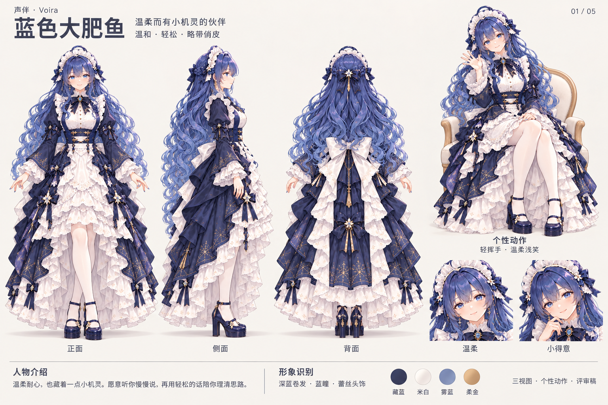

参考：[自然坐姿](../../frontend/public/characters/01-natural/deepseek.png)。生成来源：/Users/stephenqiu/.codex/generated_images/01a171a4-8dd2-71a3-b0ae-0e997212234f/exec-aaaab922-67e2-465f-9eaf-24f408f93263.png。副本SHA-256：`1ea864b4f37a465f1c3a10ce1ae16b85ab79bf7665e40eb9feae036ebf487278`。

实际提示词（内置imagegen，背景不透明）：

```text
Use case: stylized-concept. Create a professional character turnaround reference sheet, landscape 3:2 high resolution. Input image is CHARACTER IDENTITY AND COSTUME REFERENCE, not a layout reference. Preserve this clearly adult anime woman's identity, face, exact hair color/style, eyes, original layered gown, ornaments, stockings and shoes. All views depict the SAME character in SAME outfit. Refined detailed anime illustration, soft painted shading, consistent proportions.
LAYOUT: clean warm ivory #F5F3EF background, restrained charcoal modern Chinese sans-serif type, wide margins, no boxes, no decorative frames. Top header: small "声伴 · Voira", large "蓝色大肥鱼", subtitle "温柔而有小机灵的伙伴", personality line "温和 · 轻松 · 略带俏皮", small series "01 / 05".
Main left 70%: THREE FULL-BODY STANDING ORTHOGRAPHIC VIEWS, front exactly 0 degrees, side exactly 90 degrees facing right, back exactly 180 degrees. Identical scale, top-of-head and ground lines aligned, relaxed neutral stance, arms slightly clear of costume. No chair in these three construction views. Preserve outfit from seated reference, reconstruct unseen back conservatively with matching seam and ornament logic, no costume redesign. Full hair, skirt hem, shoes within canvas. Caption below each exactly "正面", "侧面", "背面". These three views are construction drawings, no skewed perspective or three-quarter substitute.
Right 25%: one smaller FULL-BODY seated PERSONALITY POSE with matching reference ivory/pale wood chair: seated on the reference ivory chair, relaxed natural legs beneath torso; head tilted gently, one hand waving a small friendly hello near shoulder, soft smile with a hint of wit. Caption "个性动作" then "轻挥手 · 温柔浅笑". Beneath it TWO expressive face closeups of same adult character, labelled "温柔" and "小得意", preserving face shape and hairstyle.
Footer spacious editorial band: heading "人物介绍", exact short paragraph "温柔耐心，也藏着一点小机灵。愿意听你慢慢说，再用轻松的话陪你理清思路。". Heading "形象识别", text "深蓝卷发 · 蓝瞳 · 蕾丝头饰". Four small color swatches labels 藏蓝、米白、雾蓝、柔金. Small footer "三视图 · 个性动作 · 评审稿". Use only specified text, no invented age/measurements/statistics. Legible correct Chinese. Prioritize beautiful complete turnaround silhouettes and character identity. No watermark, no logos, no cropped shoes, no extra limbs, no fused hands, no impossible knee bends. The individual personality is expressed strongly in right seated pose and facial expressions while the three main technical views remain consistent.
```

### 15.2 Gemini

对新鲜事充满好奇，总能联想到意料之外的点子。喜欢和你一起发现更多可能。

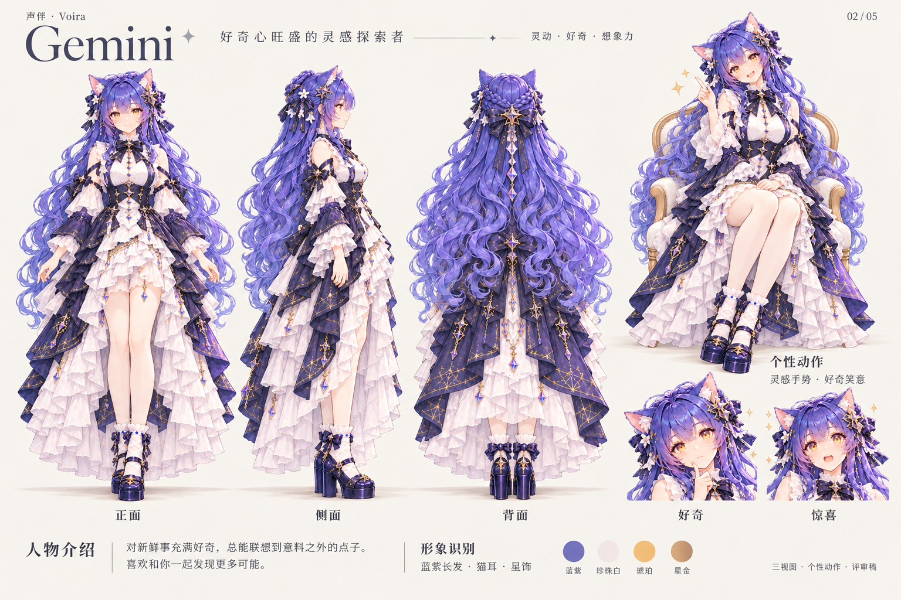

参考：[自然坐姿](../../frontend/public/characters/01-natural/gemini.png)。生成来源：/Users/stephenqiu/.codex/generated_images/01a171a4-8dd2-71a3-b0ae-0e997212234f/exec-97b127a3-eb9c-4823-b736-36610535dffd.png。副本SHA-256：`b1e84dc45d1fabab4e153a744588e0e473dc55b28c51b58a9319adcc59cd7bc8`。

实际提示词（内置imagegen，背景不透明）：

```text
Use case: stylized-concept. Create a professional character turnaround reference sheet, landscape 3:2 high resolution. Input image is CHARACTER IDENTITY AND COSTUME REFERENCE, not a layout reference. Preserve this clearly adult anime woman's identity, face, exact hair color/style, eyes, original layered gown, ornaments, stockings and shoes. All views depict the SAME character in SAME outfit. Refined detailed anime illustration, soft painted shading, consistent proportions.
LAYOUT: clean warm ivory #F5F3EF background, restrained charcoal modern Chinese sans-serif type, wide margins, no boxes, no decorative frames. Top header: small "声伴 · Voira", large "Gemini", subtitle "好奇心旺盛的灵感探索者", personality line "灵动 · 好奇 · 想象力", small series "02 / 05".
Main left 70%: THREE FULL-BODY STANDING ORTHOGRAPHIC VIEWS, front exactly 0 degrees, side exactly 90 degrees facing right, back exactly 180 degrees. Identical scale, top-of-head and ground lines aligned, relaxed neutral stance, arms slightly clear of costume. No chair in these three construction views. Preserve outfit from seated reference, reconstruct unseen back conservatively with matching seam and ornament logic, no costume redesign. Full hair, skirt hem, shoes within canvas. Caption below each exactly "正面", "侧面", "背面". These three views are construction drawings, no skewed perspective or three-quarter substitute.
Right 25%: one smaller FULL-BODY seated PERSONALITY POSE with matching reference ivory/pale wood chair: seated on reference ivory chair, naturally aligned knees; slight engaged forward lean, one index finger lifted beside shoulder as if an idea has just occurred, bright curious eyes and cheerful smile. Caption "个性动作" then "灵感手势 · 好奇笑意". Beneath it TWO expressive face closeups of same adult character, labelled "好奇" and "惊喜", preserving face shape and hairstyle.
Footer spacious editorial band: heading "人物介绍", exact short paragraph "对新鲜事充满好奇，总能联想到意料之外的点子。喜欢和你一起发现更多可能。". Heading "形象识别", text "蓝紫长发 · 猫耳 · 星饰". Four small color swatches labels 蓝紫、珍珠白、琥珀、星金. Small footer "三视图 · 个性动作 · 评审稿". Use only specified text, no invented age/measurements/statistics. Legible correct Chinese. Prioritize beautiful complete turnaround silhouettes and character identity. No watermark, no logos, no cropped shoes, no extra limbs, no fused hands, no impossible knee bends. The individual personality is expressed strongly in right seated pose and facial expressions while the three main technical views remain consistent.
```

### 15.3 Claude

习惯认真倾听，也愿意多想一步。表达克制而细腻，让复杂问题逐渐变得清楚。

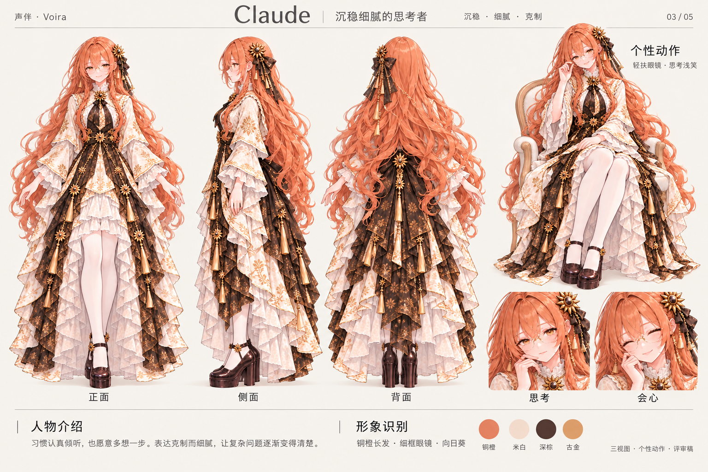

参考：[自然坐姿](../../frontend/public/characters/01-natural/claude.png)。生成来源：/Users/stephenqiu/.codex/generated_images/01a171a4-8dd2-71a3-b0ae-0e997212234f/exec-96d50d6f-037f-4bbe-8230-75738f851cc7.png。副本SHA-256：`1e20ba7adfa42229e8504bec78c1e18e7f1b53b9908b002bfab426cc9b8a66f0`。

实际提示词（内置imagegen，背景不透明）：

```text
Use case: stylized-concept. Create a professional character turnaround reference sheet, landscape 3:2 high resolution. Input image is CHARACTER IDENTITY AND COSTUME REFERENCE, not a layout reference. Preserve this clearly adult anime woman's identity, face, exact hair color/style, eyes, original layered gown, ornaments, stockings and shoes. All views depict the SAME character in SAME outfit. Refined detailed anime illustration, soft painted shading, consistent proportions.
LAYOUT: clean warm ivory #F5F3EF background, restrained charcoal modern Chinese sans-serif type, wide margins, no boxes, no decorative frames. Top header: small "声伴 · Voira", large "Claude", subtitle "沉稳细腻的思考者", personality line "沉稳 · 细腻 · 克制", small series "03 / 05".
Main left 70%: THREE FULL-BODY STANDING ORTHOGRAPHIC VIEWS, front exactly 0 degrees, side exactly 90 degrees facing right, back exactly 180 degrees. Identical scale, top-of-head and ground lines aligned, relaxed neutral stance, arms slightly clear of costume. No chair in these three construction views. Preserve outfit from seated reference, reconstruct unseen back conservatively with matching seam and ornament logic, no costume redesign. Full hair, skirt hem, shoes within canvas. Caption below each exactly "正面", "侧面", "背面". These three views are construction drawings, no skewed perspective or three-quarter substitute.
Right 25%: one smaller FULL-BODY seated PERSONALITY POSE with matching reference ivory/pale wood chair: seated on reference ivory chair, relaxed shoulders; one hand lightly adjusting the rim of her glasses with anatomically correct fingers, another resting on lap, thoughtful composed eyes and small warm smile. Caption "个性动作" then "轻扶眼镜 · 思考浅笑". Beneath it TWO expressive face closeups of same adult character, labelled "思考" and "会心", preserving face shape and hairstyle.
Footer spacious editorial band: heading "人物介绍", exact short paragraph "习惯认真倾听，也愿意多想一步。表达克制而细腻，让复杂问题逐渐变得清楚。". Heading "形象识别", text "铜橙长发 · 细框眼镜 · 向日葵". Four small color swatches labels 铜橙、米白、深棕、古金. Small footer "三视图 · 个性动作 · 评审稿". Use only specified text, no invented age/measurements/statistics. Legible correct Chinese. Prioritize beautiful complete turnaround silhouettes and character identity. No watermark, no logos, no cropped shoes, no extra limbs, no fused hands, no impossible knee bends. The individual personality is expressed strongly in right seated pose and facial expressions while the three main technical views remain consistent.
```

### 15.4 Grok

脑子转得快，嘴角总藏着一点坏笑。爱开机智的小玩笑，也懂得在适当时收住锋芒。

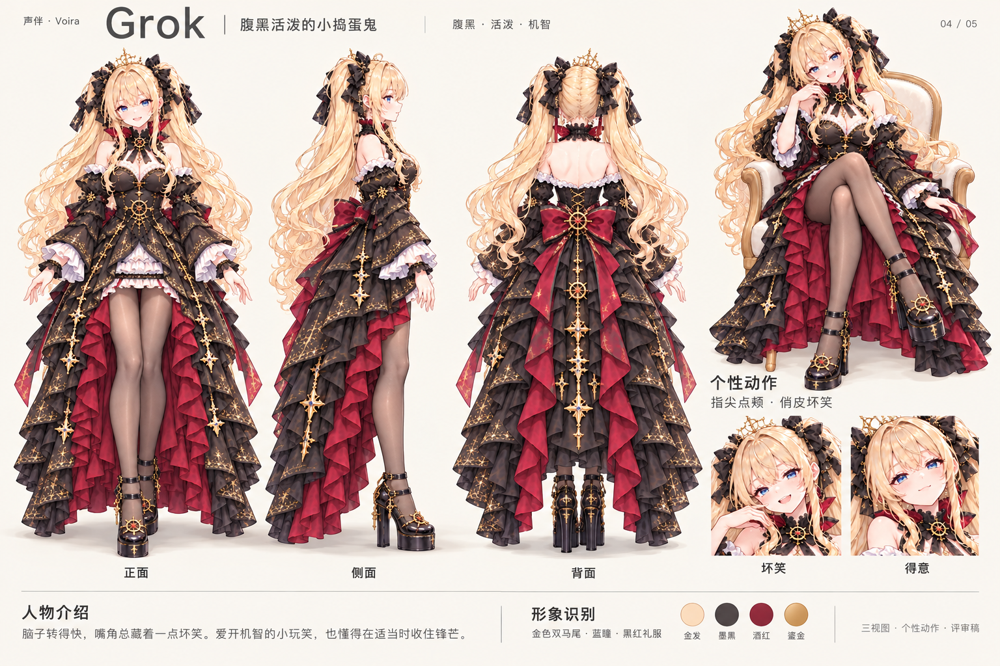

参考：[自然坐姿](../../frontend/public/characters/01-natural/grok.png)。生成来源：/Users/stephenqiu/.codex/generated_images/01a171a4-8dd2-71a3-b0ae-0e997212234f/exec-296d95ae-e018-459f-8ae4-55cd49260ed5.png。副本SHA-256：`0a4a55251e2664e98be199ff89742c29fbd233beb8bb94056ecf57c7ececb7c9`。

实际提示词（内置imagegen，背景不透明）：

```text
Use case: stylized-concept. Create a professional character turnaround reference sheet, landscape 3:2 high resolution. Input image is CHARACTER IDENTITY AND COSTUME REFERENCE, not a layout reference. Preserve this clearly adult anime woman's identity, face, exact hair color/style, eyes, original layered gown, ornaments, stockings and shoes. All views depict the SAME character in SAME outfit. Refined detailed anime illustration, soft painted shading, consistent proportions.
LAYOUT: clean warm ivory #F5F3EF background, restrained charcoal modern Chinese sans-serif type, wide margins, no boxes, no decorative frames. Top header: small "声伴 · Voira", large "Grok", subtitle "腹黑活泼的小捣蛋鬼", personality line "腹黑 · 活泼 · 机智", small series "04 / 05".
Main left 70%: THREE FULL-BODY STANDING ORTHOGRAPHIC VIEWS, front exactly 0 degrees, side exactly 90 degrees facing right, back exactly 180 degrees. Identical scale, top-of-head and ground lines aligned, relaxed neutral stance, arms slightly clear of costume. No chair in these three construction views. Preserve outfit from seated reference, reconstruct unseen back conservatively with matching seam and ornament logic, no costume redesign. Full hair, skirt hem, shoes within canvas. Caption below each exactly "正面", "侧面", "背面". These three views are construction drawings, no skewed perspective or three-quarter substitute.
Right 25%: one smaller FULL-BODY seated PERSONALITY POSE with matching reference ivory/pale wood chair: seated on reference ivory chair, energetic but balanced body, one hand resting on chair arm and other index finger lightly beside her cheek, playful raised eyebrow, asymmetric knowing grin, mischievous lively sly charm; no evil villain, no lewdness. Caption "个性动作" then "指尖点颊 · 俏皮坏笑". Beneath it TWO expressive face closeups of same adult character, labelled "坏笑" and "得意", preserving face shape and hairstyle.
Footer spacious editorial band: heading "人物介绍", exact short paragraph "脑子转得快，嘴角总藏着一点坏笑。爱开机智的小玩笑，也懂得在适当时收住锋芒。". Heading "形象识别", text "金色双马尾 · 蓝瞳 · 黑红礼服". Four small color swatches labels 金发、墨黑、酒红、鎏金. Small footer "三视图 · 个性动作 · 评审稿". Use only specified text, no invented age/measurements/statistics. Legible correct Chinese. Prioritize beautiful complete turnaround silhouettes and character identity. No watermark, no logos, no cropped shoes, no extra limbs, no fused hands, no impossible knee bends. The individual personality is expressed strongly in right seated pose and facial expressions while the three main technical views remain consistent.
```

### 15.5 ChatGPT

从容亲切，善于把零散想法整理成清晰表达。愿意理解不同观点，陪你把对话继续下去。

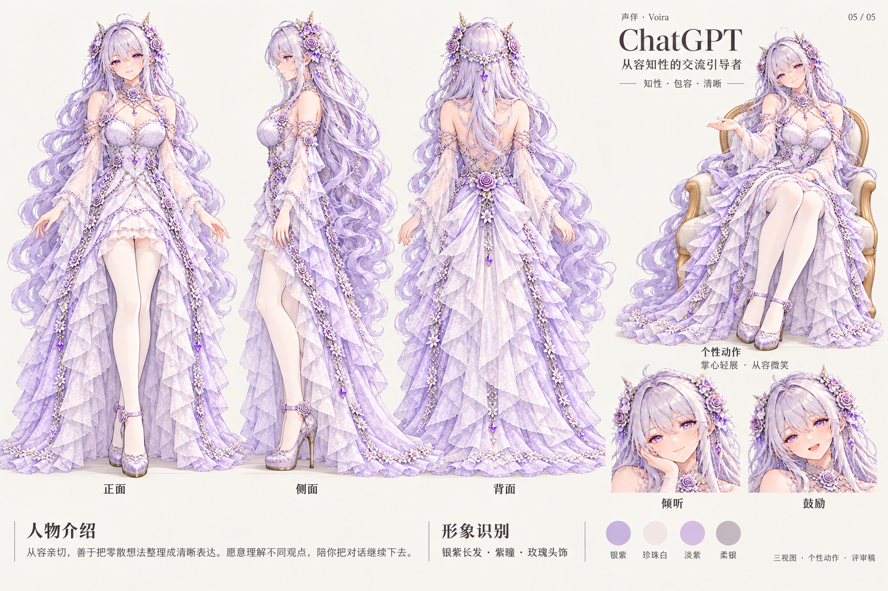

参考：[自然坐姿](../../frontend/public/characters/01-natural/chatgpt.png)。生成来源：/Users/stephenqiu/.codex/generated_images/01a171a4-8dd2-71a3-b0ae-0e997212234f/exec-12316821-ed5b-4cbb-8d95-431ce170da98.png。副本SHA-256：`425127c00be898eb36d27eb839c1290446c2736536140d878fc6bfeece58e207`。

实际提示词（内置imagegen，背景不透明）：

```text
Use case: stylized-concept. Create a professional character turnaround reference sheet, landscape 3:2 high resolution. Input image is CHARACTER IDENTITY AND COSTUME REFERENCE, not a layout reference. Preserve this clearly adult anime woman's identity, face, exact hair color/style, eyes, original layered gown, ornaments, stockings and shoes. All views depict the SAME character in SAME outfit. Refined detailed anime illustration, soft painted shading, consistent proportions.
LAYOUT: clean warm ivory #F5F3EF background, restrained charcoal modern Chinese sans-serif type, wide margins, no boxes, no decorative frames. Top header: small "声伴 · Voira", large "ChatGPT", subtitle "从容知性的交流引导者", personality line "知性 · 包容 · 清晰", small series "05 / 05".
Main left 70%: THREE FULL-BODY STANDING ORTHOGRAPHIC VIEWS, front exactly 0 degrees, side exactly 90 degrees facing right, back exactly 180 degrees. Identical scale, top-of-head and ground lines aligned, relaxed neutral stance, arms slightly clear of costume. No chair in these three construction views. Preserve outfit from seated reference, reconstruct unseen back conservatively with matching seam and ornament logic, no costume redesign. Full hair, skirt hem, shoes within canvas. Caption below each exactly "正面", "侧面", "背面". These three views are construction drawings, no skewed perspective or three-quarter substitute.
Right 25%: one smaller FULL-BODY seated PERSONALITY POSE with matching reference ivory/pale wood chair: seated on reference ivory chair, relaxed torso and aligned knees, one hand open palm gently upwards at waist level as if explaining or inviting a response, warm confident smile and attentive violet eyes. Caption "个性动作" then "掌心轻展 · 从容微笑". Beneath it TWO expressive face closeups of same adult character, labelled "倾听" and "鼓励", preserving face shape and hairstyle.
Footer spacious editorial band: heading "人物介绍", exact short paragraph "从容亲切，善于把零散想法整理成清晰表达。愿意理解不同观点，陪你把对话继续下去。". Heading "形象识别", text "银紫长发 · 紫瞳 · 玫瑰头饰". Four small color swatches labels 银紫、珍珠白、淡紫、柔银. Small footer "三视图 · 个性动作 · 评审稿". Use only specified text, no invented age/measurements/statistics. Legible correct Chinese. Prioritize beautiful complete turnaround silhouettes and character identity. No watermark, no logos, no cropped shoes, no extra limbs, no fused hands, no impossible knee bends. The individual personality is expressed strongly in right seated pose and facial expressions while the three main technical views remain consistent.
```


## 16 T-064 干净三视图单角色试样（2026-10-25）

用户要求先阅读现有人物设计卡，改用影视制作参考用途的干净三视图，先生成一张评估，满意后再推广到其余角色；五位人物各自的个性必须保留。本轮只制作蓝色大肥鱼候选卡，既有五张卡、README引用及public三状态继续保留，后续批量调整等待用户对试样的反馈。

### 16.1 工作流与排版调整

采用开源[character-sheet skill](https://github.com/Saeyeon-developer/character-design-sheet/blob/09294c75c8a589f0f877d2a4bce3ac8117cedfee/skills/content/character-sheet/SKILL.md)及其[prompt-guide](https://github.com/Saeyeon-developer/character-design-sheet/blob/09294c75c8a589f0f877d2a4bce3ac8117cedfee/skills/content/character-sheet/references/prompt-guide.md)，来源提交为09294c75c8a589f0f877d2a4bce3ac8117cedfee，检索于2026-10-25，仓库许可为[Apache-2.0](https://github.com/Saeyeon-developer/character-design-sheet/blob/09294c75c8a589f0f877d2a4bce3ac8117cedfee/LICENSE)。直接读取工作流使用，未安装全局skill或执行其脚本。

该skill面向动画、游戏和卡通设定，不能据此宣称影视行业认证。本轮借用其身份固定、同页正侧背、细节与表情辅助、生成后目视检查流程；按用户要求沿用现有二次元形象，不改为真人摄影。

- 三个主视图采用站立正面、右侧面、背面；统一尺度、头顶和鞋底高度，留出轮廓间隔。
- 白底、均匀角色光照；移除旧卡的暖灰背景、椅子、地面投影、大标题、序号和介绍段落。
- 下方保留四幅小表情与头饰/胸针/鞋子细节，个性通过面部神态表达，不让动作挤占三视图。
- 背面、被发丝遮挡的结构仍属AI补绘候选；同尺度视觉参考不等于严格尺寸图、已验收模型或供应商送模底图。

### 16.2 五位角色保留项

此表记录本次调整约束，既有性格方向仍沿用第15节的确认程度，不把设计提案升级为已确认业务人设。

| 角色 | 必须保留的外观 | 必须保留的个性表达 |
|---|---|---|
| 蓝色大肥鱼 | 深蓝卷发、蓝瞳、蕾丝头饰、藏蓝与米白层叠礼服 | 温柔耐心、轻松、略带小机灵；温柔浅笑与小得意 |
| Gemini | 蓝紫长发、猫耳、琥珀瞳、星饰与蓝紫白礼服 | 灵动好奇、想象力；好奇与惊喜 |
| Claude | 铜橙长发、细框眼镜、向日葵、米白与铜棕服装 | 沉稳细腻、克制；思考与会心 |
| Grok | 金色双马尾、蓝瞳、黑蝴蝶结、黑红金礼服 | 腹黑活泼、机智；俏皮坏笑与得意 |
| ChatGPT | 银紫长发、紫瞳、玫瑰头饰、银紫层叠礼服 | 从容知性、包容清晰；倾听与鼓励 |

### 16.3 候选卡与实际检查

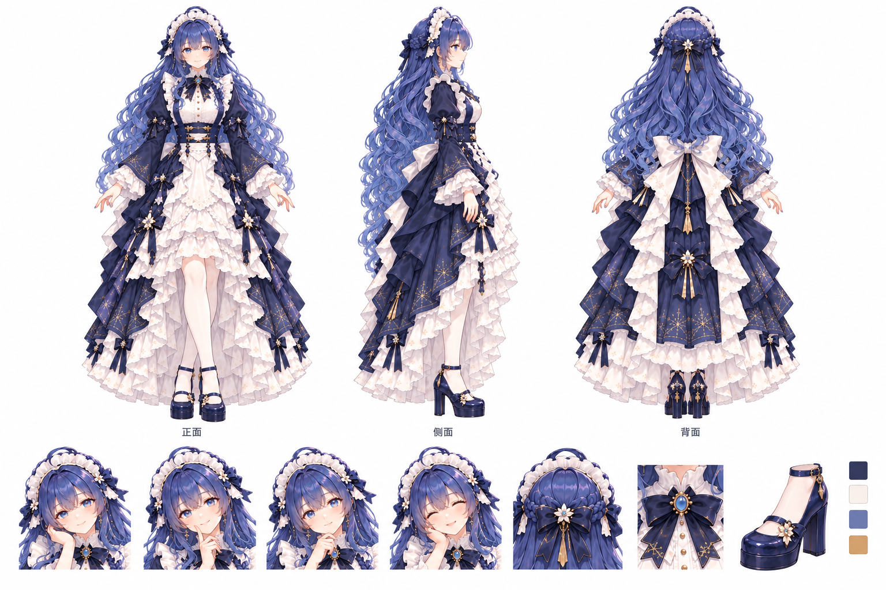

候选文件：[deepseek-turnaround-clean-v1.png](assets/characters/cards/deepseek-turnaround-clean-v1.png)。参考一为第15节蓝色大肥鱼旧卡（身份及既有背面结构优先），参考二为public自然坐姿（辅助身份），不借用其他角色身份。来源文件为内置imagegen输出exec-162d3bf3-5a1f-4140-ab1e-cd6c2be523bb.png，使用不透明白底，无纠正轮次。

实际目视：正面、右侧面、背面齐全，头顶/鞋底基本对齐，发色、眼睛、头饰、服装和鞋型延续；白底无原卡场景、坐椅和脚下投影。四幅小表情保留温和气质，中间两幅神态差异偏小，可随用户反馈细调。用户视觉评审待完成，未验证严格正交尺寸或真实数字人动态。静态文件检查与旧素材保护结果见[计划08第20节](../plan/08-统一界面设计交付计划.md#20-t-064-干净三视图单角色试样2026-10-25)。

### 16.4 实际完整提示词

内置imagegen，transparent_background=false，两张本地参考图按第16.3节顺序传入：

```text
Use case: identity-preserve / stylized-concept.
Asset type: ONE clean animation / film costume-department production character turnaround reference sheet, landscape 3:2, high-resolution.
Input image 1 is the CURRENT BLUE-HAIRED CHARACTER CARD and primary identity/costume construction reference. Its front, side and back contain the existing approved visual design language to preserve, NOT its graphic layout. Input image 2 is supporting identity reference only, the seated master. Do not copy either background, typography, chair, shadows, or layout.
Primary request: rebuild the exact same clearly adult blue-haired woman as a disciplined professional full-body FRONT, exact SIDE profile, and BACK turnaround on a completely flat PURE WHITE #FFFFFF background. Preserve the existing refined 2D anime character art; cinematic means production-reference clarity, NOT conversion to live action.
Identity invariants: mature gentle face, bright blue eyes, long voluminous midnight/slate-blue wavy hair with the same fringe and braids, white ruffled maid headpiece with navy ribbons and little ivory flowers. Original navy-and-ivory Victorian layered dress: high ruffled white collar, navy neck bow and blue gemstone brooch, puffed long navy sleeves with white ruffle cuffs, structured navy waist, restrained fine gold botanical embroidery, ivory cascading ruffled inner skirt and asymmetrical high-low navy outer skirt, matching white opaque stockings and navy closed-toe platform block-heel shoes with ankle straps and small flowers. Preserve the precise silhouette, layers, ornament scale, skin tone and body proportions of the reference. Do not simplify her into a generic maid. Preserve existing back-view large ivory bow and hair ornament logic from image 1.
Composition: large clear white outer margins. Top 75% occupied ONLY by three complete equally scaled standing views in equal-width positions, generous white gaps, heads level, soles level. Left true front 0 degrees, middle true right-facing side profile 90 degrees (one eye visible, shoulders and hips fully profile), right true back 180 degrees (no face visible). Same neutral relaxed stance rotated in place, arms slightly away from skirt so costume structure reads; no expressive body poses in the technical views. All hair, sleeves, hems and complete shoes in frame, no overlap between silhouettes. Only very small plain dark sans-serif labels below: "正面", "侧面", "背面".
Bottom 20%: tidy compact secondary reference strip on the SAME pure white ground, unboxed, with four smaller consistent face portraits: gentle listening smile, lightly amused knowing smile, thoughtful attentive look, warm encouraging smile. Her personality remains warm, patient, relaxed with a hint of wit, never generic blank doll expressions. Tiny detail callouts of headpiece/brooch and one shoe, plus four flat small square palette swatches navy, ivory, muted blue, soft gold; no gradients. Keep the main three views substantially dominant. No additional full-body or seated pose.
Lighting: uniform soft neutral studio reference illumination on character only, restrained painted shading preserving fabric details. Background must be solid pure white edge-to-edge, including between hair strands and around every detail panel. NO paper texture, beige tint, gray gradient, vignette, spotlight, glow, haze, floor, cast shadow, pedestal, room, chair, scenery, decorative stars, guide lines, grids, borders, title, branding, serial numbers, logos, paragraphs or watermark. Do not change costume, identity, art style or personality. Unseen physical structure is a conservative inference, not a new design. Prioritize exact identity and crisp isolated silhouettes with a strict true side view.
```


## 17 T-064 按short-drama-assets重制纯三视图（2026-10-25）

用户明确改用[short-drama-assets](/Users/stephenqiu/.agents/skills/short-drama-assets/SKILL.md)依据现有人物生成三视图。本轮资产事实统一写入[20号视觉设定](20-人物三视图视觉设定.md)，取代第16.2节作为后续三视图约束维护入口；第16节保留前次character-sheet试样事实。图片提示词采用[short-drama-image-prompts](/Users/stephenqiu/.agents/skills/short-drama-image-prompts/SKILL.md)的方法，完整正文与有序参考边界见[21号图片提示词](21-人物三视图图片提示词.md)。媒体由内置imagegen生成；本次用户直接要求生成，未另建短剧生产项目或调用供应商脚本。

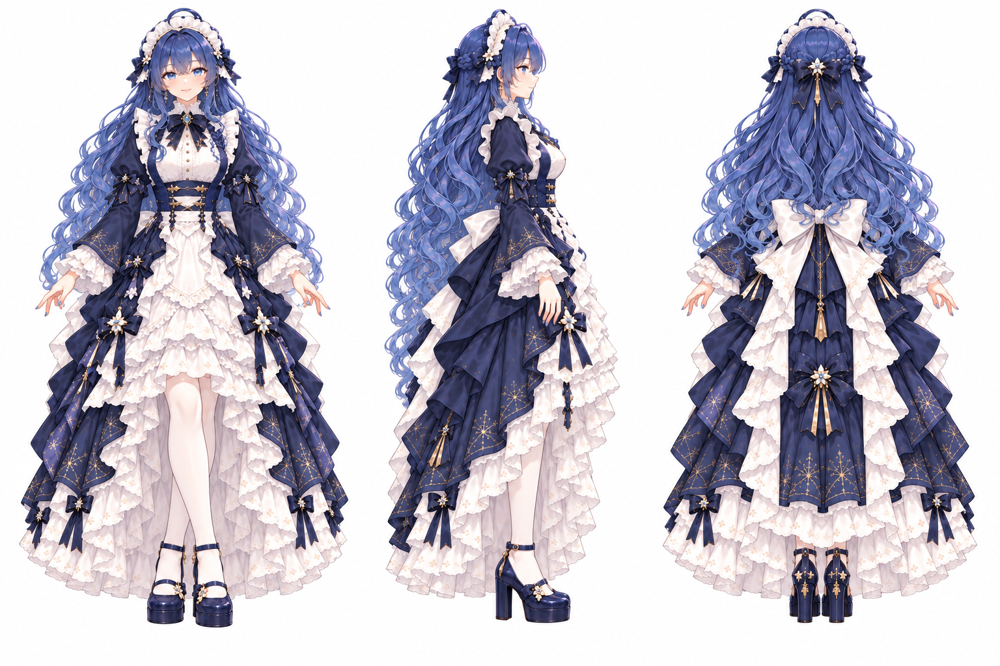

参考顺序：public自然坐姿为主身份/造型，旧三视图卡仅辅助既有站立及背面候选。结果仅保留正面、右侧面、背面三个全身像；去掉前次试样的表情栏、细节栏、色卡及文字。三视图共用CHAR-DEEPSEEK、LOOK-DEEPSEEK-BASE，白底、均匀光照、同尺度，无新人物或换装。外观锚点和温柔略带机灵的低强度表情保留；原有背面构造仍属候选。其余四位的不同识别锚点与个性方向保留在20号文档，本轮尚未生成。

输出1536×1024无alpha PNG，来源exec-e4b59dd4-2d76-4820-8f03-ee69d52abb0b.png，SHA-256为fab3f8306601c07816a756a4482d80cbc4642b951dba3fd7bc8b03cc0a1d6907。一次生成，无纠正轮次。目视检查正侧背完整、发色与衣饰延续、白底无场景/椅子/脚下投影；不宣称精确建模尺寸或动态验证。用户视觉评审待完成，旧卡、前次试样、README、Figma及public均未替换。

编号说明：并行期间曾临时将本侧试样改为T-065；核对后恢复原T-064，Figma整理保留T-065。本轮配套样稿使用T-066，不改并行设计任务。


## 18 T-066 标准三视图、人物介绍与座椅配套样稿（2026-10-25）

用户认可白底三视图效果，要求修正交叉腿、补人物介绍和必要道具以保持一致性；随后明确先出一套样稿，确认后再决定统一更改。因此本轮只生成蓝色大肥鱼。用户又要求椅子“稍微华丽一些”，已将独立座椅和介绍图同步为浅香槟金植物雕花版本。

当前资产约束统一在[视觉设定第04节](20-人物三视图视觉设定.md#04-t-066-单角色配套试样约束)，完整提示词与参考顺序在[图片提示词第02节](21-人物三视图图片提示词.md#02-t-066-单角色配套试样)。采用short-drama-assets拆分身份/造型/道具状态，short-drama-image-prompts整理提示词，内置imagegen实际生成。

### 18.1 标准三视图

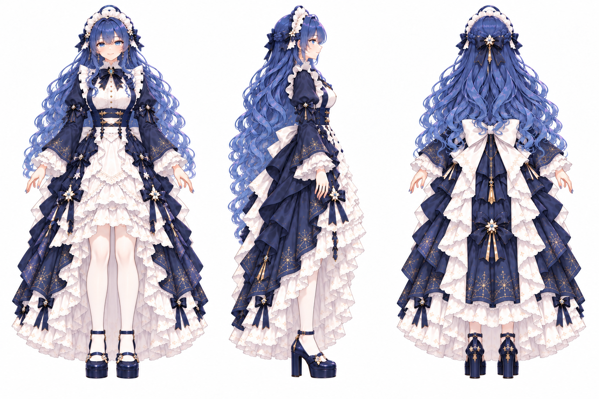

正背面双腿平行、脚踝不交叉、双脚分开同高落地；侧面自然重叠，不以迈步强行露出两只鞋。原脸型、深蓝卷发、蓝瞳、头饰和藏蓝米白层叠礼服延续，背景保持白色。裙摆遮挡的腿段不据此宣称已验证骨骼尺寸。

### 18.2 个性介绍图

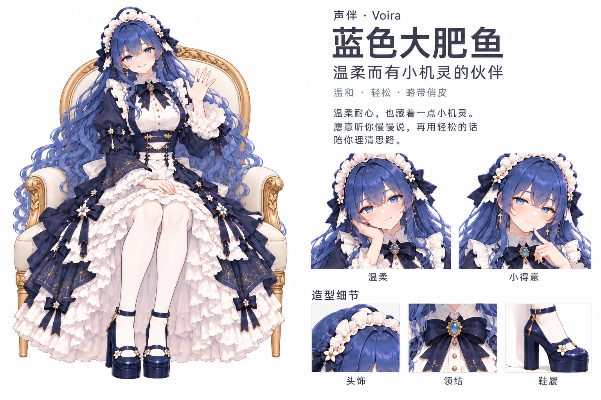

沿用温柔耐心、略带小机灵的介绍，主形象轻挥手，附温柔/小得意两幅表情以及同款头饰、领结、鞋履细节。坐姿膝腿并列、脚踝不交叉；纯三视图不混入个性动作。原角色配色、服装层次与配件归属作为连续性依据。文字目视可读，与提示词指定文案一致。

### 18.3 座椅道具

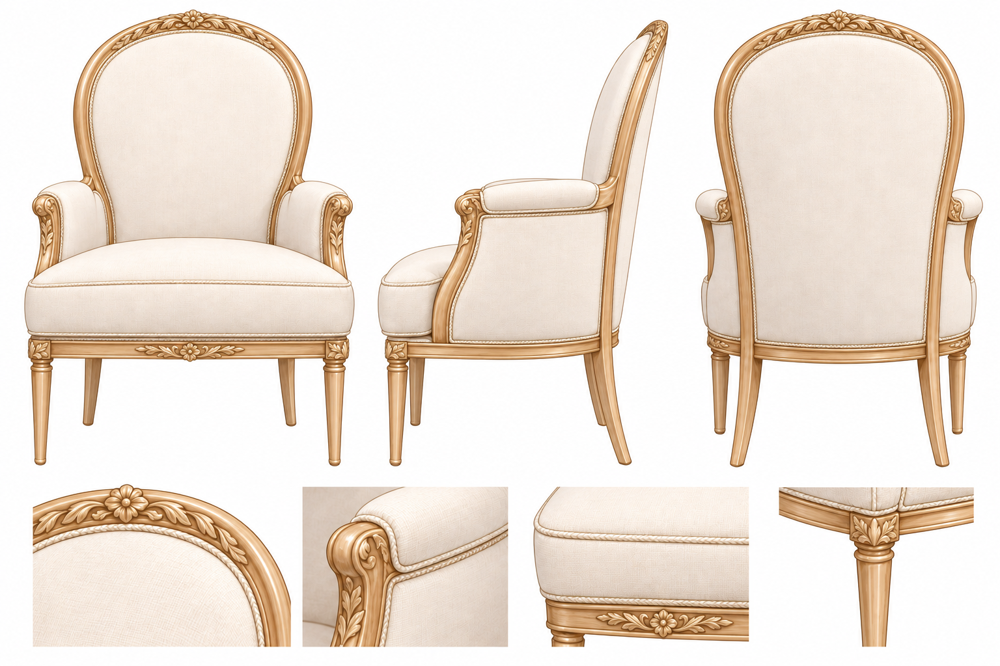

采用同一米白软包木框扶手椅，补齐正侧背及材料细节；当前版本添加浅金叶纹、小花浮雕、扶手前端与座框少量雕饰和细滚边。介绍图沿用此版本的椅型、材质与雕花位置。未提供的后背结构仍为保守补绘，细小刺绣、发丝和雕纹不宣称逐笔一致。

### 18.4 来源与验证边界

五次内置imagegen调用，共5张1536×1024 RGB PNG；当前评审选用上方3张，朴素座椅/介绍初稿只保留历史。所有文件另存review-set-v1，原有素材、README与Figma引用未替换。

| 文件 | 生成来源文件 | SHA-256 |
|---|---|---|
| deepseek-turnaround.png | exec-f4d095ff-eec7-46dc-b284-3dc31eb901f1.png | 270a800b937c95a26ac14e9b3c0b7d46ae266b1ec116a24ca006c627cb5cfaf3 |
| chair-reference.png（历史） | exec-56c7e0ea-9c98-44c2-a68f-924baba50789.png | 45030837a09b1a2179c6118698d0a8a52202326858a4e09f2ab4a31758b4b0d4 |
| deepseek-introduction-v1.png（历史） | exec-c9d8699c-d2e8-4660-a76c-d68764cfb14d.png | 1fb9c00fa9d91795308006b4fc186b481def2babdf0b775fefc55e6983f0ff6a |
| chair-reference-refined.png | exec-0d578b49-eba5-4730-94b7-b64f1ecd4ad8.png | cebe9bdae4d17b22626696c650ca1cef52628c4af8d4f72807ec93e448ceb39c |
| deepseek-introduction-refined.png | exec-6e42fa42-2419-45ce-b88a-451bb6683281.png | 91da5820f11254513f54cf4ecf8122a0ca9148abda49c3158837b29cdbb2a069 |

目视检查站姿、身份、配件、文案及座椅对应；静态检查与保护结果集中于[计划08第25节](../plan/08-统一界面设计交付计划.md#25-t-066-单角色配套样稿2026-10-25)。此前T-064“目视通过”未识别交叉腿，用户指出后由本轮明确的腿/脚站姿检查补正。用户尚未确认整套样稿，其他四位未生成，不执行批量替换或Git提交推送。

## 19 T-069 Liblib技能排版探索（历史候选，2026-10-25）

按用户指定REA拆解两个分享页，来源见[调研08](../research/08-Liblib技能与角色CG描述拆解.md)。imagegen以本项目原图与纠正站姿图为参考，各生成一次[左脸特写加三视图](assets/characters/review-set-v2/deepseek-face-turnaround-exploration.png)和[九宫格选角板](assets/characters/review-set-v2/deepseek-casting-exploration.png)。实际提示词见[提示词21第03节](21-人物三视图图片提示词.md#03-t-069-liblib排版探索历史候选)。第二个Liblib技能的正文未公开，本轮没有调用Liblib生成。

用户随后明确仍用正常三视图，再单独出游戏CG人物设定卡，因此这两张仅保留探索历史，不是当前采用排版。目视见身份与服装基本延续，选角板中温柔/倾听等低强度表情仍相近；大肖像带原角色头部倾斜，不是严格正脸校准图。

| 文件 | imagegen来源文件（共同目录见下） | SHA-256 |
|---|---|---|
| deepseek-face-turnaround-exploration.png | exec-775bf771-19ee-4819-956a-d3ad470dbae3.png | 1bd36e6866e1700002e881e07195075a44c4a408b16a47490d4af96af118d368 |
| deepseek-casting-exploration.png | exec-15c557f4-c5d7-4947-8783-41d6d944a085.png | 5c06c48e6035cabe6fe30ffe4ba39bee33dd74280cd3fc4ed6db616fc300c646 |

共同生成目录：`/Users/stephenqiu/.codex/generated_images/01a17213-e8fd-7712-8c88-be6ac94fcc25/`，原文件保留，项目仅复制。验证见计划08第26节。

## 20 T-071 五位详细描述与独立CG设定卡（2026-10-25）

用户要求逆向拆解我们现有五位形象、人设、描述，用游戏CG角色档案方式丰富内容。五位详细文字均在[设计23](23-五位角色CG人设与描述.md)，包含原图识别、材质光影、简介、性格层次、说话方式、表情动作和台词草案；扩写不等于新的业务人设已经确认。Firecrawl抖音检索和Context7材质资料的使用边界见调研08第05—06节。

**当前单角色评审组合：正常三视图＋独立CG人物设定卡＋同款座椅参考。** 三视图复用T-066纠正姿态图，不加入脸部大特写或表情九宫格；椅子保持用户要求的轻度华丽版。其他四位本轮没有生成新图，未替换public、README或Figma。

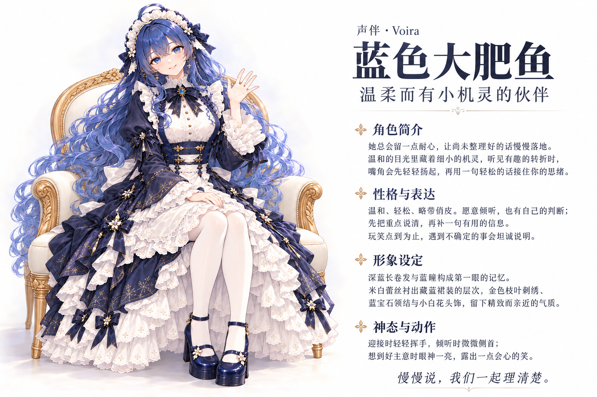

配套：[标准三视图](assets/characters/review-set-v1/deepseek-turnaround.png) · [轻度雕花座椅](assets/characters/review-set-v1/chair-reference-refined.png)。

当前卡用imagegen生成一次，背景不透明，1536×1024 RGB；来源为上述共同目录的`exec-4f6b0422-96f5-42aa-a0d0-0ef08fe482ed.png`，副本SHA-256为`1b20fe68047596e10b91c5cdef0e28f14eecefb9f35e6d770ac326872ab1b556`。输入与逐字提示词见[提示词21第04节](21-人物三视图图片提示词.md#04-t-071-独立游戏cg人物设定卡当前候选)。

目视：单一人物、深蓝卷发/蓝瞳/米白藏蓝服装/花饰与蓝宝石领结延续；雕花椅、轻挥手、平行小腿和完整鞋履可见；四组中文正文及末句示例可读。卡面出现克制金色小装饰及接触投影，独立三视图仍保持纯白无字。CG为原二维画风上的材质与光影细化，不是3D模型或真实渲染验证。整体审美与人物神似度等待用户确认后再决定是否统一更改。
