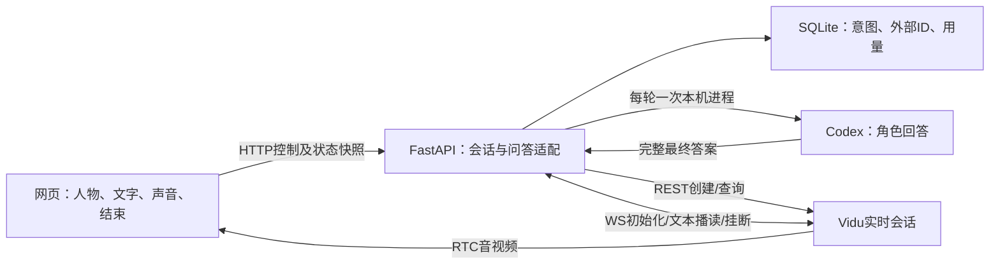

# 03 Vidu网页PoC最小业务设计

上游：[需求索引v0.10](../requirement/01-数字人MVP需求草案.md)；下游：[产品验收](../prd/01-网页数字人PoC产品与验收标准.md)、[计划07](../plan/07-网页数字人PoC验证计划.md)。T-019/T-020/T-022/T-023/T-024仅交付文档；以下接口、数据表和运行参数均为拟实现契约，没有创建代码、数据库或收费会话。

功能规则各自维护：[FR-020 角色音色](../requirement/21-角色音色.md)、[FR-021 角色人设](../requirement/22-角色人设.md)、[FR-022 回答长度与表达](../requirement/23-回答长度与表达.md)、[FR-023 听完后人工继续](../requirement/24-听完后人工继续.md)、[FR-024 最近三轮上下文](../requirement/25-最近三轮上下文.md)、[FR-025 测试用量与预算控制](../requirement/26-测试用量与预算控制.md)、[FR-026 持续异常反馈](../requirement/27-持续异常反馈.md)。其他功能见上游索引；本文保留跨功能协议与状态编排，不把独立需求重新合并。独立功能落地见[功能设计索引](00-功能设计索引.md)：DES-018—033逐项承接16个当前FR；DES-012—017继续维护共享协议。T-024基于源码复核补齐创建令牌重试、结束意图、人工确认并发与预算持久化细节，不扩大业务范围。

## 01 设计范围与决策

已确认：Vidu、蓝色大肥鱼、人物与背景合成画面、提问后回答、网页先行、本地优先及本机Codex生成回答；接入协议从简。工程沿用[PROJECT](../../PROJECT.md)，视觉沿用[DESIGN](../../DESIGN.md)及[现有界面设计](01-网页体验界面设计.md)。并行DES-011为静态角色轮播设计；本业务设计从DES-012开始，五位静态候选不等于五位实时接入。

| 设计 | 需求 | 最小方案及理由 |
|---|---|---|
| DES-012 角色输入 | FR-001/020/021；NFR-002/004/007 | 一个固定配置，蓝色大肥鱼自然坐姿候选；母版与场景合成后另存送模版本，系统音色/人设单列；不建素材CMS |
| DES-013 会话与媒体 | FR-002/011；NFR-001/004/006 | FastAPI持有Vidu REST/WS，网页ARTC只订阅远端音视频；一个本机体验者和一个活动会话 |
| DES-014 文字问答 | FR-004/005/019/021/022/023/024；NFR-001/002/004/007 | 本机Codex生成最终答案，Vidu text_tts播读；单输入占用/ID去重，未知不重发；按已确认Q-012人工听完后继续，按Q-013仅携带最近3轮已确认问答 |
| DES-015 页面与故障 | FR-006/011/026；NFR-003/006 | 同页媒体/输入/启声/结束/持续错误；HTTP快照轮询；不需要独立SSE状态链路 |
| DES-016 终止与用量 | FR-002/007/025；NFR-003/005 | 终止须查询供应商；未知阻止新会话；浏览器租约、会话上限和试验累计限额统一控制 |
| DES-017 恢复与记录 | FR-008/024/025；NFR-004/005/007 | 本机SQLite保留外部ID和请求意图，支持后端重启核对；配置/图片为文件，不引入Redis或任务平台 |

环境建议为本机Chrome、单FastAPI进程/worker、Next.js同源访问后端；Q-010本机方向已确认，公网共享不在此契约适用范围。媒体SDK/provider/模型版本在真实接入前锁定，不使用漂移版本当验收基线。

## 02 用户流程与状态

### 02.1 角色、媒体与页面

配置固定为`character_id=deepseek`、显示名“蓝色大肥鱼”；不意味着使用DeepSeek模型。原始母版为deepseek.png；并行T-026已整理[自然坐姿（状态一）](../../frontend/public/characters/01-natural/deepseek.png)，T-017已交付[浅色舞台](../../frontend/public/scenes/voira-studio.png)。按最新静态方向优先评审这些候选，具体组合/裁切尚未冻结；素材交付不自动视为送模批准。本轮未制作合成图。

角色配置必填：`config_version`、母版/送模文件与SHA-256、使用范围记录、云资产ID及就绪状态、模型/provider/运行地区、voice ID、人设版本。送模图无UI和其他人物，脸嘴清楚；构图以实际媒体区评审，不臆定供应商像素门槛。回答生成另记录Codex版本、模型、受限配置与人设版本；音色方向、人设及回答长度已确认；具体voice ID和送模图仍待Q-004评审。

2026-10-25确认的体验配置：自然清楚的成年普通话女声，轻松有活力、不刻意幼态；人设采用独立FR-021的温和、略俏皮AI伙伴；默认2—3短句、约40—100字（最多150码点），简单问题可更短。具体voice ID仍为空待选，不能将音色方向确认写成素材配置已就绪；小何2.0/Vivi2.0保留试听候选。

未开始展示标注清楚的静态预览；收到真实首帧后，用一个不透明视频平面替换预览与其背景，避免重复叠人。默认保持原比例完整显示，空余区域用现有主题填充；仅在确认嘴脸安全区域后允许裁切。控制和文字区避开嘴脸；不将其他静态角色卡片做成可创建收费会话的按钮。

主流程：查看预览 → 开始 → 连接 → 手动启声（若受限）→ 提问 → 等待并听到人物回答 → 人工确认听完后继续 → 结束 → 核对结果。输入占用期间可编辑下一问草稿，但不能下发。问答正文仅在当前网页和后端内存保留；按已确认Q-013，后端仅以最近3轮已人工确认的完整问答作为Codex上下文。T-078新增[FR-030](../requirement/31-本次会话完整对话记录.md)：当前网页显示本次完整记录，不随模型三轮窗口截断；页面内存、结束只读和不承诺刷新恢复的设计见[DES-034](25-会话记录与直播页面结构.md)。可展示“生成的回答”，不宣称它是已播出字幕；不承诺跨会话记忆。

### 02.2 会话、媒体和输入分开建模

| 会话状态 | 进入依据 | 可用操作与下一步 |
|---|---|---|
| idle | 无未结清会话 | 开始；缺少配置/预算时显示原因并禁用 |
| creating | 本地已持久化创建意图 | 禁止重复创建；可请求结束，待返回外部ID后立即清理 |
| creation_unknown | 请求已可能发出但无确定结果，或创建时后端崩溃 | 禁止新建；核对供应商记录，不能自动再POST创建 |
| connecting | 已保存外部live_id，建立控制和媒体 | 分别展示控制、画面、声音状态；结束始终可用 |
| active | WS ready，网页已报告RTC加入及首帧 | 可提问；声音仍可能受限/无实际音频，不显示“已听到” |
| degraded | 原活动会话控制/媒体/浏览器租约异常 | 停止接收新输入；原问答结果未知，结束与核对可用 |
| ending | 已停止输入并请求挂断 | 只可查看/再次请求核对；不新建 |
| end_unknown | 查询失败或尚无ended证据 | 持续展示未确认结束，保留占位与用量；继续核对 |
| ended | 查询确认供应商ended，或供应商后台有人工可追溯核对证据 | 允许下一次开始；费用可仍待结算，单独标记 |
| failed_no_session | 明确在发送创建请求前失败或供应商明确拒绝且未创建 | 展示错误，允许用户修正后发起新意图 |

`provider_status`保留原值，映射到本地状态；浏览器报告的`media_state`只证明本地观察，不能改写供应商终态。后端同会话递增`revision`；网页忽略旧版本和非当前会话的晚到结果。

输入状态：`pending`（本地意图已落库）→ `generating`（Codex调用中）→ `answer_ready`（已取得并校验最终答案）→ `dispatching`（尝试写Vidu WS）→ `sent`（本地WS写入成功，非服务端受理回执）。生成失败/超时为`generation_failed`/`generation_timeout`；确定未向Vidu发送为`failed_not_sent`；写入不确定为`unknown`。均不自动重试。`continued_by_user`仅代表用户确认听完并释放占用，随后才加入最近3轮上下文；不是自动检测完成。

供应商当前没有文本成功回执；仅凭Codex进程完成、WS写成功、回复文本、静音、若干秒无声或估计语速，均不得变成`completed`。按已确认Q-012，在`sent`且控制/媒体连接健康时显示“我已听完，继续提问”；使用者应在实际听完后点击，记录确认时间和操作来源。按钮只解锁、不自动提交草稿，旁注“无法自动判断播放结束，请听完后点击”。用户已选择此PoC方式；仍明确提示误点可能导致重叠，不宣称自动检测完成。生成中未超时或尚未听到时可继续等待；生成失败、用户报告无回应、断线或结果未知，提供结束核对，不用“继续”掩盖失败。自动无操作连续聊天需先补可靠完成证据，再改需求与验收。

### 02.3 超时与重试建议

以下为可评审的工程默认值，不是供应商性能承诺或已批准测试额度：HTTP控制调用10秒后查询本地结果；创建/控制/首帧观察窗口60秒；Codex生成30秒提示仍在生成，建议120秒截止并取消本次拥有的进程；答案下发后30秒仍未听到回复则提示等待/结束，这些窗口分别计时；挂断后30秒仍未确认进入end_unknown。快照每2秒查询，连续3次失败显示状态不可用。浏览器每5秒续约，30秒未续约发起清理。读取查询有限退避重试，Codex生成、创建和文本发送均不自动重试。

收到文字超时提示但实际仍在说话，不自动挂断当前回答；由体验者选择继续等待或结束。达到已配置会话/试验硬时长时允许结束整场，并明确原因；这与普通输入抢占不同。后台节流导致续约丢失也可能结束PoC，须在用例中记录，不承诺后台标签页长期运行。

## 03 接口设计

### 03.1 本项目HTTP契约草案

公共约定：JSON，UUID为字符串；时间UTC ISO8601，时长秒，费用积分用十进制字符串。所有写请求校验同源Origin、JSON类型与本地访问边界；仅绑定本机，Host采用显式白名单，禁止任意CORS。浏览器首次创建前用加密随机源生成至少256位控制令牌，与创建Idempotency-Key一并保存在sessionStorage；通过X-PoC-Control-Token请求头传递，不入URL/日志。后端只持久化令牌哈希，之后所有会话操作校验同一令牌，关闭后由租约清理。该令牌不是公众登录体系；远程分享需另立需求并落实Q-008访问与保存规则。

常用对象：`SessionSnapshot`含`id/state/provider_status/revision/active_input_id/media_state/audio_enabled/audio_playback_state/end_evidence/cost_status/usage/error/updated_at`；`usage`含`estimated_seconds/provider_billed_seconds/provider_credits/codex_attempts/codex_tokens/codex_cost`，未知为null，不写0。`InputReceipt`含`id/session_id/state/created_at/generation_started_at/generation_finished_at/answer_text/sent_at/user_confirmed_at/error`；当前输入回执嵌入SessionSnapshot的active_input，沿现有状态轮询取回，不新增流式接口。answer_text仅为内存中的完整最终答案，可空，响应Cache-Control:no-store；结束/重启后不承诺回看。均不得返回供应商长期密钥。

| 方法与路径 | 请求与响应 | 权限、幂等及失败 |
|---|---|---|
| GET /api/poc | 200：固定角色/预览URL、配置版本、ready布尔、缺项列表、active_session_id可空 | 本机同源；无副作用、不创建会话；不返回秘密配置 |
| POST /api/sessions | Header Idempotency-Key UUID；body character_id固定deepseek。202：SessionSnapshot；不回传控制令牌 | 同key同参数且控制令牌匹配返回同意图；令牌不匹配403，不同参数409；未结清会话409；缺配置/额度409；请求意图先落库再外调 |
| GET /api/sessions/{id} | 200：SessionSnapshot | 控制令牌；只读本地状态；不存在404；轮询不新建或重发任何内容 |
| POST /api/sessions/{id}/connection | body空对象；200：provider、当前会话RTC必要参数及凭据、expires_at可空 | 控制令牌；Cache-Control:no-store；仅返回现有短期凭据，不新建；丢失/过期409并提示结束核对，不假定供应商有刷新接口 |
| POST /api/sessions/{id}/inputs | body input_id UUID、text字符串，trim后1—500 Unicode码点；202 InputReceipt | 控制令牌；先校验input_id归属当前路径会话，跨会话复用ID返回409且不泄露旧记录；同会话同ID同内容返回原记录，同ID不同内容409；忙409；未就绪409；无效输入422；仅本地接收，随后异步生成Codex答案并播读；不代表已回答 |
| POST /api/sessions/{id}/inputs/{input_id}/continue | body outcome=heard_finished；200 InputReceipt | 控制令牌；首次确认仅当前sent且连接健康允许；已continued_by_user的同输入重试只返回旧记录，不动后来轮次；其他状态409；记录人工继续，不写自动播放完成 |
| POST /api/sessions/{id}/heartbeat | body media_state枚举joining/frame_received/disconnected/error、audio_enabled布尔（用户设定开关）、audio_playback_state枚举enabled/muted/blocked/unknown/error；200 SessionSnapshot | 控制令牌；续租和本地观测；只允许当前会话，过期会话409；报告不能延后硬时长上限；音频开关/播放观察/实际听到分别记录 |
| POST /api/sessions/{id}/end | body reason=user/timeout/media_error/no_response；202 Snapshot，已结束则200 | 控制令牌；幂等；重复不重置预算或创建新会话；断页可尽力发送，但以租约兜底 |

单会话开始/结束/输入写入以事务串行；读最多5次/秒、写最多2次/秒/控制令牌（建议参数），超限429。错误统一`code/message/retryable/request_id`，不返回上游完整报文。重要code包括CONFIG_NOT_READY、SESSION_BUSY、SESSION_UNRESOLVED、INPUT_BUSY、INPUT_CONFLICT、MEDIA_CREDENTIALS_UNAVAILABLE、PROVIDER_UNAVAILABLE、GENERATION_FAILED、GENERATION_TIMEOUT、ANSWER_INVALID。

后端HTTP请求结束不撤销已落库意图；客户端超时先按session/input ID查询，不能换新ID偷偷重发。首次创建响应丢失时，使用同一Idempotency-Key取回原意图；重试必须携带原创建键及预先保存的控制令牌，后端可核验而无需保存明文令牌，不另开收费会话；仅凭可猜测/泄露的创建键不能领取新令牌。浏览器丢失所有恢复凭据后只能等待/由本机操作者核对，不能随便接管未结清会话。

FastAPI按请求/响应模型生成`/openapi.json`和`/docs`；Umi OpenAPI生成至`frontend/src/api`。不手写另一份Swagger，不引入`/v1`，不建立自定义脚本目录。RTC及Vidu WS是独立协议，不把它们冒充HTTP生成客户端覆盖。

### 03.2 Vidu适配边界

文档依据为[官方实时参数](https://platform.vidu.cn/vidu-stream/doc/s2-avatar/realtime/parameters)，2026-10-25复核；[本轮来源记录](../research/evidence/vidu-poc-contract-sources.json)保存原契约证据；本次text_tts与音色复核见[补充来源](../research/evidence/local-codex-poc-decision-sources.json)。

| 外部能力 | 拟使用方式 | 不作出的假设 |
|---|---|---|
| POST /live/s_avatar/realtime | 后端指定video、固定avatar/voice/persona等真实字段 | 200只代表创建，不证明WS ready/首帧/声音；未确认创建幂等协议，不自动重试 |
| WS /live/ws/live/connect | 后端鉴权并使用live_id/conn_id；type1初始化，type2 success才表示控制ready | 控制ready不等于网页媒体ready；NOT_READY只在同一会话重试初始化 |
| type100 text_tts | 以本地输入ID作为msg_id发送Codex最终答案；实时doubao及匹配voice ID为候选 | qwen_omni不支持；没有成功业务ACK，不假定msg_id服务端去重，不调用text_dialog二次生成答案 |
| RTC | 网页按返回provider加载兼容SDK，关闭本地音视频发布，订阅远端 | 固定仓库只实现ARTC，返回其他provider则明确不支持；不索要设备权限来绕过问题 |
| type5 call_hangup / type6 force_hangup | 发出或接收挂断后启动状态核对 | 无独立业务ACK；WS断开不是ended证据 |
| GET /live/v1/lives/{live_id} | 核对status、结束时间、billed_seconds、credits_cost | 状态结束和费用已结算分开；未返回不写0 |

Vidu仅承担发声/形象：按已核实字段建议farewell_enabled=false、persona_enhance=false、enable_recording=false；不发送用户问题建立第二份供应商对话。greeting_instruction存在，但空值是否能关闭自发开场未验证，必须实测“不提问不自发说话”。text_tts不更新供应商对话上下文，短期上下文由本地后端维护。

不预设字幕/逐轮结束回执；真实接入若观察到额外事件，先记录原始类型与关联可靠性，再修订契约。参考仓库[stage.html 350—375行](https://github.com/garycaogan/ai-live-avatar/blob/5559ec5440c93814737155183dbe832df0b9f215/static/stage.html#L350-L375)仅提供关闭本地发布的静态实现证据。

### 03.3 本地Codex调用边界

**选择建议：** FastAPI通过本机子进程调用已安装Codex，每轮生成一次完整答案；不将网页直接连接开发中的Codex聊天。首轮不接MCP，不引入常驻app-server。当前本机为codex-cli 0.163.0，已通过帮助确认非交互exec、stdin、JSONL事件、ephemeral和ignore-user-config选项，尚未运行模型任务。帮助可用不等于认证、生成质量、延迟或取消已经通过。

| 边界 | 拟实施规则与验证 |
|---|---|
| 输入 | 后端使用独立FR-021已确认人设/长度约束 + 最近3轮已人工确认的完整问答 + 当前用户问题；问题始终为内容，不能作为shell命令或配置。用参数数组和stdin传入，禁止拼接shell字符串 |
| 配置 | 固定本地CLI路径/版本、模型和隔离配置；使用独立工作目录和最小环境，避免继承开发仓库指令、任意MCP服务和工具配置；ignore-user-config只处理配置继承，不宣称完成权限隔离 |
| 访问能力 | 角色只需生成文本；接入前验证禁用无关工具/网络搜索及限制文件读取的实际配置。read-only沙箱仍可能读文件或调用工具，不能仅凭该标志验收隔离；不使用危险自动放权选项。限制未验证前不开放普通用户输入 |
| 认证 | 使用本机支持的认证方式，不读取或复制开发聊天的登录秘密到项目。官方支持ChatGPT与API密钥认证，并建议程序化工作流使用API密钥；最终按本机授权与账单边界配置，调用仍经本地Codex，非网页直接调API |
| 输出 | 解析JSONL的最终agent回答并确认成功终态；只取一个完整答案，过滤工具/日志/中间事件。校验非空、纯文本和最多150个Unicode码点；默认2—3短句、约40—100字，简单问题允许更短，不为凑字数添话；异常拒绝播读，不把整个stdout读给人物，不按分片多次触发Vidu |
| 生命周期 | 同一输入ID最多一次启动意图；生成预算先累计再调用；超时/结束只取消本次拥有的进程，绝不结束用户其他Codex进程。每次发往Vidu前复查会话/输入版本，旧结果丢弃 |
| 上下文与保存 | 推荐每轮ephemeral且不resume开发线程，按已确认Q-013重新携带最近3轮已人工确认的问答，超过3轮移出最旧一轮；不足3轮用已有轮次，首次为空。失败/未确认轮次不加入；会话结束或后端重启清除后端正文，不从开发线程恢复；前端本次记录副本按FR-030生命周期单独处理。CLI不持久化本地session不等于上游不保留数据；问答仍会发给模型服务，答案和角色图会发给Vidu，不把本地优先写成完全离线或云端零留存 |
| 失败与用量 | 失败/超时/超长不自动再调用、不切换到Vidu问答；本轮提示结束后重新开始。记录真实token/费用（可取得时），未知单列；杀掉本机进程不保证上游立即停止生成/收费 |

依据：[官方非交互模式](https://learn.chatgpt.com/docs/non-interactive-mode)、[认证](https://learn.chatgpt.com/docs/auth)、[app-server](https://learn.chatgpt.com/docs/app-server)及[本轮证据](../research/evidence/local-codex-poc-decision-sources.json)。app-server的JSON-RPC接口不等于MCP；本机mcp-server子命令帮助未得到专用说明，本轮不以它作为可用能力。

## 04 数据与恢复

建议SQLite只用于单机恢复，不作为多用户数据库；图片和非秘密角色配置为本地文件，长期密钥为后端环境配置。不开新数据库端口。生产/分享访问须重新评审访问与并发。

下表给出最小字段组；组内字段具有相同类型和约束。所有状态列由设计枚举CHECK约束。未写默认值的字段必须显式赋值；null表示尚未取得，不能解释为成功或零。

| 表/字段 | 类型、可空、默认与约束 | 用途 |
|---|---|---|
| sessions.id / create_key | TEXT，非空；主键 / UNIQUE；无默认 | 本地会话与创建幂等 |
| sessions.config_version / run_id | TEXT，非空；无默认 | 固定配置版本、同一次批准试验的累计范围 |
| sessions.state / revision | TEXT非空无默认 / INTEGER非空默认0、CHECK>=0 | 状态及单调快照版本 |
| sessions.active_slot | INTEGER，可空，UNIQUE、CHECK=1；创建时设1 | 所有未结清状态持有同一槽；明确无会话或已核对ended才置null |
| sessions.provider_live_id | TEXT，可空默认null、UNIQUE | 外部会话恢复；创建未知可以缺失 |
| sessions.controller_token_hash | TEXT非空，无默认 | 不存明文控制令牌；校验控制请求 |
| sessions.created_at / updated_at | TEXT UTC，非空，无默认 | 本地事件时间 |
| sessions.lease_expires_at / deadline_at | TEXT UTC，可空默认null | 浏览器租约与不因续租改变的硬上限 |
| sessions.provider_status / ended_at / end_evidence | TEXT，可空默认null | 原始状态及可追溯终止依据；人工依据脱敏 |
| sessions.estimated_seconds | INTEGER非空默认0、CHECK>=0 | 本地保守累计用量，重启/重试不清零 |
| sessions.provider_billed_seconds / provider_credits | INTEGER / TEXT十进制，可空默认null | 供应商核对用量；与估算并存，不相加重复计费 |
| sessions.stop_requested_at / end_reason | TEXT可空默认null / TEXT可空默认null | 创建中/生成中结束意图，所有外调和晚到结果先检查 |
| sessions.error_code | TEXT，可空默认null | 归一错误，不存供应商完整凭据/报文 |
| inputs.id / session_id | TEXT非空；主键 / FK sessions.id，RESTRICT删除 | 一个会话多次输入 |
| inputs.content_hash / char_count | TEXT非空 / INTEGER非空CHECK 1—500；无默认 | 同ID内容冲突判断；正文仅发送时驻留内存 |
| inputs.state / active_slot | TEXT非空 / INTEGER可空CHECK=1 | 同会话最多一条占用，UNIQUE(session_id, active_slot) |
| inputs.created_at / sent_at / user_confirmed_at | TEXT UTC；created非空，另两项可空默认null | 三种不同事实；人工确认不覆盖sent时间 |
| inputs.confirmation_source | TEXT可空默认null，非空仅user | 与user_confirmed_at共同记录人工继续，不表示机器播完 |
| inputs.codex_attempted / codex_version / model | INTEGER非空默认0且仅0/1 / TEXT可空默认null | 一条输入最多启动一次生成；试验按输入汇总累计尝试数，启动失败也计一次尝试 |
| inputs.generation_started_at / generation_finished_at | TEXT UTC，可空默认null | 与Vidu发送和人工继续分开计时 |
| inputs.answer_hash / answer_char_count / codex_tokens / codex_cost | TEXT / INTEGER / INTEGER / TEXT十进制，可空默认null | 答案关联与可取得的真实用量；正文不落库，未知费用不写0 |
| inputs.error_code | TEXT，可空默认null | 未发送、未知及失败原因 |

索引：sessions(run_id, created_at)支持累计核对；inputs(session_id, created_at)支持当前轮次回查；不建无查询用途的额外索引。人物/声音版本通过config_version引用配置快照，配置文件改变不得改写历史记录。

创建事务先写sessions并占槽，再出网；供应商返回ID即持久化。请求可能成功但ID未保存时，状态为creation_unknown；没有外部幂等保障便无法保证跨系统恰好一次，需核对供应商后台该试验窗口并记录人工依据。未完成核对不释放槽。

输入事务先检查会话和占用，持久化意图后仅发送一次。进程重启发现pending/generating/answer_ready时，保守记generation_failed（error_code=RUN_INTERRUPTED，确定未发往Vidu）并结束原会话，不重新生成；发现dispatching/sent且无明确人工释放时，将结果记unknown；不从数据库恢复正文并自动重播。启动时先扫描全部未结清会话，已知live_id则查询并清理；未知ID按上条处理，恢复前不接收新创建。

本地记录建议保留至该试验核对结束；评审默认7天后可清理已结束且结算核对完成的数据，未决会话不自动删除，远程分享另按Q-008落实。日志不默认保存问题全文或录音，测试人员仅记录自编非敏感样本和必要人工观察。SQLite迁移将在应用初始化时建立；当前没有既有迁移框架。实现前选定与应用集成的迁移方式，备份并验证恢复；不新增自定义脚本文件。本轮未创建数据库或迁移。

### 04.1 试验额度与预留补充

T-024补齐FR-025已有累计/重启要求的存储落点。新增`runs`表（拟建），不是商业账单。所有额度来自实际调用前的批准配置，不提供隐式默认授权。

| 表/字段 | 类型、可空、默认与约束 | 用途 |
|---|---|---|
| runs.id | TEXT非空主键，无默认 | 一次批准试验的run_id；sessions.run_id外键，RESTRICT删除 |
| runs.config_json / config_hash / approval_ref | TEXT非空，无默认 | 不可变限额/计价依据快照、SHA-256、用户批准依据；不含密钥 |
| runs.max_session_seconds / max_total_seconds / max_codex_attempts | INTEGER非空无默认、CHECK>0 | 三种独立上限，启动前必填 |
| runs.currency / max_total_cost | TEXT非空无默认 / TEXT十进制非空无默认 | 核准币种及总金额，应用验证正数；金额计算使用Decimal，不用浮点 |
| runs.created_at | TEXT UTC非空，无默认 | 创建批准配置时间 |
| sessions.vidu_reserved_cost / inputs.codex_reserved_cost | TEXT十进制可空默认null | 保守预留；未核价不可进入收费步骤，unknown不按0释放 |
| sessions.vidu_reservation_status / inputs.codex_reservation_status | TEXT非空默认not_reserved | not_reserved/reserved/unresolved/settled；只有有依据的结算才释放剩余预留 |

config_json还应包含Vidu计价版本/积分换算、Codex模型计价与单次保守预留办法；若无法给出可执行的控制方式则保持配置未就绪，不凭答案150字推算整个模型调用费用。真实供应商侧限额可作为控制补充，仍须记录其覆盖范围。

同一SQLite写事务读取run累计与未释放预留、校验上限、占用会话或输入并更新预留，然后才外调。累计由sessions/inputs的真实记录聚合：未决项目按保守预留、已结算项目按实报费用，不能把预留和同项目实报再相加。一次输入codex_attempted从0到1最多一次，启动失败仍计尝试。核对值与原估算并存，超限后停止后续操作并记录差异，不篡改账本让结果看似在限额内。

创建出网前持久化created_at作为保守时长起算点（包含创建/连接等待），deadline_at取该时点加单场上限与本run剩余可用时长中的较小值；未决会话保留其时长占用。浏览器续租不延后deadline。重启按持久化起算点补算至当前时刻的未决耗时（不重复累计已记时段），先清理后开放创建；有可信供应商终止时间后保留估算并以外部依据核对。系统时钟回拨不能减少已记录用量，时钟异常先阻止新请求并核对；运行中计时用单调时钟，恢复用UTC记录并保守处理。

runs与会话/输入在同一SQLite库，按run_id聚合；沿用sessions(run_id, created_at)、inputs(session_id, created_at)索引，不额外建队列服务。已批准配置不得被覆盖，变更额度必须有新批准记录并保持既有用量归属；不能用新run_id规避旧的未决会话或预留。

### 04.2 轮次确认与恢复一致性

人工继续与结束、下一次输入共用单会话互斥与SQLite事务。首次继续时检查state=sent、当前占用、连接健康且stop_requested_at为空；更新continued_by_user、user_confirmed_at、confirmation_source=user，释放inputs.active_slot并增加session revision。active_input_id从当前占用派生，释放后为null；当前continue响应仍返回已确认InputReceipt。

随后在同一互斥区更新内存三轮窗口，成功后才允许下一轮。若提交后崩溃，重启不恢复正文、结束残留；若仅内存追加失败，立即降级并结束，不继续缺失上下文的问答。已确认input_id的重复请求返回原记录，不重复追加，也不清除新的活动输入。此处没有宣称数据库与内存可跨进程原子提交，而是以失败关闭会话守住一致性。

取消/结束前尚未进入dispatching的输入置failed_not_sent并记录SESSION_ENDING，生成超时/失败保留对应generation_*；dispatching或sent但结果无法确定则记unknown，保留已发送事实。已continued_by_user的历史不能被后续结束改成unknown。旧结果必须核对session/input身份及状态，不仅比较时间。

同源Next.js代理只转发本机允许的目标和已校验的Origin/Host，不信任任意客户端伪造的转发头；FastAPI校验配置中的浏览器Origin与控制令牌。该机制只覆盖本机单用户PoC，不视作公网认证。

## 05 非功能设计与验证

| NFR | 设计措施与真实边界 | 验证入口 |
|---|---|---|
| NFR-001 | 区分本地时间、供应商事件和浏览器首帧/首音；逐样本列延迟，不设虚构SLA | TC-016/017/020 |
| NFR-002 | 固定蓝色大肥鱼版本，真实短长句对照脸/嘴/声音/服饰与背景；合成画面不免除保形要求 | TC-016/017/020 |
| NFR-003 | 断线降级、输入未知不重发、版本过滤、终止核对、重启扫描；无自动续开 | TC-018/019 |
| NFR-004 | 授权来源、AI标识、本机访问、令牌校验、密钥仅后端、日志脱敏；不自动录播 | TC-016/020 |
| NFR-005 | 创建前要求设置run_id、会话/累计时长及批准费用上限；按已核对费率保守预留、扣减累计额度，不足拒绝 | TC-019/020 |
| NFR-006 | 一个目标桌面浏览器；键盘可操作、可见焦点、输入校验、启声提示和持续错误；页面不请求音视频采集 | TC-016/018 |
| NFR-007 | 配置哈希、请求关联、未知/人工/供应商证据分栏；最小复现步骤及限制 | TC-020 |

Codex调用次数、模型用量及Vidu时长分别累计；用量不因刷新或重启清零。Codex认证、模型或受限配置缺项时开始不可用。费用值必须来自Q-006，文档不设默认获准金额。结束请求失败仍占用试验预算；估算时长与供应商用量采用保守较大值控制剩余额度，费用不确定时保留预留不释放。供应商费率无法核对时不开展真实测试。会话ended可释放并发槽，但费用未核对的预留仍计入预算。

浏览器租约只在后端存活时能触发清理。后端/设备全停期间无法保证实时挂断或费用绝不超限；真实测试前须落实供应商侧可用的限制或人工后台终止路径，并有人值守。恢复后立即核对，不能把本地计时器描述为供应商硬停费保证。

## 06 评审出口

本文原基线覆盖16项P0 FR及7项NFR；T-078新增FR-030后为17项当前功能，新增显示记录与待细化契约见第08节。待确认问题与推荐统一见需求第12节：五项体验选择已确认，Q-012/013关闭；Q-004只剩具体voice ID、送模版本和动态观感；Q-005/006规模、账号及预算实际调用前再定，Q-008保存建议未新增确认。Q-010本地方向及Q-011合成画面保持关闭，不再以动态透明分层阻塞。

交付本设计不意味着启动实施；当前无运行应用、模型调用、真实媒体、数据库或浏览器验收结果。需要修改业务取舍时先回改requirement及AC，再维护计划；不能以本轮文档授权执行收费测试。

## 07 参考仓库适配与实施顺序

源码依据见[RES-008](../research/07-参考仓库到网页PoC实现映射.md)，最新固定提交5559ec5440c93814737155183dbe832df0b9f215；沿用协议分层，不照搬aiohttp服务、SSE、估时轮播、自动续开或本地finish终态。16份功能设计见[索引](00-功能设计索引.md)，每项保留唯一主FR与验收关联。

| 责任边界 | 拟落入现有目录 | 建设内容 |
|---|---|---|
| 页面/交互/媒体 | frontend/src/features、components、stores | DraftComposer、阶段提示、Continue按钮、MediaAdapter；SDK/轨道对象留局部生命周期，Zustand不保存长期秘密 |
| HTTP与模型 | backend/app/api、schemas；frontend/src/api | 8个控制接口及Pydantic模型、自动OpenAPI与生成客户端；不另写版本路由或脚本 |
| 业务编排 | backend/app/services | SessionService、TurnService、ConversationWindow、RunBudget；单进程单worker，跨异步边界复查意图 |
| 外部协议 | backend/app/integrations | Vidu REST/WS适配、LocalCodexAdapter；仅此层接触外部凭据/进程 |
| 配置与恢复 | backend/app/core及应用数据目录（实施时确定绝对路径） | 配置版本、SQLite连接/迁移、脱敏日志；运行数据库和秘密不放frontend/public或docs |

实施按“契约/账本及模拟故障 → 创建/展示/声音/结束闭环 → Codex隔离与输出 → text_tts → 人工继续与3轮上下文 → 经批准的真实验收”推进。先验证可结束再接生成，单会话闭环通过后再讨论直播。详细入口与退出条件见设计索引；这些是实现建议，不代表已恢复代码任务或批准收费调用。

## 08 T-078 显示记录与未来输出的协议边界

本次新增FR-030页面完整记录，不扩大模型三轮窗口，不新增正文持久化表。页面按session_id/input_id累积已接收的本轮问题、答案及状态，不能用最新快照替换全部消息；人工继续前取得最终文本的字段和缺失处理需在代码阶段前细化。前端结束只读、离开清理为DES-034建议；后端终止与内存清除语义保持。

独立干净输出与自动评论操作页仅在[设计25](25-会话记录与直播页面结构.md)预留。当前八个HTTP控制端点不因此扩为直播API，不引入评论调度或额外媒体订阅。多视图同会话、音频归属和自动播放完成信号尚待直播阶段协议设计与真实验证。
