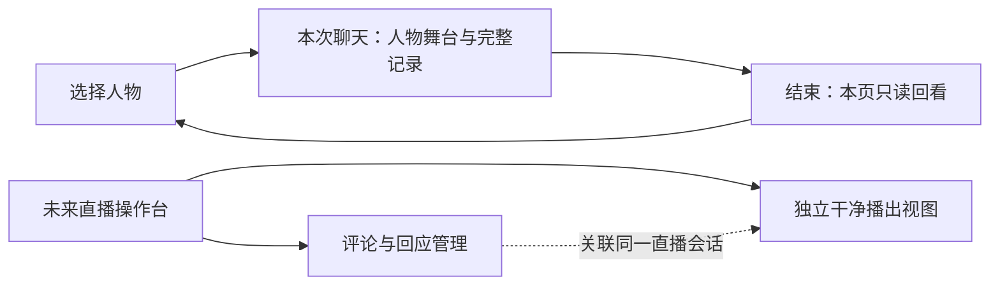
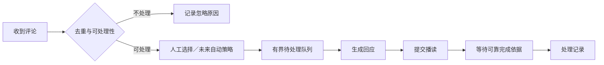

# 25 会话记录与直播页面结构

## 01 来源、范围与替代关系

2026-10-25用户确认本次完整对话记录、预留独立干净播出视图、自动读评论后续实现但页面先设计。T-078交付文档结构；用户随后明确授权T-079修改Figma，实际交付见第08节。应用仍未实现。

| 设计 | 主需求与阶段 | 本轮内容 |
|---|---|---|
| DES-034 本次对话记录 | [FR-030](../requirement/31-本次会话完整对话记录.md)，当前新增 | 连续记录、阅读、输入与页面状态 |
| DES-035 干净播出视图 | [FR-003](../requirement/04-外部直播输出.md)，后置实现、现在预留 | 观众画面与操作控制分离、失联和音频边界 |
| DES-036 评论互动操作页 | [FR-010](../requirement/11-外部互动事件采集.md)、[FR-012](../requirement/13-外部消息队列.md)，后置实现、现在设计 | 评论列表、队列、当前回应与暂停流程 |

继续采用[DESIGN](../../DESIGN.md)暗色摄影棚、单人物中心、液态玻璃和固定头像几何。本文替代[DES-011第14.17节](01-网页体验界面设计.md#1417-聊天态统一布局与样式t-075)中“固定高度欢迎卡即完整聊天页”的结构用途；T-079已更新现用聊天稿并增加独立结构评审分区，入口见第08节。多角色素材不代表实时多角色能力，当前验证角色范围不变。

本文为信息架构与交互草案。标准Tabs、ScrollArea、Sheet、Button、Tooltip、Alert等按既定shadcn/Radix语义映射，不新增组件库或技术选型；不宣称已有代码或键盘行为。

## 02 页面职责与导航



聊天与直播操作台是不同场景；直播输出不会自动携带私人聊天记录、草稿或模型上下文。未来若从聊天进入直播，应先结束并核对原会话，再显式开始直播会话，不能靠隐藏卡片把私人会话直接变为公开播出。这是设计建议，跨模式协议仍待直播阶段评审。

页内收合、查看旧消息与主题切换均不应重建人物会话。独立播出页只订阅指定直播会话，不能自行生成答案或再开收费人物。路由名、鉴权及多视图同步协议不在本轮冻结。

## 03 DES-034 桌面聊天结构

建议以1440×900画板评审：外边距24，头部56，内容间距16；左侧记录面板384，右侧人物舞台992，内容高748，底部辅助区32。尺寸是新布局建议，既有选择页及头像尺寸保持；不足宽度时采用下一节的收合布局。

```text
┌ 声伴 · Voira       本次交流                         主题图标 ┐
│ ┌ 对话记录 · 会话状态 ┐  ┌───────────────────────────────┐ │
│ │ 用户问题           │  │                               │ │
│ │ 人物回答及状态     │  │         单一人物舞台            │ │
│ │ ……独立纵向滚动……   │  │       嘴脸不被卡片覆盖          │ │
│ │ [有新消息 ↓]       │  │                               │ │
│ ├───────────────────┤  │  原位置头像／姿态：交流中锁定    │ │
│ │ 草稿输入     [发送]│  └───────────────────────────────┘ │
│ │ [听完，继续]       │                    [结束交流]       │
│ └───────────────────┘                                   │
└ AI数字人 · 本次记录不长期保存                              ┘
```

面板内部：标题56、消息区自适应、输入及状态区建议160（内容增长可增高）；只有消息区滚动。开始聊天时介绍卡收起，记录面板在原左侧区域展开。展开／收合不缩放或旋转人物，不移动头像栏；舞台安全区按展开状态预留，收合仅隐藏面板、保留“对话记录”图标入口，Tooltip及可访问名称明确。

液态玻璃用于外围卡和按钮；长消息区采用更稳定的深灰／浅灰半透明底，折射与背景高光减弱，文字本身不施加滤镜。消息字号14/24，辅助状态12/20，内距16；无装饰描边，焦点轮廓仍可见。人物入场动效不作用于消息区，减少动态偏好下直接淡入或无动画。

### 03.1 状态与操作

| 状态 | 记录面板 | 可执行操作 |
|---|---|---|
| 新会话、暂无提问 | 人物欢迎语＋“从一句问候开始”；无虚构旧记录 | 就绪后发送 |
| 提交中／结果未知 | 原问题显示明确状态，不插入重复气泡 | 编辑草稿；核对结果，不能盲目重发 |
| 已接收／生成中 | 问题保留，人物回应占位稳定 | 草稿可编辑；发送禁用 |
| 答案就绪／播读中 | 展示生成文本，另显示真实可知的播读状态 | 不把文本完成当播放完成 |
| 等待人工继续 | 原有问答不移除，显示“听完，继续” | 符合原契约时确认，随后可提交下一问 |
| 失败／连接异常 | 本条显示原因、可用处置及持续异常条 | 根据确定状态核对／结束，不自动重播 |
| 已结束 | 本页已收到记录只读，保留滚动位置 | 返回选择；离开／新会话后不承诺保留 |

生成文本按现有最终答案协议展示，本轮不新增逐字流式接口。未接收的本地问题标为发送失败，不能展示成已完成对话；未知结果保留未知。按session_id与input_id合并更新；终止后晚到事件不能写入新会话。

### 03.2 数据与生命周期建议

前端页面内存保存完整显示记录，包含session_id、input_id、本地提交顺序、问题、可取得的答案、处理状态和必要时间。每条答案在本轮结束前进入显示记录，后续状态轮询不得覆盖旧正文。读取旧消息不重新请求模型、不重新播读、不加入模型记忆。

后端模型上下文仍为[FR-024](../requirement/25-最近三轮上下文.md)最近三轮已确认问答；无正文持久化表或任意历史查询API。现有快照必须能让页面在人工继续前取得本轮最终文本，不能让只包含最新状态的轮询丢掉旧回答；接口字段与“答案尚未取回就继续”的处理需在代码阶段前回到[共享协议](03-Vidu网页PoC最小业务设计.md)评审。刷新不承诺重建完整记录。

结束后后端清空上下文；前端只读副本建议保留到离开、刷新、关闭或新会话。旧稿中笼统“结束清除正文”对前端副本的含义以此分层建议为准，具体生命周期仍待评审。不得将完整正文写localStorage、IndexedDB或普通日志来偷偷实现长期保存。

## 04 窄屏与手机结构建议

手机仍属设计覆盖，当前真实PoC优先桌面。以390×844有效视口评审，不以固定944长画板代替软键盘设计：顶部保留品牌和会话状态，人物位于上部；下方为可展开的记录面板，输入区固定在面板底部并避让安全区。详细高度按实际视口调整。

- 默认人物与最近消息同时可见；点击“对话记录”进入展开面板，上方保留人物小窗，容器内滚动查看完整记录。
- 使用Sheet式展开／收合，明确返回入口，退出后恢复原阅读位置；不将页面级竖向手势与角色切换绑定。
- 键盘打开时优先保留输入及最近消息，可收小人物展示区；键盘关闭恢复，不能裁掉发送或结束操作。
- 手机不复制桌面三列直播工作台；未来评论操作页使用“评论／队列／当前回应”Tabs，并固定显示暂停自动处理和当前任务状态。

## 05 DES-035 独立干净播出视图

面向观众的画面与操作台不是同一张截图。建议先按16:9构图预留，9:16仍由[FR-017](../requirement/18-横竖画幅切换.md)后续评审；不承诺透明背景或人物抠像，现阶段媒体是人物与背景合成。

```text
┌──────────────────────────────────────────┐
│                                          │
│             人物与场景                    │
│             单一视觉中心                  │
│                                          │
│       可选、经过批准的播出字幕区           │
│ AI数字人                                 │
└──────────────────────────────────────────┘
```

| 层级 | 允许出现 | 不进入播出 |
|---|---|---|
| 画面 | 人物、背景、必要AI标识；字幕默认关闭 | 头像栏、输入框、操作按钮、私人消息、内部报错、账号和连接凭据 |
| 声音 | 指定直播会话的人物声音 | 操作提示音、私聊音频及多视图重复播放 |
| 状态 | 无来源时中性待机；失联时中性“暂时离开”画面建议 | 把静态图伪装成仍在实时回应，或自动切入别的会话 |

打开播出页只表示视图可用，不表示OBS已采集、平台已开播或观众已收到。未来分别验证本地输出、采集音视频、观众端实际效果。操作台标示输出连接及音频归属，默认避免两页同时出声；操作台监听方式、关闭控制页后的租约和断线处理都需真实协议验证。

字幕若启用，只能来自批准的公开回应；生成的完整答案不得直接标成实时已播字幕。没有播放进度依据时关闭逐字同步。操作面板尺寸、收合和主题变动不影响输出画幅；人物／场景变更需显式确认是否作用于播出。结束直播后输出进入待机，不转入私聊。

## 06 DES-036 自动读评论操作页

### 06.1 信息结构与线框

这是**后续功能的页面设计**，不连接平台、不读取评论、不启动自动播读。建议默认人工选择评论；自动处理开关初始关闭，来源和播出未就绪时不可启用，并解释原因。“自动读评论”暂按“选取评论后生成回应并播读”设计；是否先念昵称／原评论、纯复读模式及自动放行策略仍待直播阶段确认。

建议1440×900：外边距24、顶部56、列间距16，左列320、中央656、右列384，底部独立保留停止操作。人物在中央舞台，列表不叠到嘴脸；空间不足收合为Tabs，保持当前回应与暂停入口可见。

```text
┌ 声伴 · Voira  直播互动   来源：未连接   自动处理 [关]  [播出视图] ┐
│ 评论来源与列表       │ 人物舞台／输出监看        │ 待处理队列       │
│ [全部][待处理]      │                           │ 1. 评论与来源    │
│ 昵称 · 时间 · 来源  │       单一人物            │ 2. 评论与来源    │
│ 评论内容           │                           │ [移出]           │
│ [加入队列][忽略]   │ 当前回应                   ├─────────────────┤
│                   │ 所选评论 → 回应文本        │ [待处理][已处理] │
│ ……独立滚动……       │ 生成／播读／未知状态       │ 结果与原因       │
│ [有新评论 ↓]       │ [跳过待处理项]             │                  │
├──────────────────────────────────────────────────────────────┤
│ 接收状态 · 队列数量          [暂停自动处理]       [结束直播会话] │
└──────────────────────────────────────────────────────────────┘
```

“全部／待处理”筛选评论源列表；右列Tabs切换队列与处理记录，标签区固定尺寸，数字变化不挤动面板。顶部自动开关控制是否自动选取，底部暂停是运行中的快捷操作，两者共享同一状态，不能成为两个独立开关。

### 06.2 内容与状态

| 区域 | 需要展示的信息 | 操作与反馈 |
|---|---|---|
| 来源 | 平台／房间标识、连接状态、最近接收时间 | 未连接说明接入条件；不展示密钥。无权限／断线有正文错误与重试入口 |
| 评论流 | 来源、昵称、正文、接收时间、处理状态 | 加入队列、忽略；同来源事件去重，已入队不能重复点击；上翻不被新评论拉走 |
| 待处理队列 | 待处理条目、来源、入队时间、选择原因 | 移出尚未执行条目；过期／重复／超限显示原因，不静默丢弃；容量与阈值待定 |
| 当前回应 | 当前评论、生成答案、播读状态 | 生成失败与送播未知分开；已发送后不把“跳过”伪装成立即停止音频 |
| 已处理记录 | 已回应、忽略、过期、失败、结果未知 | 按本次直播查看，不能将“提交成功”算“观众已听到”；不承诺长期保存 |

示例昵称、评论与计数只在评审稿中标注为示例，不伪装真实接入。未来正式页面没有来源时显示真实空状态，不预填假评论。

### 06.3 操作流程与异常



- **暂停自动处理**：停止自动选取和启动下一条；不宣称撤回已发往媒体服务的内容。来源仍连接时可以继续展示评论，并明确“继续接收、暂不自动回应”。
- **来源断线**：暂停自动推进，保留当前任务与已收到记录，显示最近接收时间；恢复后不自动补播积压，先评审过期策略。
- **生成失败**：当前条目标记失败，可明确重试；未知是否送播时先核对，不重复读同一条。
- **跳过**：只作用于未执行条目；播读中的停止能力在供应商验证前不承诺。结束会话有独立反馈，继续显示终止核对状态。
- **来源已连但无评论**：显示“等待新评论”；队列空显示“暂无待处理评论”；自动关闭显示人工选择引导，三者不混为连接错误。
- **私人输入与评论冲突**：未来直播操作台只允许明确标为公开回应的输入；私人聊天不进入直播队列。同一人物同一时刻只播读一个任务，人工插入与评论优先级留待直播调度评审。
- **自动下一条**：当前网页仍用人工听完继续。未来评论自动推进必须先验证可信的播放完成／占用释放依据、预算和处理规则；没有依据时停在待确认状态，不用固定延时冒充说完。

### 06.4 后续决策入口

FR-010负责事件来源、权限、字段和失联；FR-012负责选择、去重、队列与完成信号；FR-003负责输出与音频。平台、审核／自动放行策略、是否读昵称原文、过期阈值、打断能力、直播上下文和长期记录均未确认。本轮先设计页面容纳这些状态，不为它们建立新的运行时默认值。

## 07 评审与验证清单

- 聊天：0条、超过3轮、多屏长记录、上翻时新消息、失败／未知、结束只读、新会话隔离、面板收合和主题切换。
- 播出：无来源、就绪、失联、结束；控制台与输出并排检查，不泄露私人内容，音频只有选定一路；16:9构图先评审。
- 评论：未接入、无权限、已接入无评论、队列空／满、重复／过期、生成中、播读中、暂停、送播未知、断线恢复、停止核对。
- 交互：固定Tab几何、焦点与键盘顺序、可见错误、手机面板和软键盘避让；这只是待验清单。

追溯：[PRD第12节](../prd/01-网页数字人PoC产品与验收标准.md#12-本次记录与直播页面预留t-078)、[计划08第33节](../plan/08-统一界面设计交付计划.md#33-t-078-会话记录与直播页面需求2026-10-25)。T-078只验证文档一致性；T-079的Figma视觉与原型证据见第08节，真实服务仍未执行。


## 08 T-079 Figma设计交付（2026-10-25）

用户直接授权按本文更新Figma，保持人物中心、暗黑液态玻璃，不展开前端。沿用现有摄影棚和人物素材，没有替换并行评审中的角色候选。

| 入口 | Figma节点 | 本轮内容 |
|---|---|---|
| [设计导航](https://www.figma.com/design/ZO9RS5jCJqDWBnAxB8yV2w?node-id=197-13660) | 197:13660 | 三类场景及原型示例边界，入口连线 |
| [完整记录](https://www.figma.com/design/ZO9RS5jCJqDWBnAxB8yV2w?node-id=192-12909) | 192:12909 | 四轮示例、消息独立滚动、固定输入、回到最新、收合与结束只读 |
| [干净播出](https://www.figma.com/design/ZO9RS5jCJqDWBnAxB8yV2w?node-id=193-13439) | 193:13439 | 1440×810单人物与背景、AI标识；另有等待连接／暂时离开 |
| [评论互动](https://www.figma.com/design/ZO9RS5jCJqDWBnAxB8yV2w?node-id=193-13032) | 193:13032 | 评论流、队列、当前回应、处理记录；暂停／断线／未连接／入队与移出状态 |
| [手机记录](https://www.figma.com/design/ZO9RS5jCJqDWBnAxB8yV2w?node-id=192-13328) | 192:13328 | 390×844展开阅读面板、人物小窗与固定输入 |
| [手机评论](https://www.figma.com/design/ZO9RS5jCJqDWBnAxB8yV2w?node-id=197-13548) | 197:13548 | 评论／队列／回应Tabs、固定当前任务、暂停和结束入口 |

### 08.1 布局与组件

60张原聊天稿（五角色×三姿态×明暗×桌面／手机）已替换旧欢迎卡为Session records组件。人物与头像姿态区保留原几何；桌面记录面板在Scene内x96/y118、384×660，结束按钮x96/y800、384×44。页面头部品牌与主题图标保持。手机基础聊天保留原人物舞台；完整记录展开稿使用390×844，人物小窗与记录分区展示。

新分区192:12908包含55个顶层节点：25个深色状态及对应25个浅色状态、3个干净输出、1个来源说明、1个设计导航。10个Session records变体位于现用组件页191:12573，继续复用既有Button、Theme、Avatar及PoseTabs。完整记录两张主评审稿为支持Figma实际滚动锚点，将面板转成可编辑Frame，内层按钮与材质样式保持复用；其他现用稿保留面板实例。

评论台左右玻璃面板与人物舞台分离，人物x510/y94、365.185×547.778；当前回应位于人物下方，暂停／结束放到右列下方，已修正初稿底部重叠。外围沿用共享液态玻璃填充及效果，消息／输入采用稳定内表面。字体均为现用Noto Sans SC；主题仅图标切换，不添加主题文字。

### 08.2 原型与边界

接通主角色空会话→正在回应→单轮回应→人工继续，完整记录滚动／回到最新／收合／结束只读，评论暂停／恢复、队列／处理记录Tabs、入队／移出及手机Tabs。播出视图入口指向独立Figma原型视图，不等于真实媒体出口。25组明暗切换保持对应页面状态。

暂停／断线下浏览处理记录或手机Tabs保持原运行状态，不因切换面板自动恢复处理。全部对话与评论是设计样例；完整记录四轮场景为独立评审入口，不是点击一次发送生成四轮真实会话。尚未实现自由输入、实时新消息自动跟随、真实持久化／终止、键盘／触屏／软键盘、评论权限或播出同步。少量列表操作用固定示例状态演示，不构成可任意编辑的运行系统。

结构、截图及实点证据见[计划08第35节TC-079](../plan/08-统一界面设计交付计划.md#35-t-079-完整记录与直播figma设计2026-10-25)。原T-078文档任务因与并行角色任务T-077冲突，本轮完成编号校正；角色任务与候选素材不变。


## 09 T-080 面板轻量化与场景切换（2026-10-25）

用户要求进一步减少两侧信息与厚重感，让人物突出，并优化聊天／直播切换。本节替代第06节及第08节中评论台默认展示密度和尺寸；业务职责、私人记录隔离、直播后置边界不变。入口仍为[评论台193:13032](https://www.figma.com/design/ZO9RS5jCJqDWBnAxB8yV2w?node-id=193-13032)与[完整聊天192:12909](https://www.figma.com/design/ZO9RS5jCJqDWBnAxB8yV2w?node-id=192-12909)。

### 09.1 渐进展示与材质

- 桌面默认只展示最新待选评论、下一条队列项和当前回应。已在回应／已入队／已忽略的内容不重复堆在待选区；没有新待选内容时显示空状态。
- 左面板由304×668缩至280×320，右面板由324×668缩至280×312；当前回应560×108。默认两侧玻璃占用面积约减少58%。未连接状态保留必要接入说明，左面板可较高。
- 人物由约365×548增至420×630，场景内x494/y76。隐藏重复姓名与状态段，头像／姿态切换素材和干净播出不变。
- 新Airy玻璃样式降低暗色基底不透明度至0.11，移除装饰阴影与描边；保留低折射GLASS效果（radius 8、depth 4、refraction 0.035），内容行不再叠加深色卡片。文字自身不降低透明度。
- “查看全部评论”“展开队列／查看全部记录”打开舞台两侧的展开层，收合回到原页面及其运行／暂停状态，人物不被居中的列表遮住。展开层复用已有内容，滚动区与关闭操作分离。
- 手机评论态统一390×844，人物204×306；下方面板342×280，以评论／队列／回应Tabs减少同时展示的信息。多条内容在面板内滚动，暂停与结束固定在外部。

### 09.2 聊天与直播导航

评审分区及主角色自然姿态聊天入口增加固定位置“聊天／直播操作台”Tabs，明暗模式一致。切换入口与播出入口分开，进入操作台不等于开播。

| 当前状态与动作 | 原型结果 |
|---|---|
| 正在聊天，点直播操作台 | 打开切换确认；取消留在当前聊天与阅读位置；确认结束后进入未连接／自动关闭的直播准备页 |
| 直播运行或暂停，点聊天 | 提示结束并核对输出停止后返回；取消保持直播页面；示例确认后回到聊天只读记录 |
| 聊天已结束，点直播操作台 | 直接进入直播准备页 |
| 未连接直播准备，点聊天 | 返回示例聊天只读记录，不自动重新开始交流 |
| 明暗切换 | 保留对应场景和运行状态；展开层与确认框显式使用同主题 |

桌面与手机各有深／浅两套切换确认，手机新增未连接直播准备页220:15408／220:15450，避免跳到桌面稿。240ms叠化用于导航；未加入新的真实会话行为。

本轮Figma使用固定示例记录表示返回路径，不能证明任意历史会话保存、准确终止或音频停止。真实跨场景切换仍应核对原会话停止结果；结果未知不能直接开始新的公开播出。未实现前端、评论连接或播出协议。


## 10 T-081 队列管理与一致状态（2026-10-25）

用户要求修正队列管理。本节替代第08／09节中固定样例入队／移出跳转、队列展开层与手机三项Tabs；人物中心、Airy玻璃、聊天／直播导航及独立干净输出保持。关联[FR-012第08节](../requirement/13-外部消息队列.md#08-t-081-队列管理设计建议)，真实调度继续后置。

### 10.1 信息结构与操作

| 区域 | 展示与行为 |
|---|---|
| 当前回应 | 位于人物下方，独立于待回应；已经提交的内容不能从队列移出或重复加入 |
| 待选评论 | 只显示可加入的内容；加入追加末尾，忽略转入操作记录；无待选时显示空提示 |
| 默认队列摘要 | 只保留实际数量、下一条内容和管理／记录入口，280×286 |
| 展开队列 | 右侧336×576，按顺序排列；逐项移回待选，后续项可设为下一条；不打断当前回应 |
| 操作记录 | 单独Tab展示回应结果与移回／忽略示例，不计入待回应数量，不再使用无依据的固定记录总数 |
| 暂停／断线 | 后续不自动开始；整理队列、收合、浏览记录和主题切换均保留停止推进的状态 |

桌面[管理入口223:14886](https://www.figma.com/design/ZO9RS5jCJqDWBnAxB8yV2w?node-id=223-14886)改为同一舞台中的展开状态，不再用拦截整个页面的模态层，暂停与结束按钮仍可操作。收起返回[默认评论台193:13032](https://www.figma.com/design/ZO9RS5jCJqDWBnAxB8yV2w?node-id=193-13032)，人物与当前回应的位置不变。

手机沿用390×844及342×280面板；固定“评论／队列／回应／记录”四项Tabs，面板内部滚动，暂停与结束在外部固定。新增四张运行／暂停×明暗操作记录页，移动操作留在手机布局。[手机队列197:13585](https://www.figma.com/design/ZO9RS5jCJqDWBnAxB8yV2w?node-id=197-13585)为评审入口。

### 10.2 示例原型与限制

原型使用本地Figma变量共享晚风、雨点、月光三条示例的队列顺序、数量、候选资格和记录可见性；各页面不再各自写死结果。入队、移出与设为下一条先读取操作开始时的顺序，再更新对应条目，避免连续点击误删、错序和状态回退。深浅主题、暂停与队列／记录页面共用示例状态。候选为空或队列为空时显示对应提示。

记录示例仅表达每条评论是否发生过移回或忽略，不是带时间戳、可重复记录全部事件的审计日志。未实现自由评论、真实来源接入、自动推进、持久化、多端同步、可靠停止或真实播出。原型不能验证真实播放结束依据；“设为下一条”是本轮设计建议，后续产品评审仍需确认优先级与公平性。

交付及连续点击证据见[计划08第39节](../plan/08-统一界面设计交付计划.md#39-t-081-队列管理一致性2026-10-25)。前端、public和角色素材未由本任务修改。
