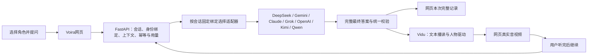

# 31 AI服务与数字人协同设计

设计编号：**DES-037**；主需求：[FR-031 七位角色与AI服务绑定](../requirement/32-七位角色与AI服务绑定.md)。本文定义应用结构与接入取舍；公共字段、状态、接口和存储统一维护在[共享设计03](03-Vidu网页PoC最小业务设计.md)，不建立第二套协议。

## 01 产品结构

Voira是七位AI各有形象的数字人交流应用。用户选择谁，就由对应服务回答，再让该角色以声音和画面表达。当前网页与本地FastAPI继续作为客户端和业务入口；七服务按适配器接入，不另建教程中的Node消息桥。

图中七个服务是可选择的目标，不是每个问题都调用七次。角色对照唯一见FR-031；一个活动会话只调用自己的服务。共享后端不表示共享上下文、认证或费用账户。

## 02 页面与交互

沿用现有人物舞台、七位选择入口、五态素材与黑白灰无边框布局；业务聊天结构沿用[DES-034](25-会话记录与直播页面结构.md)，服务配置由[AI接入管理](32-个人中心与AI接入管理界面.md)承接；不扩展独立多租户后台。

| 场景 | 用户看到与可以做的事 |
|---|---|
| 选择人物 | 展示角色和对应回答服务；说明该角色具体缺项。切换预览不创建媒体、不调用模型 |
| 开始交流 | AI连接、该角色送模资产、音色、预算全部符合准备条件才开始；分别呈现连接与真实画面状态 |
| 提问与回答 | 固定输入区与本次完整记录；生成中可编辑下一问但不能发送；完整答案可显示，同时明确尚未等于播完 |
| 数字人播读 | 显示当前角色的音视频；静音、启声和结束入口可用；服务名不混入人物台词 |
| 听完继续 | 沿用人工确认，只解锁下一次发送，不自动发送草稿、不按字数推测播放结束 |
| 更换交流对象 | 建议先结束并核对当前会话，再选择并开始；新会话上下文为空，不迁移上一位AI的私聊 |
| 某项失败 | 明确是回答服务、素材、音色或媒体问题；保留已收到文本并停止新发送，提供结束核对；不自动改成另一家AI |

AI文本已就绪但人物资产／声音缺项时，可以先完成该服务的内部文本联调；产品中的数字人开始入口仍显示缺项。纯文字独立模式若要面向用户开放，需另行确认交互，不能悄悄降级后宣称数字人成功。Kimi／Qwen不能借用其他角色素材。手机响应式布局可复用；真机远程访问、原生应用与公网发布不在本轮接入范围。

## 03 接入与隔离

| 层 | 职责及拟落点 |
|---|---|
| 页面 | `frontend/src/features`展示角色、当前会话及消息；`src/api`消费自动生成HTTP客户端 |
| 会话编排 | `backend/app/services`持有服务选择、单输入占用、上下文与取消；统一管理生成和播读意图 |
| 角色服务绑定 | 从服务预设创建独立连接，再绑定对应角色；后端持有适配器、模型、秘密引用和版本，会话冻结使用；字段与校验见共享设计03.5 |
| 回答适配器 | `backend/app/integrations`将各自API或受控CLI转换为同一最终文本结果；不修改消息记录、不自行触发Vidu |
| 媒体适配器 | 同目录的Vidu适配器独立处理创建、播读、音视频连接和结束核对 |

接入入口采用[预设引导](32-个人中心与AI接入管理界面.md#04-连接管理与状态)，可复用已有连接，也可填写预设所需字段创建连接；API与CLI是传输实现选择，不影响角色映射。Codex可作为ChatGPT／OpenAI角色的候选实现，Claude Code可作为Claude候选；其他五项必须有各自的真实服务入口。当前仅证实本机安装Codex与Claude Code，没有证实任何一项已通过Voira联调。实际接法、模型和认证归FR-031的Q-014维护。

会话创建时冻结绑定与人设版本；生成前截取当前会话最近三轮已确认问答。换角色创建新会话，结束／重启清空后端正文。API若有远端续聊ID，不能直接复用个人会话或无限历史；适配器须证明仍满足三轮窗口，否则使用显式历史的无状态请求。CLI须隔离开发目录、工具和配置，不能以提示词代替访问限制。

本机账本保存意图与必要标识，正文按既有内存生命周期保存。重连只核对同一输入，不自动新建生成任务。`AI已返回`、`已尝试播读`、`用户确认听完`分别记录；一旦结束或绑定不匹配，晚到结果不能展示为当前回答或发往Vidu。取消只作用于本任务拥有的调用；费用未知保留未知。

## 04 教程中采用的机制与不适用部分

参考：[YourChat图文教程](https://www.douyin.com/note/7673002691720022202)，作者🦔，图内版本2026-08-11；2026-10-26读取24页图文文本，适配器与群聊路由页另做目视核对。属于第三方实现建议，未运行其代码。以下仅保留影响本项目取舍的结论，原图、OCR、抓取回包不进入知识库。

| 教程机制 | Voira采用方式 |
|---|---|
| 第7—8、16—17页统一适配器 | 复用职责分离；由FastAPI适配已有服务，只向业务层返回最终正文和归一状态 |
| 第9、15、19页消息ID与去重 | 复用输入ID及持久化意图；沿既有HTTP回执与轮询，不为此新增浏览器WebSocket |
| 第16—18页上下文隔离 | 复用隔离原则；当前按角色／会话／绑定隔离，不引入教程的20—30条群聊历史 |
| 第18—19页群聊路由与跳数限制 | 保留为未来独立需求的设计依据；七角色一一绑定并不等于批准双AI群聊 |
| 第10—11、22页历史恢复与outbox | 不照搬持久化正文和自动重发；本项目保持当前页面记录、三轮模型窗口及未知不重发 |
| 第13—14、20页网页／真机连接 | 当前仍本机同源；外部手机上的localhost不指向开发电脑，未来远程接入要另补身份和网络设计 |

教程的客户端ack只说明消息桥接收，不证明模型已回答或人物已说完。其伪代码和UUID去重不构成跨外部服务的恰好一次保证；本项目继续区分未知、失败与已确认。

## 05 实现顺序与验收出口

1. 落实七项绑定配置清单，核对已有连接所在位置；先做无真实调用的配置校验与七适配器Mock路由。
2. 完成共享会话／账本／生成客户端；逐项实现可复用的服务适配器。可以先让一个已就绪角色跑通，不以七项全部就绪阻塞局部交付，也不能把一项结果复制为七项通过。
3. 将最终答案接到已有Vidu设计、人工继续和三轮上下文；补齐完整记录的取得与去重。媒体所需资产／音色与AI认证分别验收。
4. 按批准额度逐角色验证真实来源、隔离、异常、声音／口型与终止；每个角色分别给出文本已验／数字人已验／未验结论。

用户价值与验收见[PRD第14节](../prd/01-网页数字人PoC产品与验收标准.md#14-七位角色对应ai与数字人协同)，执行依赖及TC见[计划09第09节](../plan/09-网页PoC逐功能实现与验收计划.md#09-七位ai与页面记录的实施约束)。本设计未接通服务、未修改界面或运行调用；具体连接缺项不妨碍本次设计交付。
