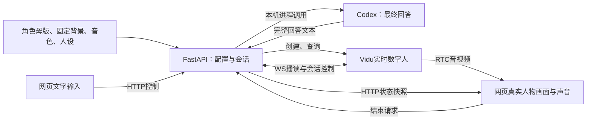

# 01 数字人网页 PoC 需求草案

> 历史快照：2026-10-25按用户要求拆成独立功能需求后已替代，不再维护或作为当前规格。当前入口见[需求索引](../01-数字人MVP需求草案.md)。下文保留v0.9内容及当时确认状态。

**当前核心目标已确认：先跑通数字人网页，直播留到后续阶段。** 这次调整替代此前“双端同时作为一期目标”的阶段安排；外部开播、推流和平台互动不再是当前PoC的功能、前置条件或验收门槛。人物效果参考偏好及已确认工程技术栈继续沿用。

对“跑通网页”的最小实现建议是：在浏览器中展示一个真实可驱动的数字人，能看到画面、听到声音，发送一条文字后得到人物语音/口型回应，并能明确结束会话。静态页面、预录视频和Mock只算页面开发证据，不能算真实数字人链路已跑通。用户已确认Vidu、蓝色大肥鱼、人物与背景合成画面及“提问后人物回答”；本地优先及PoC由本地Codex生成回答也已确认，接入协议按最小方案选择。音色方向、人设、回答长度、人工继续和最近3轮上下文已确认；具体音色、送模版本与真实观感仍待落实，预算等实际调用前再定。决策状态见第12节，全文因仍有未决项保留草案。

当前验证计划：[网页数字人PoC](../../plan/07-网页数字人PoC验证计划.md)；工程约束：[PROJECT](../../../PROJECT.md)；来源：[调研索引](../../research/00-调研索引.md)、[补充研究](../../research/04-实播复盘与平台逆向补充.md)；任务：[BLACKLOG](../../../BLACKLOG.md)。

v0.5补充[第09节形象与素材要求](#09-虚拟人物形象与素材要求)，依据[RES-007形象调研](../../research/06-虚拟人物形象制作与驱动调研.md)。网页优先、直播后置、单角色真实验证和既有FR/NFR编号保持；新增制作细节为建议，未将静态设计或素材生成记为动态验收。

历史v0.6按用户要求把技术选型与“如何实现”整理回本份原始需求，见[第10节](#10-人物形象技术选型与实现路径)。当时Vidu与动态分层为待确认建议；v0.7已按用户回复选定Vidu合成画面，关闭Q-011。新增第11节逐项承接抖音十图功能，未来直播功能仅列候选；最小业务设计与产品验收已形成草案。

v0.8落实本地优先与本地Codex回答，新增FR-019及第12节决策清单。Codex生成回答，Vidu文本播读并驱动人物；不新增面向用户的手动台词功能，也不意味着模型离线运行。

v0.9记录用户对五项体验选择的直接确认，关闭Q-012/013并收窄Q-004；预算及实际调用条件后置落实，不新增代码或真实调用授权。

## 01 用户、问题与当前阶段

当前面向项目内部开发者和体验者验证网页数字人效果，不按直播运营者与公众观众建设产品。建议先用一个桌面浏览器、一个体验者、一个角色和一个活动会话，验证“网页—后端—数字人服务—网页音视频”的最短链路。

本阶段回答三个问题：数字人能否在我们的网页实际运行；文字是否能触发可见可听的回应；会话异常或结束时是否能看清状态并停止继续消耗。暂不验证直播商业模式、观众增长、平台开播或多人分发。

| 依据 | 当前采用内容 | 不作为当前要求的内容 |
|---|---|---|
| 用户本轮纠正 | “核心的POC阶段要做的是跑通数字的网页，后续在考虑直播” | 旧版双端首发、抖音权限或外部评论前置 |
| 用户此前偏好 | 人物效果以原参考作品为准 | 不推导为必须换装、唱跳或完整复刻直播间 |
| RES-001源码与RES-005补充研究 | 会话创建、真实媒体、回应状态、终止与费用边界 | 直播调度、备用节目、长时换接和多观众分发平台 |
| 已确认工程约束 | Next.js/React等前端栈与FastAPI后端；遵守PROJECT | 不因PoC改回单文件演示或引入另一套框架 |

## 02 已确认方向与变更记录

| 性质 | 内容 | 当前效力 |
|---|---|---|
| 已确认范围纠正 | 网页数字人PoC优先，后续再考虑直播 | 覆盖此前“双端同时作为一期目标”；无需再次确认是否延后直播 |
| 已确认效果偏好 | 以原参考人物效果为方向 | 具体动态样例与可接受程度仍需评审 |
| 已确认工程约束 | Next.js、React、shadcn/ui、Radix UI、Tailwind CSS、Prettier、ESLint、Axios、Zustand、Umi OpenAPI；FastAPI与Google Python风格 | 保持既有规范；按功能组织路由，无版本号分层；FastAPI自动OpenAPI/Swagger；生成API位于frontend/src/api；不创建自定义脚本文件/目录 |
| 已确认路线与人物 | Vidu网页PoC；蓝色大肥鱼；人物与背景可以先合成；提问后人物回答 | 保留当前立绘身份；不要求实时透明层，不直接朗读用户问题；本轮只写文档 |
| 已确认本地运行方向 | PoC就由本地Codex生成回答，接入协议按最小方案选择；本地优先 | 网页/后端/配置/状态在本机；Codex本地进程负责调用，模型推理和Vidu仍可依赖云端；不要求MCP协议，不复用当前开发聊天作为角色会话 |
| 已确认五项体验选择 | 自然清楚的成年普通话女声方向；温和略俏皮的AI伙伴；默认2—3短句/约40—100字；人工听完后继续；最近3轮已确认问答上下文 | 2026-10-25用户直接确认；具体音色仍待试听，预算等实际调用前再定；不代表动态效果通过或允许实现 |
| 建议实现边界 | 单体验者、单角色、单活动会话、文字触发音视频回应 | 用最小链路解释网页PoC，不自动增加语音连麦、公众账号或聊天室 |

v0.4保留既有编号及来源关系：FR-003双端输出、FR-009换装/动作、FR-010外部事件明确后置；新增FR-011定义网页展示，不把原双端要求改名复用。FR-001/002/004—008缩减为网页会话需要的能力。旧TC-001—010保留为历史研究场景，当前从TC-016起编号，避免与工程计划TC-011—015冲突。

## 03 当前PoC范围与成功定义

**建议流程：** 打开网页 → 载入预置蓝色大肥鱼 → 开始体验 → 首帧就绪并开启声音 → 输入文字 → 本地Codex生成回答 → Vidu发声并驱动人物 → 人工听完后继续（已确认）→ 结束体验 → 确认服务端会话终止。

| 当前范围 | 交付内容 | 简化边界 |
|---|---|---|
| P0：网页体验 | 一个以人物为主体的页面，含开始/结束、声音控制、文字输入与状态反馈 | 预览和控制在同一页即可，不做独立直播工作台、观众房间页或纯净播出页 |
| P0：角色与连接 | 一个授权预置角色、音色及必要人设；通过后端建立真实数字人会话 | 可由开发配置准备，不要求上传后台、素材库、内置生图或声音克隆 |
| P0：真实音视频 | 浏览器可见人物动态画面，可主动开启声音 | 不使用循环录播冒充生成；不接OBS、直播伴侣、RTMP或CDN |
| P0：文字驱动 | 文字提交后能触发一次语音和口型输出，显示已发送、等待回应、人工确认继续或失败/未知状态；不伪造播放完成 | 建议先单请求串行；忙时禁用或明确拒绝新提交，不做弹幕抽选、TTL池或人工候选队列 |
| P0：本地生成回答 | 本机后端调用Codex取得最终回答，再由Vidu播读；当前轮与会话可关联 | 不建设MCP服务平台，不开放模型/工具选择器；失败不自动切回Vidu生成回答 |
| P0：结束与排障 | 静音、结束会话、失败提示、明确重试和必要日志；基本时长/费用上限 | 静音不等于终止；不做独立备用节目、全天故障恢复系统或完整计费后台 |
| 后续阶段 | 外部开播/推流、平台评论、共享直播间、多观众分发、直播运营控制台、长期稳定性、输出审核流水线 | 不需要现在取得外部平台账号或推流/评论权限；不会因这些未完成而阻塞网页PoC |
| 本阶段不做 | 换装/道具/背景编辑、主动唱跳、自动暖场、语音输入、多人/多房间、会员/支付、商品问答、完整录播、长期记忆、多供应商切换UI | 未来是否加入需另行决定，不作为隐藏验收项 |

PoC通过应有一次可复现的真实闭环：打开网页、创建会话、收到首帧和语音、输入文字并获得人物回应、结束并核对服务端终止结果。页面Mock联调与真实供应商验证分别记录，不能相互替代。

原20名观众、2小时/8小时运行、5小时付费配额、双端开播率等研究建议退出当前验收。建议先按单浏览器、短会话验证；具体短测规模在第06节确认。页面启动速度、提交至网页首音、冻结/无声/失败、终止状态与累计测试用量作为观测项，不先承诺原5秒/30秒等未实测门槛。

## 04 功能性需求

P0为当前网页PoC的实现建议；范围方向已确认，细节不等于已完成实现或实测。

| 编号 | 需求 | 当前阶段 | 可观察结果与异常边界 |
|---|---|---|---|
| FR-001 | 配置并复用一个授权角色、音色及必要人设 | P0，缩减 | 一个预置配置可用；形象、音色、人设和来源按第09节成套记录；缺项提示，不创建无效会话；无需素材管理后台 |
| FR-002 | 开始网页体验并反馈会话状态 | P0，缩减 | 区分未开始、创建/连接中、可用、失败、已结束；重复点击不重复创建会话；创建超时后核对残留，不盲目重试 |
| FR-003 | 同一节目输出到网站与外部平台 | 后置 | 保留原双端需求身份；当前不实现、不验收，不作为FR-011的依赖 |
| FR-004 | 提交网页文字并反馈结果 | P0，缩减 | 空内容/超长内容有提示；已收到不显示为已回应；无需观众登录、聊天广场或音视频输入权限 |
| FR-005 | 将文字交给数字人并跟踪回应 | P0，缩减 | 单请求串行；处理中不因普通提交打断；区分后端已发送、可观测回应、失败和结果未知；供应商没有成功回执时不伪造“已受理/已播完”，未知不自动重播。首轮已确认为提问后回答；播读本地Codex的最终回答，不朗读用户问题。面向用户的手动台词播读FR-016仍后置；人工继续已按Q-012确认，见第12节 |
| FR-006 | 提供网页声音和体验控制 | P0，缩减 | 静音/恢复声音明确；异常时可隐藏人物并显示错误状态、结束会话；无需独立备用节目节点或直播接管面板；不把本地静音写成停止生成 |
| FR-007 | 结束会话并控制测试用量 | P0，保留必要边界 | 停止接收新输入并请求服务端终止；区分终止中、成功和未知/失败；达到已配置上限停止新增生成；网页关闭/断开后有超时清理策略；终止未知时阻止新建，累计用量不因重试清零 |
| FR-008 | 保留必要会话与错误记录 | P0，缩减 | 能关联会话ID、创建/回应/结束时间、错误及用量估算；供应商核对结果另记；开发日志足够，不做运营报表或账单产品 |
| FR-009 | 预制形象切换及有限动作 | 后置 | 不影响当前单形象的基础语音/口型验证 |
| FR-010 | 外部平台互动事件接入 | 后置，已明确 | 不再是待升级的首版条件项；本轮无需选择外部平台或取得评论权限 |
| FR-011 | 在网页呈现真实数字人音视频与基础体验界面 | P0，新增 | 可见动态人物，可主动开启声音，文字引起实际音视频变化；未连接/无声/失败状态清楚；静态画面或预录视频不算真实链路通过 |
| FR-012 | 多来源消息的去重、排队和过期处理 | 后续候选 | 识别事件后先去重，再按顺序处理；过期仅作用于未处理消息；阈值与来源适配另行确认，不能按定时器截断正在说的回答 |
| FR-013 | 商品资料与讲解轮换 | 后续候选 | 操作者维护并确认商品名称、价格说明、卖点和话术；缺失或过期不编造，暂停/切换边界可见 |
| FR-014 | 礼物事件感谢 | 后续候选 | 仅按实际已接收且去重的事件触发，数量和用户信息有来源；不能用OCR猜测或重复感谢 |
| FR-015 | 空闲主动讲解与暖场 | 后续候选 | 队列空闲且启用时才触发；受用户互动、禁用和结束控制，间隔与优先级另定 |
| FR-016 | 手动指定话术播读 | 后续候选 | 输入内容按播读语义输出，与提问后回答明确分开；必须验证选定provider支持，不用问答命令冒充逐字播读 |
| FR-017 | 横竖画幅与浮动工作台面板 | 后续候选 | 9:16/16:9适配、卡片关闭/收起/拖动可恢复；不遮人物嘴脸或关键控制；当前仅落实网页主体和安全裁切 |
| FR-018 | Mac与Windows桌面分发 | 后续候选 | 安装、启动、权限、更新与使用说明分别验证；安装包能开不等于真实媒体通过；不作为网页PoC工程约束 |
| FR-019 | 在本机调用Codex生成角色回答 | P0，用户确认 | 本机后端按固定人设和当前会话上下文调用Codex；只把成功取得且校验过的最终回答交给Vidu。区分生成中、失败/超时、已发往播读；错误或结束后的晚到结果不播读，不自动重试或换回答供应商；不授予角色任意本地文件/开发工具访问能力 |

本阶段已选定Vidu实时数字人路线；具体模型/provider、账号支持及质量由真实测试核验。若失败需记录证据并重新决策，不能自动切换供应商、增加费用或引入插件平台。

## 05 非功能性需求

| 编号 | 类别 | 当前PoC约束与记录方式 |
|---|---|---|
| NFR-001 | 响应性能 | 记录创建到网页首帧/首音、文字提交到首音、失败与超时；少量样本先列明逐条结果，不用小样本P95冒充稳定性能。原直播的5秒/30秒门槛不沿用为当前通过条件 |
| NFR-002 | 人物与媒体 | 固定角色和短句/长句观察画面、音色、口型与连续性；记录无声、黑屏、冻结、明显脸部/衣着异常；参考效果作为评审方向。原25fps/150ms为历史研究值，当前先收集实测与样例 |
| NFR-003 | 异常处理 | 网络断开、页面刷新/关闭、服务端异常不能一直显示可用；可明确结束或提示重试；旧会话结果不得污染新会话。不要求180秒无感恢复、跨会话记忆、连续2小时或自动续接直播 |
| NFR-004 | 访问与内容 | 仅用获授权素材，页面明确标识AI数字人；长期密钥仅后端持有，不放地址栏/浏览器代码或普通日志。已确认本地优先；网页、后端及状态在本机，模型调用仍可能发送必要文本到云端；若需远程分享，再补访问限制，不默认公网无鉴权开放 |
| NFR-005 | 测试成本 | 真实调用前明确账号及测试预算；分别控制Vidu时长/费用与Codex调用次数/实际费用，重试累计；结束状态与供应商用量分开核对。保留停费边界，不建设商业结算系统 |
| NFR-006 | 浏览器可用性 | 先支持一个目标桌面浏览器；开始/结束/静音/文本输入可操作，加载与错误状态明确；声音自动播放被阻止时可手动恢复。手机适配与多端压测后置 |
| NFR-007 | 可复现 | 记录配置版本、会话与输入输出时间、异常及终止依据；给出实际启动/停止说明，另一执行者能复现网页闭环。供应商“说完”不等于本地已播放完，无法观测则标未知 |

已确认工程规范保持不变，详见PROJECT及两端规范。当前不要求直播分发、复杂数据库/队列、独立媒体出口和自动审核系统；是否引入存储等基础设施由最小设计说明必要性。

## 06 待确认问题

不再重复询问“是否后置直播”。音色方向、人设、回答长度、人工继续和最近3轮上下文已获用户确认；Q-012/013关闭，Q-004只剩具体音色、送模版本与真实观感。Q-005/006的规模、账号和预算在实际调用前再定；Q-010/011保持关闭。第12节集中维护确认状态和剩余建议。以下保留原Q编号并标明状态；不将历史直播决策继续全部列为当前阻塞。

| 编号 | 当前状态 | 处理方式 |
|---|---|---|
| Q-001 | 方向已明确；商业用户研究后置 | 当前为网页数字人PoC；建议一个内部体验者，不再要求先确认共享直播间运营模式 |
| Q-002 | 外部平台问题后置 | 暂不需要外部平台/账号；网页设备环境另见新增Q-010，不复用旧问题编号 |
| Q-003 | 已明确后置 | 外部评论不进入当前PoC，不等待平台权限 |
| Q-004 | 部分已确认 | 已确认蓝色大肥鱼、问答、自然清楚的成年普通话女声方向、温和略俏皮AI伙伴人设及默认2—3短句/约40—100字（最多150码点）。仍需试听确定具体voice ID、评审送模图与真实观感；不得重新询问已确认部分，详见第12节 |
| Q-005 | 实际调用前再定 | 建议先2问/不超过2分钟冒烟，成功后10问/不超过10分钟短测；试听另计，规模受累计预算约束；先看真实闭环与观感，不沿用20人/2小时及直播响应SLA |
| Q-006 | 真实调用前需落实 | 可用Vidu账号与本地Codex认证/模型权限、两类用量及费用上限、终止异常核对方式；不在文档粘贴密钥，不默认批准原5小时预算；长期直播预算后置 |
| Q-007 | 直播调度问题后置 | PoC建议单请求串行、忙时明确提示，未知结果不自动重播；不再要求确认弹幕抽选、候选池或TTL |
| Q-008 | 本机阶段可按最小方案；分享前再落实 | 不建公众观众账号和录播；只留必要排障信息。若需要团队远程访问，再确定访问方式、保存周期和删除规则，不阻塞本机页面搭建 |
| Q-009 | 公共播出审核取舍后置 | 本阶段无外部直播和公开播出；保留素材授权、AI标识及结束控制，不要求先选直播直通/缓冲审核方案 |
| Q-010 | 本机方向已确认，关闭 | 用户要求本地优先，PoC由本地Codex回答且协议从简。默认建议本机桌面Chrome，版本由执行者记录。远程分享另立后续需求，不再反复询问本机或公网 |
| Q-011 | 已确认，关闭 | 用户明确按Vidu方案推进，人物与背景可以先合成画面。当前不要求动态透明分层、不建设Live2D备选管线；静态设计分层保留。角色保持失败时再凭证据重新选型 |
| Q-012 | 已确认，关闭 | 每次实际听完后点“我已听完，继续提问”；等待时可编辑草稿但不可发送；点击只解锁、不自动发下一问。保留误点风险说明，人工确认不当作自动播放结束证据，见第12节4 |
| Q-013 | 已确认，关闭 | 仅本次会话最近3轮已人工确认的完整问答，后端内存保存；结束或后端重启清除，不跨会话、不复用开发线程。失败/未确认轮次不进入上下文，见第12节5 |

表中明确标记的已确认项来自用户直接回复，其余为建议或待落实项。本轮授权仅文档，不因可以Mock就恢复代码实现；后续直播问题不阻塞已授权的规格整理。真实模型调用的账号、预算及授权素材需要在调用前落实；供应商协议、首帧、回应和终止能力由工程核验。

## 07 确认记录与下一阶段出口

| 日期 | 记录 | 当前效力 |
|---|---|---|
| 2026-10-25 | 此前确认双端一期及参考效果偏好，形成v0.1—v0.2 | 双端的一期安排已由本轮指令替代；参考效果偏好保留 |
| 2026-10-25 | 指定工程栈并简化目录/接口生成约定，形成v0.3 | 工程约束继续有效，保留既有目录与规范 |
| 2026-10-25 | 用户明确当前核心是跑通网页，直播以后考虑 | 网页优先与直播后置已确认；更新v0.4，不再以双端闭环作为本阶段出口 |
| 2026-10-25 | 用户要求逆向参考仓库及抖音教程，先整理人物形象的需求与制作方法；当前设计已记录五位角色视觉映射 | v0.5补充形象素材建议及证据入口；不改变单角色PoC，不代表首测角色/音色已选或允许业务实现 |
| 2026-10-25 | 用户要求先整理人物形象技术选型及实现方式，纳入原始需求 | v0.6补充第10节与Q-011；仅文档授权，选型仍为建议，真实效果/账号/预算未验证 |

2026-10-25新增用户确认：Vidu、蓝色大肥鱼、人物与背景合成画面、提问后人物回答；用户要求阅读指定抖音帖子并将每项功能整理为原始需求。本轮仅文档授权，未授权代码和收费调用。

此前v0.8确认记录（2026-10-25）：用户选择“PoC就由本地Codex生成回答，接入协议按最小方案选择”。本地优先为确定约束；codex exec是工程推荐，MCP并非必选；音色、人设、人工继续和预算未因本次答复自动获准。

2026-10-25用户直接确认：“先按你的推荐确认音色方向、人设、回答长度、人工继续和最近3轮上下文，预算等实际调用前再定。把这些确认同步到需求、设计和验收文档中，暂时不要写代码。”本次关闭Q-012/013；Q-004音色方向、人设和回答长度已确认，具体音色及素材/观感未确认。Q-005/006的建议次数、分钟数和金额均未获批准。

下一步只围绕网页体验评审最小设计和验收规格：页面布局/状态、会话开始结束、文字驱动、媒体接收、错误处理与服务端密钥边界。设计/PRD/plan按此范围收敛，不要求先设计外部平台适配或商业运营系统。

当前文档更新没有运行应用、调用付费模型或完成网页验收。已有前后端目录仅为骨架；网页UI/Mock联调、真实数字人链路和成本核对需分别记录实际结果。旧双端PoC已标为已替代，只保留后续直播阶段的研究参考。

## 08 本轮设计修订范围（2026-10-25）

用户先提出前端Mock实现，随后明确收窄为“只需要修改设计稿，先不展开实现”；以最新指令为准。本轮只修改声伴Voira的Figma人物首屏、互动入口与状态示意，不初始化应用或连接真实服务。此前本轮临时实现已停止并移出项目，前端恢复骨架。首屏采用原创AI静态人物，不新增直播、语音输入、账户或付费能力。

## 09 虚拟人物形象与素材要求

本节细化FR-001/011、NFR-002/004/007；制作方法及源码/教程证据见[形象调研](../../research/06-虚拟人物形象制作与驱动调研.md)。以下规格中音色方向、人设与回答长度已按第12节确认；具体voice ID、送模图和动态观感仍按Q-004落实，其余制作建议不自动视为通过。它们不新增在线生图、角色商店、声音克隆、换装或角色切换功能。

### 09.1 目标和范围

用户在网页看到的角色应与选定形象一致，文字回应时有可辨识的口型与声音，短会话内保持同一身份和画风。当前[DESIGN第15节](../../../DESIGN.md#15-五位角色与手机交互细化2026-10-25)已记录五位角色视觉映射及透明立绘方向；保留该候选集合，只选一个角色做真实PoC。早期真人“小伴”是设计历史，不作为本次默认角色或写实画风要求。

已有文件和生成提示词见[五位角色素材记录](../../design/02-五位角色素材生成记录.md)。首测已确认使用当前蓝色大肥鱼；保留原立绘，另做送模派生图，不要求重新生成五位角色。

并行设计已记录每位角色A端坐/B交叠坐姿两种静态形态，见[DESIGN第16节](../../../DESIGN.md#16-五位角色双坐姿2026-10-25)。T-018后续按用户反馈改为自然斜坐/舒展翘腿v2，建议首测优先评审蓝色大肥鱼自然斜坐候选，具体送模版本未冻结；静态提案不等于已绑定模型、动作帧序列或运行时坐姿切换，不将素材任务完成度写为本任务结果。

“候选素材存在”“静态视觉评审通过”“供应商接受输入”“真实网页动态通过”分别记录。没有音色试听或真实动态证据时不得跨级标记为角色可用；无需建设这些状态的管理后台。

### 09.2 最小形象规格

| 维度 | 建议要求 | 可核对依据 |
|---|---|---|
| 身份与画风 | 使用已确认的蓝色大肥鱼，固定角色标识/显示名、画风、发色、瞳色、发型和关键配饰；不凭品牌名称承诺模型能力 | 与选定母版并排比较；记录可辨识特征 |
| 构图与表情 | 单人，目光接近镜头，表情自然；眼睛和嘴清楚可见。建议先评审胸腰以上派生构图，保留用户指定造型 | 面部不被头发/手/前景遮挡；无明显眼睛、手指和服饰错误；构图改变另作版本 |
| 服装和背景 | 首测固定一套服装与一个背景，光线方向一致，不要求实时换装或换背景 | 待机与回应过程不出现明显身份、关键服饰或背景突变 |
| 网页适配 | 角色脸和嘴避开介绍、交流和控制面板；静态头像裁切与实时媒体适配分开 | 以目标桌面实际媒体区检查；不把手机设计稿当作已支持移动端 |
| 图片文件 | 保留原始母版，单独记录实际送模图的格式、像素、字节数和哈希；不把仓库1.2:1/1280或离线2K参数设为统一限制 | 选定接口的文档校验和真实接受结果；扩展名与实际MIME一致 |
| 音色 | 先用一个目标实时服务可用的系统音色；中文清楚，音量稳定，与角色说话风格相符；不要求克隆 | 记录provider、环境、voice ID和同一段文本的试听结论；名字不替代实际试听 |
| 人设 | 简短记录AI身份、说话风格、当前能力边界；开场意图与测试台词分开；不含直播礼物/暖场承诺 | 按已确认回答模式观察真实回复，不把输入问题直接当回复 |
| 来源与复现 | 素材来源、生成/编辑记录及使用范围可追溯；输入图、人设与音色可按版本复用 | 仅保留必要来源和版本，不记录密钥、临时签名链接或把第三方截图认定为可直接商用资产 |

当前立绘是网页静态分层素材，不默认具有可驱动的骨骼/口型，也不证明供应商输出透明视频。已确认的Vidu路线从立绘与固定背景准备一张完整送模图，实际视频如何覆盖静态背景须由业务设计说明；若不能保留角色或满足布局，记录失败并回到选型，不能以静态循环替代。

### 09.3 交付物与评审顺序

| 交付物 | 最小内容 |
|---|---|
| 角色说明卡 | 首测角色、固定外观特征、声音/性格方向、素材版本和选定依据 |
| 图片包 | 原始母版、一张送模派生图、必要的网页封面/头像裁切说明；母版不被派生图覆盖 |
| 来源记录 | 原创/授权依据或来源、适用范围、生成工具与提示词版本（若有） |
| 声音与人设配置 | 一个voice ID/provider、试听记录、简短人设、独立开场意图；配置文件即可，无需后台 |
| 动态评审记录 | 对应素材版本、实际输入与回复、异常时间点、观感结论、待解决问题；与TC证据关联 |

建议顺序为：已有候选选一位 → 锁定形象特征 → 准备母版/送模图/裁切 → 静态评审 → 系统音色与人设 → 真实网页短测 → 根据证据只改一个因素 → 冻结可复现版本。素材制作和真实调用依赖不同，不能把选定静态形象视为已批准额外费用。

### 09.4 验收边界与未决项

静态评审关注同一角色、清晰面部、造型/手部缺陷、无UI水印及遮挡；真实动态评审关注待机到说话、短长句、连续回应中的脸/发饰/服饰稳定、可理解的声音和对应口型。发生黑屏、冻结、明显变脸或无声，应记失败与时间点，不以上传成功代替效果通过。主观风格接受程度由Q-004确认；不新增未实测的帧率、分辨率或同步误差承诺。

当前只需继续落实第06节同一组问题：Q-004落实送模版本、具体音色与真实观感；Q-005/006在实际调用前确定规模、账号和预算；Q-010/011/012/013已关闭，五项已确认体验选择不再列为阻塞。本轮不重新询问已确认的角色视觉映射与直播后置。真实验证仍使用TC-016—020，最新追溯与操作见[网页PoC第08—09节](../../plan/07-网页数字人PoC验证计划.md#08-最小设计与产品验收基线)，全部未执行。

## 10 人物形象技术选型与实现路径

本节是原始需求中的技术可行方案，帮助确定产品边界与后续实施输入；业务契约见[最小业务设计](../../design/03-Vidu网页PoC最小业务设计.md)，产品结果见[验收标准](../../prd/01-网页数字人PoC产品与验收标准.md)，本节不重复接口定义或授权实现。来源见[RES-007第09节](../../research/06-虚拟人物形象制作与驱动调研.md#09-形象驱动技术选型补充)。

### 10.1 原始需求表述

用户进入声伴网页，看到选定的虚拟人物；开始体验后输入文字，人物能用声音和对应口型回应，过程中保持同一角色，用户能够结束体验并看到明确结果。首轮只验证一个角色、一种坐姿、一个音色、一个活动会话；当前五位角色及双坐姿供视觉评审，直播输出后续另行考虑。

这需要打通四件事：**角色长什么样 → 如何让它动起来 → 如何生成并说出回复 → 如何在网页播放和结束**。静态立绘只解决第一件事，单独接入聊天模型或TTS也不能完成整个人物体验。

### 10.2 技术路线比较与推荐

| 路线 | 必须准备的资产/能力 | 优势与限制 | 当前建议 |
|---|---|---|---|
| 单图云端实时数字人：Vidu S2-Avatar实时版 | 一张完整人物底图、音色、人设、账号；后端控制与浏览器RTC | 可复用参考仓库的接入思路，不先制作骨骼；人物细节、画风稳定、延迟/费用和透明输出仍需实测 | **用户已选定的网页PoC路线**，已接受合成画面；不等于账号已开通、费用已批准或真实效果通过 |
| Live2D Cubism Web + 对话/TTS | 分层绘制与绑定后的模型包、嘴形/眨眼等参数；独立语音链路 | 便于按原图控制造型、在网页独立合成人物和背景；需要美术拆层、补绘、网格/变形器与参数制作，现有PNG不能直接用 | **条件备选**：透明分层/造型可控成为硬要求，或云生成角色稳定性不合格时评审 |
| 3D人形模型 + VRM | 网格、材质、骨骼、面部表情/嘴形、动画及浏览器渲染 | 适合需要3D动作与视角的角色；需要独立3D资产，不能直接继承现有二维立绘效果 | 当前后置，现有需求未要求3D或全身动作 |
| 自托管音频驱动模型，如MuseTalk | 模型运行环境、音频/人物素材、对话/TTS、媒体传输与运维 | 可自行组织推理链路；仍需验证二次元适配和部署成本，唇形模型不等于完整平台 | 当前后置，不因开源就认定部署或使用成本更低 |
| 静态PNG + CSS动效/预录片段 | 当前静态素材 | 适合页面占位和Mock状态展示 | 只作UI验证，不作为FR-011真实人物回应的通过依据 |

推荐依据是当前目标与已有证据：先验证单角色网页闭环，已有Vidu输入/控制/RTC参考实现，但还没有Live2D或VRM模型资产。Q-011已确认接受合成画面；当前只设计Vidu一条链路。若未来新增动态透明分层要求，须回到上游重新评审，不预建通用渲染插件平台。

### 10.3 推荐PoC的技术组成

| 层次 | 建议选择与职责 | 确认程度 |
|---|---|---|
| 形象素材 | 现有首测角色母版 + 固定背景，另做一张干净送模图；静态预览和模型输入分别版本化 | 已有视觉方向；送模版本待Q-004评审 |
| 形象驱动 | Vidu S2-Avatar实时版产品，具体模型版本按账号可用性锁定；不用异步MP4任务替代实时回应 | 路线已确认，具体版本/账号/效果待验证 |
| 回答生成 | 本机FastAPI调用本地Codex；推荐每轮一次非交互codex exec，完整回答校验后再播读 | 用户已确认本地Codex；认证、模型与受限运行方式待验证，不要求MCP |
| 发声与人物驱动 | Vidu实时版text_tts播读Codex回答；推荐支持该能力的doubao实时配置和匹配音色 | 文档支持此组合，账号/地区/声音/效果未实测；不再让text_dialog二次生成回答 |
| 网页 | 已确认Next.js/React及现有组件栈，展示真实媒体、文字输入、会话/错误状态和声音控制 | 工程栈已确认，应用未初始化 |
| 媒体接收 | 建议先使用参考链路的ARTC Web SDK；实际会话返回的provider必须与客户端SDK一致 | 候选，版本和接收能力未实测 |
| 后端 | 已确认FastAPI；负责角色配置、会话创建、文字下发、供应商WS、终止、用量和错误归一 | 工程栈已确认，业务实现未开始 |
| 控制与反馈 | HTTP承担开始/发送/结束和状态快照轮询；供应商WS独立由后端维护；音视频走RTC | 最小设计建议；先不引入SSE，避免同时维护两种状态协议 |
| 数据 | 原图/派生图为文件；角色配置可用配置文件；活动外部会话ID、状态与累计用量需要可恢复记录 | 最小设计建议本机SQLite恢复外部会话ID与累计用量；不建角色CMS |

长期供应商密钥仅留在FastAPI端。网页只获得当前会话必要的短期RTC凭据；public目录只存可公开的静态素材。已确认的OpenAPI/Swagger和frontend/src/api生成约定继续有效；生成HTTP客户端不包含RTC或供应商WS协议，两者由独立适配层处理；当前不实现SSE。

### 10.4 推荐链路如何工作

1. **素材准备**：固定一个角色/姿态，检查来源、图像格式、人物面部、音色与人设。上传或引用供应商资产，并记录本地版本与云资产ID，不把资产准备成功视为人物动态合格。
2. **开始体验**：后端先校验配置、预算及是否已有活动/终止未知会话，再创建一次外部会话。保存可恢复的外部ID与状态；重复点击不得重复创建。
3. **连接控制和媒体**：后端建立供应商WS并完成初始化，网页用返回的会话凭据加入RTC接收人物音视频。创建请求成功、控制ready、收到首帧和实际听到声音分别记录。
4. **发送文字**：网页调用本项目HTTP接口，后端校验长度与忙状态，分配输入标识；调用本地Codex按人设生成最终回答，校验后通过text_tts发给Vidu，不把问题、工具输出或中间事件当回答播读。
5. **展示回应**：RTC负责真实声音和画面；后端事件更新状态。可以展示Codex生成的回答，并标明“生成的回答”；它是待播读文本，不等于实际字幕或已播完，实际发声仍需听音对照。页面播放被浏览器阻止时提供手动开启入口。
6. **结束和清理**：后端停止新输入、取消本次拥有的Codex调用并丢弃晚到答案、发送Vidu挂断并查询外部终态；网页退出媒体与释放资源。终止未知保留外部ID、阻止新建并提供核对入口，网页静音或关闭不等于已停费。
7. **恢复与复现**：页面断开/刷新、后端重启或初始化失败后仍能定位残留会话；记录同一素材版本、实际回复、媒体问题及累计用量。超时和预算按Q-005/006配置，不能照抄参考仓库的长直播默认值。

网页PoC仍只有文字输入；不要求用户打开摄像头或麦克风。实现目标是只订阅远端媒体；参考仓库的接收逻辑可借鉴，但供应商官方快速演示包含设备发布流程，不能直接照搬。**不请求设备权限也能收到人物音视频**必须纳入真实验证；若服务无法满足，应回到选型，不静默扩大需求。

### 10.5 接入前必须澄清的技术限制

- **有画面与纯语音不是同一配置。** 官方实时参数把video描述为音视频、audio描述为纯语音；当前目标需要真实人物视频，不能因为用户只输入文字就选audio并假定有画面。
- **回答与播读分工已改变。** Codex生成回答，Vidu使用text_tts播读；官方当前表中qwen_omni不支持text_tts，doubao支持，需选择实时doubao匹配音色。该内部协议不等于开放FR-016手动台词功能；text_dialog不作为失败回退。音色/provider/地区/账号组合仍需实测。
- **下发成功不等于已说完。** 官方文本信号没有成功业务回执；后端最多依据实际事件标“已发送/有回应/未知”，不凭无报错或估算语速生成“已播完”。如果无法可靠判断何时允许下一次输入，需在设计中明确未知状态和恢复操作。
- **透明立绘不保证透明视频。** Q-011已接受合成画面，不把视频当作透明人物层；保留静态稿，真实画面作为单一媒体平面评审。
- **角色名称与模型供应商分开。** 蓝色大肥鱼、Gemini、Claude、Grok、ChatGPT是现有角色视觉映射；本期不承诺分别连接同名大模型，也不建设模型切换平台。

上述协议事实来自2026-10-25的[Vidu实时参数](https://platform.vidu.cn/vidu-stream/doc/s2-avatar/realtime/parameters)，具体账号行为仍待工程验证。API字段和事件类型在后续design中落实，本节不建立第二套接口定义。

### 10.6 采用Live2D时的替代实现路径

本轮不采用此路线。只有未来明确新增分层要求，或Vidu形象质量失败并完成重新选型后，才评审此路线。需要的输入是**可编辑分层美术 → 补绘遮挡区域 → 网格/变形器/参数绑定 → 导出模型包**；模型包包含model3.json、moc3、纹理以及实际用到的动作/表情/物理配置。已有十张静态姿态不能自动转换成这些文件。

网页用Cubism Web加载模型，后端生成回复并调用选定TTS；网页播放返回音频，用对应音频驱动已绑定的嘴部参数，并叠加眨眼/呼吸等基础运动。背景与模型可独立组织。基础音量驱动的开合嘴不等于音素级口型或真实面部表演，需按Q-004约定效果；不能按固定计时随意张嘴冒充音频同步。

这条路线还需选择并验证LLM/TTS、音频播放时序、模型/SDK使用条件和模型制作成本。当前不先指定另一套付费供应商或交期。若采用，应在design说明FR-011如何由“真实回复音频 + 实时参数渲染”验收；不要求本机渲染伪装成云端视频，也不能用静态CSS摆动替代绑定。

### 10.7 实现顺序与阶段出口

| 阶段 | 做什么 | 出口与证据 | 当前状态 |
|---|---|---|---|
| 方案收敛 | Vidu、蓝色大肥鱼、合成画面、提问后回答已确认；建议固定一张自然坐姿候选 | 送模版本/音色按Q-004；账号预算另按Q-006 | 主方向已确认，细节待评审 |
| 素材就绪 | 按第09节准备选定路线需要的真实资产；固定版本 | 静态评审及来源记录；资产能被所选引擎实际接受 | 待执行，现有设计素材不等于就绪 |
| 最小规格 | 会话、媒体适配、文字问答、未知/结束、契约和验收 | DES-012—017、US-001—005、AC-001—024与计划07 | 草案已整理，未批准开发 |
| 网页联调 | 初始化确认的工程栈，先验证控制/状态；接入一条真实链路 | Mock单列，真实首帧/声音/无设备权限路径映射TC-016 | 未执行 |
| 回应与终止 | 短长句、连续回应、静音、断连、结束、残留和费用核对 | TC-017—020有真实记录；人物保持、声音/口型与输入有对应关系 | 未执行 |
| 复盘定案 | 评价形象质量、响应、复现与实际用量 | 决定继续该路线、修正一个因素复测，或另行记录重新选型决策 | 未执行 |

遇到明显角色身份/画风漂移、无法满足已确认分层要求、所选互动不被支持、纯订阅无画面或终止无法核实时，记录失败并停止新增会话，先解决或重新选型。不能靠增加预算、让用户授权摄像头、循环预录或提前建设直播系统绕过验收。

后续直播阶段另行评估媒体输出、平台权限和互动接入；当前只记录这个演进方向，不新增OBS/RTMP、弹幕采集、自动暖场、多角色并发或长时直播任务。本轮只形成原始需求和实现建议，未安装SDK、制作绑定模型、启动应用或调用收费会话。

## 11 抖音参考逐功能原始需求与落地顺序

### 11.1 参考身份及采用原则

本节对应用户指定的[程序员七七图文，作品7697175786456911113](https://www.douyin.com/user/MS4wLjABAAAA4Ifyzc7S7vgKqqsMD1ccen4br6oLao63C8Skl6JRpyk?modal_id=7697175786456911113)。2026-10-25重新读取正文和全部十张图片，观察台账见[RES-003第07节](../../research/03-参考作品观察.md#07-十图复核与需求转换2026-10-25)。作者展示的是映播0.2.8本地界面与OCR示例，明确未连接实时收费会话；我们可以借鉴行为规格，不能以它证明真实口型、声音、延迟或稳定性。

下表是本项目的原始功能分解，不是抄录参考产品规格。P0行细化8项原网页需求，补充FR-019本地Codex回答；后续候选行完整保留帖子功能意图，但不增加当前实施范围。来源中的“图”均为十图序号。业务设计的具体协议、数据和状态只在DES中维护，避免多份契约冲突。

### 11.2 每项功能如何设计与实现

| 原始需求落点 | 用户需要的行为 | 来源及性质 | 本项目设计与实现步骤 | 可观察结果及范围 |
|---|---|---|---|---|
| FR-001 形象输入 | 使用固定人物形象开始体验，重复使用同一身份 | 图02；用户已选蓝色大肥鱼 | 锁定deepseek母版及自然坐姿候选 → 与固定背景准备派生图 → 核对来源/哈希 → 上传并记录云资产ID | P0：加载同一版本；失败不启动；上传就绪不等于动态通过 |
| FR-001 音色选择 | 听到适合角色且清楚的中文声音 | 图02；系统音色为项目建议 | 核对实时provider/环境支持 → 同样本试听 → 固定一个voice ID → 随配置版本保存 | P0：声线一致；本轮不做音色库或克隆 |
| FR-001 人设 | 人物知道自己是AI角色，并按简短风格回答 | 图02；问答由用户确认 | 固定AI身份、语气、能力边界 → 开场意图单列 → 每次会话加载同一版本 | P0：不是逐字复述问题，不承诺直播、唱跳或未实现能力 |
| FR-002 开始与连接 | 一次点击进入真实体验，知道连接处于哪一步 | 图02/10 | 前置校验 → 原子占用单会话 → Vidu创建 → WS初始化 → RTC接收 | P0：配置缺项、失败或超时可见；重复点击只有一个创建意图 |
| FR-011 人物主体 | 人物居中且嘴脸不被控制面板遮挡 | 图06/07；本项目保留现有视觉规范 | 未开始显示静态预览 → 首帧后替换为人物与背景整体视频 → 按安全区域适配 | P0：不拉伸或误把不透明背景当透明层；不要求重做Figma |
| FR-011 真实媒体 | 看见人物动态并听到真实声音 | 图02/10；作者待实测项 | 使用video会话 → 浏览器只订阅远端音视频 → 分别记录首帧/首音 | P0：不要求麦克风/摄像头；Mock或录播不能验收 |
| FR-004 文字输入 | 输入问题并知道是否送出 | 项目用户确认；由图02评论入口改为网页输入 | 空白/长度校验 → 输入ID → 后端校验活动会话 → 下发问答命令 | P0：错误保留输入；“已发送”不写作“已回答” |
| FR-005 对话回答 | 人物针对问题给出有语义关联的回答 | 用户确认；Vidu协议 | 本地Codex生成最终回答 → Vidu text_tts播读 → 接收真实媒体；生成文本与实际听到的内容分栏 | P0：问答模式不顺带触发道具动作；拿不到字幕时不造字幕 |
| FR-019 本地回答 | PoC由本机Codex产生角色答案 | 用户本轮直接确认 | 本机后端按固定人设/有限上下文生成最终回答 → 校验 → Vidu播读 | P0：不继承开发线程/任意工具权限，不自动重试或让Vidu重答 |
| FR-005 重复提交 | 同一次提交的点击/网络重试只产生一个下发意图 | 图05/08的重复问题，经网页场景改写 | 相同输入ID返回原记录；同ID不同内容拒绝；发送结果不明不重发 | P0：不按文字内容永久去重，用户之后主动再问相同问题可以是新输入 |
| FR-005 串行与完整回答 | 当前回答期间不被下一次普通提交打断 | 图05/08 | 同一会话仅一个占用中的输入；忙时保留草稿并拒绝发送；无后台积压队列 | P0：普通提交不抢占；结束体验始终可以中止整场 |
| FR-005 继续下一问 | 供应商未给结束回执时，仍能明确控制下一轮 | 协议限制引出的项目建议，并非帖子已有功能 | PoC建议由体验者听完后点击“我已听完，继续提问”；只记人工确认，不产生provider completed事件 | P0设计草案：未知/断线时禁用继续并引导结束核对；若用户不接受人工步骤，需先验证可靠完成信号再修改规格 |
| FR-006 声音控制 | 主动启声、静音和恢复，错误能看见 | 图03/10 | 浏览器播放受限显示启声按钮 → 本地静音/恢复 → 错误信息持续在页面显示 | P0：静音不挂断、不停费；启声按钮成功不等于已听到人物回答 |
| FR-007 结束与清理 | 结束后不再接受新问题，知道是否真正结束 | 图10；项目补充成本边界 | 禁止新增输入 → 发送挂断 → 查询供应商终态 → 核对用量；断页按租约清理 | P0：未知保留记录并阻止新建；不以退出RTC或WS关闭证明停费 |
| FR-008 排障与复现 | 找到问题卡在哪一步并能复现 | 图05/07/08/10 | 记录配置版本、输入/会话关联、状态及时间；人工观察与供应商结果分栏 | P0：不做直播工作台；日志不含长期密钥或临时凭据 |
| FR-010 评论采集 | 后续把外部评论转换成可处理事件 | 图02/08，静态OCR示例 | 先选合法可用的事件来源；若采用OCR，明确屏幕区域/权限/昵称正文/置信度与错误修正 | 后续候选：演示读取4条不证明真实直播接入；不现在申请权限或开发采屏 |
| FR-012 去重与过期队列 | 后续避免重复播旧评论及无限堆积 | 图05/08，作者提出60秒 | 按来源事件ID或受控指纹去重 → 有界等待队列 → 入队时刻/过期策略 → 当前回答后选下一条 | 后续候选：60秒仅参考值，待确认；已开始回答不因TTL被截断，过期/去重原因可查 |
| FR-014 礼物感谢 | 后续对真实礼物事件作一次合适回应 | 图04；作者目标 | 获得可靠事件 → 去重 → 合并/优先级策略评审 → 交给串行调度 | 后续候选：不凭画面猜测礼物金额，不伪造礼物 |
| FR-013 商品录入 | 后续可维护有依据的商品资料 | 图04/07/09 | 本地录入名称、价格说明、卖点、话术及来源 → 操作者确认 → 保存版本 | 后续候选：初期不接额外商品源；资料缺失不自动编造 |
| FR-013 商品轮换 | 后续按选定商品顺序讲解 | 图09 | 选择商品 → 串行安排话术 → 完整讲完再换 → 可暂停与恢复 | 后续候选：与实时评论的优先级另行确认，不增加本轮队列 |
| FR-015 空闲讲解 | 后续无互动时可以主动讲话 | 图04 | 空闲判定 → 显式启用 → 间隔/预算限制 → 与互动调度协同 | 后续候选：停止会话后不得自动恢复；当前PoC不自动暖场 |
| FR-016 手动话术 | 后续操作者可让人物说指定文字 | 图07 | 独立播读入口 → 验证text_tts支持 → 串行投递 → 核对实际说出内容 | 后续候选：与本轮“提问后回答”不同，不共用伪装的模式按钮 |
| FR-009 换装 | 后续更换成套服饰且保持人物身份 | 图03/09 | 准备完整搭配和默认造型版本 → 等待当前回答结束 → 切换 → 检查实际效果 | 后续候选：不把十张静态坐姿当换装或动作资产；效果失败保留回退入口 |
| FR-009 道具及动作恢复 | 后续点名或手动触发已启用道具，使用后回默认形态 | 图09；作者标明动态待验证 | 道具/关键词白名单 → 显式启用 → 串行触发 → 实际动作与恢复核验 | 后续候选：不规定必须七道具三动作；卡片存在不代表生成与恢复成功 |
| FR-017 画幅及面板 | 后续按展示场景切9:16/16:9，卡片可收起/关闭/拖动 | 图06/07 | 确认容器与安全区域 → 媒体适配 → 面板状态与复位 → 横竖分别验收 | 后续候选：本轮只保证目标桌面人物不受遮挡；不同时建设可编辑工作台 |
| FR-003 独立播出与声音 | 后续通过纯净窗口把同一节目送到直播伴侣 | 图02/03/07/10 | 明确媒体出口 → 无控制叠层播出 → 捕获画面及音频 → 在观众端核对 | 后续阶段：工作台预览与真实播出分开；目前不接OBS/RTMP/直播伴侣 |
| FR-018 桌面交付 | 后续在Mac/Windows安装运行 | 图03/04/05 | 先决定是否确需原生桌面能力 → 打包/权限/签名策略 → 两端安装与真实链路验证 | 后续候选：当前仍Next.js网页，不因参考桌面端改工程栈 |

图01是产品总览；图03—05中的Prompt、版本和反馈方法归入NFR-007的复现要求，不新增“Prompt生成器”功能。图10的五项开播核验在网页PoC转换为“画面、声音、文字入口、实际回答、结束核对”，未来才恢复外部评论与观众端检查。

### 11.3 最小设计决策与交付步骤

先按以下顺序完成一条链路，每一步都要交付能检查的结果。步骤是后续实施输入，**不是本轮已经执行的代码任务**；执行门槛和TC见[计划07第08—09节](../../plan/07-网页数字人PoC验证计划.md#08-最小设计与产品验收基线)。

| 步骤 | 实现内容 | 交付与阶段出口 | 依赖 |
|---|---|---|---|
| 1 锁定体验输入 | 蓝色大肥鱼、固定合成图、系统音色、人设及问答模式 | 配置说明和送模图版本；素材、音色未验证不得标就绪 | Q-004；本轮仅定义规格 |
| 2 冻结最小契约 | 单会话、文字校验、状态快照、重复/未知/结束处理 | DES-012—017及US/AC评审；人工继续机制明确 | 需求v0.8；不等待直播决策 |
| 3 建立网页与后端骨架 | 采用已确认工程栈，完成同页预览、开始/结束、输入与错误状态 | 可运行应用及HTTP契约检查，Mock证据单列 | 用户后续明确授权代码实现 |
| 4 接通单角色媒体 | 后端Vidu REST/WS，前端ARTC订阅；核对实际provider | 真实首帧、首音、无设备权限及重复开始证据 | Q-006预算/权限、本机目标浏览器；TC-016 |
| 5 接通问答与串行 | 本地Codex最终回答、text_tts、输入ID、忙状态、人工继续、无自动重播 | 短/长问题实际回答、声音/口型、重复/忙/未知反馈 | 第4步；TC-017/018 |
| 6 验证结束和故障 | 挂断、状态查询、持久化恢复、断页清理和累计用量 | ended依据或未解决记录；未知不能继续新建 | 第4步；TC-018/019 |
| 7 复现与决策 | 同配置完成经批准的短测，逐样本记录 | TC-020、观感评审、实际费用；决定继续、改单一因素或重新选型 | Q-005规模；所有适用AC通过 |

不预排直播功能的实现日期。FR-003/009/010/012—018只有在网页阶段复盘后获得明确范围授权，才继续其原始需求确认、业务设计、PRD和实施计划。

## 12 网页PoC待确认清单与推荐（2026-10-25）

### 12.1 已确认，不再重复询问

本地优先、PoC由本地Codex生成回答、接入协议按最小方案选择，均来自用户直接回复。本轮补充确认自然普通话女声方向、人设、回答长度、人工继续及最近3轮上下文，不再重复询问这些选择。网页先行、直播后置、Vidu、蓝色大肥鱼、角色和背景合成、提问后人物回答保持有效。推荐实现为“本机网页 → 本机FastAPI → 本地Codex → Vidu文本播读/人物驱动 → 网页音视频”；CLI在本机运行不代表模型离线，Vidu也仍是云服务。

### 12.2 逐项确认状态与理由

2026-10-25用户已按推荐确认第1项音色方向及第2—5项；具体voice ID并未选定。第6—7项仍待素材/动态评审，第8—9项实际调用前再定，第10项仍为最小保存建议。下表保留原十项编号，确认范围不扩展为整份PRD通过或开发/调用授权。

| 项 | 当前状态 | 对应问题 / 决策内容 | 已确认方案或剩余建议 | 理由与确认方式 |
|---|---|---|---|---|
| 1 | 方向已确认；具体音色待选 | Q-004：音色方向和最终音色 | 成年、自然、清楚的普通话女声，轻松有活力，不刻意幼态或夸张；先试听“小何2.0”，以“Vivi2.0”作对照；只定一个系统音色，不克隆 | 与现有女性角色协调，减少变量。两者来自实时doubao列表，名称不证明听感；方向已确认，实际调用条件落实后听同一组台词再定voice ID |
| 2 | 已确认 | Q-004：人物身份和性格 | 声伴中的蓝色大肥鱼；温和、略俏皮、会认真回答的AI伙伴。采用第12.3节已确认人设；不替角色虚构复杂身世 | 足以验证角色一致性和问答；不把视觉映射解释为DeepSeek官方身份或绑定同名模型 |
| 3 | 已确认 | Q-004：回答长度与表达 | 默认2—3个短句，约40—100个汉字；最多150个Unicode码点，纯口语，不读Markdown。简单问题允许更短 | 降低等候和连续播读负担，便于听完后继续。不是语速或延迟承诺；超长答案先判不合格，不截断半句话或自动二次调用 |
| 4 | 已确认 | Q-012：是否接受每轮人工继续 | 听完后点击“我已听完，继续提问”；可提前编辑下一问，发送暂不可用；点击继续只解锁，不自动发送草稿 | 目前没有可靠的本地播放结束证据，可避免普通下一问抢占。代价是每轮多一步，误点仍可能造成重叠；仅作为PoC操作约定，不宣称解决自动连续对话 |
| 5 | 已确认 | Q-013：能记住多少上下文 | 仅本次会话最近3轮已人工确认的完整问答；问题与Codex答案驻留后端内存，结束或后端重启清除 | 支持“刚才那个问题”的短追问，同时避免跨会话长期记忆、开发线程混入和额外历史系统；未确认/失败轮次不写成已完成上下文 |
| 6 | 待评审 | Q-004：哪份图作为送模版本 | 优先评审蓝色大肥鱼自然斜坐候选，与固定背景合成；优先评审嘴脸清楚的胸腰以上构图；从现有素材明确选定一版再冻结 | 静态设计有并行更新，不能把最新文件自动视为已批准送模图。确认的是具体合成画面/哈希，不重新选择角色，不在本轮制作图片 |
| 7 | 待样例评审 | Q-004：第一轮动态质量底线 | 同一张脸、关键发饰/服装不变、背景连续、声音清楚、口型无持续明显错位；轻微非关键装饰抖动可记录后评审 | 先判断人物能否可信地回答。明显变脸、持续冻结、无声、裁掉嘴脸均失败；是否接受轻微瑕疵由实际样例评审，不预先认定合格 |
| 8 | 实际调用前再定 | Q-005：短测规模 | 先2问/不超过2分钟冒烟；通过后10问/不超过10分钟；试听另计，所有步骤计入同一批准额度 | 先排除接不通、无法结束等问题，再观察连续问答。额度或时间不足时减少样本并记录未完成，不加钱或延时凑齐 |
| 9 | 实际调用前再定 | Q-006：试验额度及可用账号 | 建议首批Vidu累计不超过15分钟（含试听/冒烟/短测），Codex最多12次调用尝试（含失败）；另分别填写可接受的费用上限，由较先触达者限制后续调用 | 时长/次数方便控制但不等于金额。按用户安排，在实际调用前确认金额或现有额度可用范围；先核对费率、认证和模型权限，不假定订阅调用免费，也不在聊天中粘贴密钥。多执行者复现若超额另行确定额度 |
| 10 | 保留建议 | Q-008：是否保存聊天和录音 | 不录音录像、不落盘保存问答全文；本机仅保留配置版本、必要状态/时间/用量及脱敏错误，已结束且结算完成的记录建议7天后可清理 | 足够定位PoC问题，保持本地优先；未结清会话保留到核对完成。自编验收样本可单独记入测试证据，不能据此默认保存普通聊天 |

第1项音色方向已确认，后续在实际调用条件落实后试听，再确定具体音色；小何2.0/Vivi2.0仍仅为候选。候选来自[Vidu官方音色列表](https://platform.vidu.cn/vidu-stream/doc/voice-list)：小何2.0为`zh_female_xiaohe_uranus_bigtts`，Vivi2.0为`zh_female_vv_uranus_bigtts`。本轮未试听；不能仅凭名称承诺甜美程度、情绪表现或与角色匹配。

### 12.3 已确认人设与人工继续规格

**人设已确认（2026-10-25）：**

> 你是声伴里的蓝色大肥鱼，一位温和、轻松、略带俏皮的AI伙伴。用自然普通话直接回应用户，先回答重点，再补一句有用的信息。默认两三句，简单问题可以更短；不知道就坦诚说明。不要冒充真人或模型厂商，不主动扮演恋人，不声称能看见、听见或操作未提供的信息与设备。只输出适合人物说出的最终回答。

本轮角色不主动开场、不自动暖场或追问；网页显示静态欢迎语，用户提交第一问后才发声。该条是为了保持“用户提问才回答”的建议；Vidu是否能完全关闭自发开场/告别须工程验证，不能以空字段推断有效。

**人工继续已确认（2026-10-25）：**

1. 点击发送后显示“正在生成回答”，保留问题并锁定本轮；下一问可编辑但不可发送。
2. Codex最终文本校验通过后显示“生成的回答”；Vidu文本发送完成后提示“已发送给人物，请等待并听完回答”，不显示“已播完”。
3. 在当前发送状态明确且控制/媒体连接正常时展示“我已听完，继续提问”，旁注“无法自动判断播放结束，请听完后点击”。人工确认后只解锁输入，用户再自行发送下一问。
4. 若仍未听到，选择继续等待或结束体验；无声/异常可明确记录为未回应。生成失败、发送未知或连接异常不能通过“已听完”跳过；结束始终可用。超时提醒不自动认定结束、不自动重播。
5. 记录用户确认时刻。即使Codex进程已完成、文字已生成、音量为零，也不能当作人物播放完成；误点可能造成重叠的限制继续明确告知；用户已选择该PoC操作方式，不将它包装为自动完成检测。

### 12.4 无须用户选择、由工程验证的事项

推荐先用`codex exec`，每轮一个本地非交互进程，完整答案就绪后再发往Vidu；不引入MCP服务层或常驻app-server。依据为本机0.163.0的帮助输出和[官方非交互调用文档](https://learn.chatgpt.com/docs/non-interactive-mode)。它是接入建议，尚未运行任何模型任务。

工程负责验证：Codex认证/模型实际可用、只提取最终答案、工具和文件访问受限、超时取消与晚到丢弃；Vidu的text_tts、账号/地区/音色组合、抑制自发回答、真实媒体和终止；网页无摄像头/麦克风权限也能接收媒体。只读沙箱不等于没有读取或工具能力，不能仅靠人设提示词保证隔离。当前协议依据与缺口见[来源记录](../../research/evidence/local-codex-poc-decision-sources.json)和[业务设计第03.3节](../../design/03-Vidu网页PoC最小业务设计.md#033-本地codex调用边界)。这些是工程职责，不能把尚未实测的能力转交给用户“确认支持”。

本轮只同步文档；没有实现代码、安装SDK、读取登录凭据、运行Codex生成任务或创建Vidu会话。所有真实TC仍未执行。
