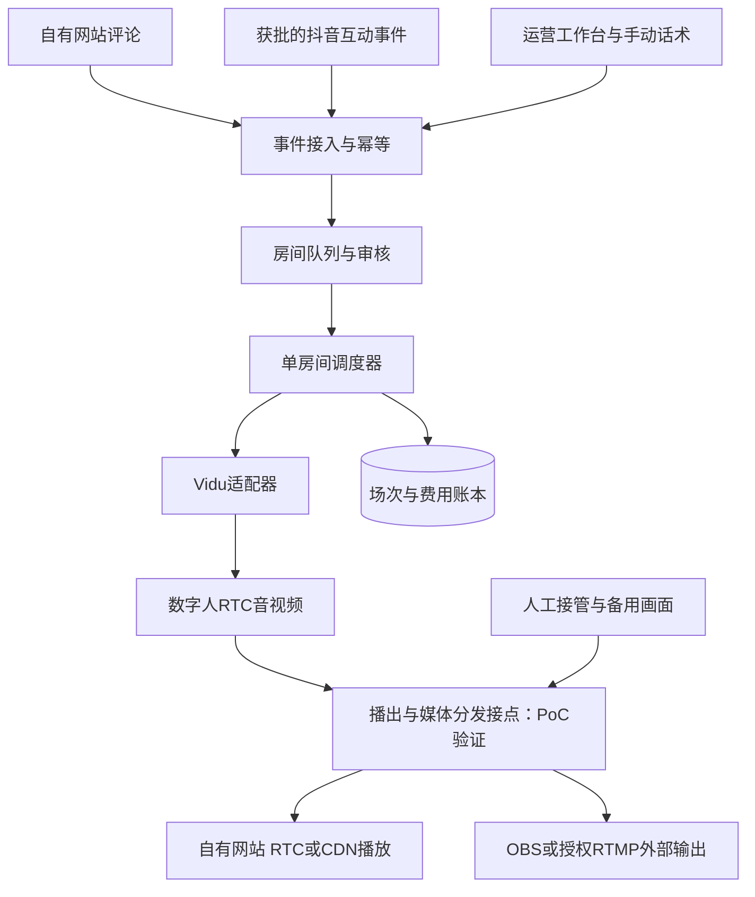
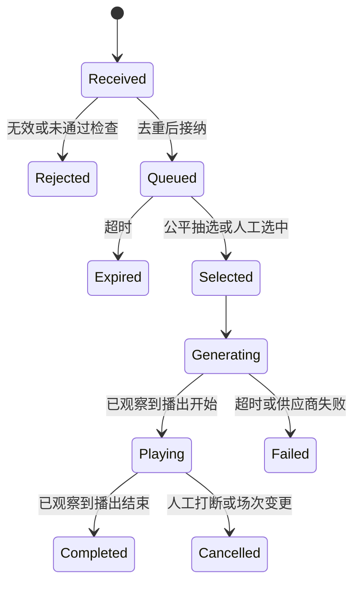

# 01 DigitalHuman：数字人直播平台产品与技术调研

> 当前阶段说明（2026-10-25）：用户已明确网页数字人PoC优先、直播后置。本文保留此前直播研究结论；其中双端一期/平台权限/长时测试不再是当前要求。以[当前需求v0.7](../requirement/01-数字人MVP需求草案.md)及[网页PoC计划](../plan/07-网页数字人PoC验证计划.md)为准。

调研日期：2026-10-24—25，Asia/Shanghai。状态：立项建议，尚未进行付费模型实测或真实开播。

v0.2补充：[实播复盘与平台逆向](04-实播复盘与平台逆向补充.md)核对Gary的X文章、Vidu/LiveAvatar/Tavus公开入口及官方接口。下列早期功能设想不等于首版清单；范围以[数字人MVP需求草案](../requirement/01-数字人MVP需求草案.md)的评审结果为准，当前仍未确认。

## 01 建议决策

本次研究按「写实数字人直播工作台 + 自有网站观看互动 + 外部直播输出」方向展开。调研聊天中，用户对用途问题回答“两者同时作为第一期目标”，对形象问题回答“以参考视频的实际效果为准”。这是研究方向的确认，**不等于下文功能清单、技术栈、预算或排期已经批准**。依据实际图文观察，建议采用写实人物、居中舞台、生活化背景、横竖屏切换，不先投入3D骨骼和动捕制作。

建议先用 **Vidu S2-Avatar 实时版验证视觉与互动体验**，以 `ai-live-avatar` 为编排参考；平台业务层独立设计。生成一条节目流，再分发到网站和外部平台。多人观看不应各自创建一个数字人生成会话。

首轮技术验证必须同时跑通网站和外部输出，不能用单机演示替代双端闭环。抖音账号接入、Vidu媒体出口和实际质量是三个前置门槛。若完整语音链路无法满足可控话术及输出审核，切换到 Vidu 组件版 + 自有 LLM/TTS；若持续成本不可接受，再对比 MuseTalk 自托管。此处选型是建议，非供应商采购承诺。

补充研究把**角色质量、独立接管、双端同源、终止与账单核对**提前为最小验证门槛。先证明可播、可控、可停，再扩展互动样本和连续运行；顺序见[PoC第06节](../plan/05-双端PoC验证计划.md#06-按证据推进的决策门槛)。LiveAvatar与Tavus作为交互机制和媒体接入的候选对照，不因演示页观感直接替换Vidu，也不认定它们已适配外部直播。

## 02 参考作品究竟证明了什么

[用户提供的抖音作品](https://www.douyin.com/user/MS4wLjABAAAA4Ifyzc7S7vgKqqsMD1ccen4br6oLao63C8Skl6JRpyk?modal_id=7697175786456911113)来自「程序员七七」，名称为「映播」。它是10张开发图文，不是已经验证完整实时能力的直播录像。

Firecrawl获取了公开文案；REA启动临时Chrome，访问指定作品并等待5秒，取得页面可访问性文本与截图。REA证据 `ev_d7e91d0b1e32778f177aa044573d6f83df815f459d216380d18660acb0d1e6b1`，浏览器由工具退出。截图有登录遮罩；随后使用浏览器打开该页面公开列出的图片，视觉检查第2—10张。没有登录、采集私有接口或实际操作映播产品。

| 观察对象 | 已观察到的证据 | 对本产品的启发 | 不能由此证明 |
|---|---|---|---|
| 第6、7张舞台 | 写实女性坐姿、室内背景；人物居中，浅色半透明控制面板；横竖屏配置 | 人物是视觉主体；控制台与纯播出画面分开 | 人物是否连续生成、动作自然度、口型质量 |
| 第7张工作台 | 角色预览、消息/队列/处理记录、商品资料与手动话术；标注0.2.8演示且未连接Vidu | 把消息处理阶段和直播状态直接展示给运营者 | 商品事实问答、实际商品展示和实时媒体连通 |
| 第2、3张链路 | 照片/声音/人设配置，连接Vidu，直播伴侣捕获独立窗口，识别评论 | 画面、声音、消息是三条分别验收的链路 | 仅看到视频就能证明观众听到声音 |
| 第5、8张队列 | 对重复识别、旧消息和说话中途切换的修复描述；提出60秒过期 | 幂等、过期、背压、播报完成信号属于核心产品能力 | 已经达到真实直播的连续性和响应指标 |
| 第9张互动素材 | 商品/道具管理、完整服装搭配、触发与恢复；说明真实动作仍需验证 | 用审核过的素材和动作白名单，先支持恢复默认 | 任意换装、拿取物品的视觉一致性 |
| 第10张验收 | 明确要求核验画面、声音、评论、回复、收播断开 | 将它们转化为可记录的端到端验收 | 已经稳定运行数小时 |

**不把“映播”与 `garycaogan/ai-live-avatar` 视为同一项目。** 本次没有证据证明作者、代码或版本的对应关系。前者用于体验拆解，后者用于实现研究。详见 [参考作品观察与证据台账](03-参考作品观察.md) 和 [REA取证记录](evidence/rea-douyin-observation.json)。

## 03 产品定位与一期边界

优先用户假设：小型内容团队、品牌展示人员和虚拟角色运营者。他们需要用有限的人力维持一个可互动、可接管、成本可控的数字人直播间。本次没有用户访谈与市场规模数据，不能据此证明付费意愿。

核心任务：运营者配置授权角色与节目内容，预检后开播；观众在网站或已接入的外部平台互动；系统选择合适消息回复和执行有限动作；运营者随时介入，结束后查看效果与成本。

一期采用**共享直播间**：所有观众看同一条人物音视频和同一次回应。每人专属一对一会话会改变并发和计费模型，后续单独规划。

| 模块 | 一期必要能力 | 验收时应看到什么 |
|---|---|---|
| 角色资产 | 授权照片、音色、人设、默认形象、完整服装版本、授权记录 | 同一角色可复用；不上传作者原角色作为自有资产 |
| 直播工作台 | 大舞台、横竖屏、安全区、可收起面板、独立纯净播出页 | 输出不包含运营按钮、密钥、队列和调试信息 |
| 场次管理 | 创建、预检、开播、暂停互动、人工接管、停播、费用上限 | 网站观看状态、生成会话状态和外部推流状态分别显示 |
| 自有观众端 | 直播目录/房间、播放、静音解除、文字评论、连接状态、AI标识 | 手机和桌面可观看；评论进入同一个房间队列 |
| 互动编排 | 来源标识、去重、TTL、抽选/人工选中、动作白名单、处理日志 | 显示候选/已选/生成中/播出中/完成/过期/失败，避免把“已收到”显示成“已回答” |
| 外部直播 | 纯净舞台供OBS/直播伴侣采集；具备权限时RTMP/RTMPS转推；接入允许的官方事件 | 真实目标账号看得到且听得到；事件能回到工作台 |
| 内容控制 | 人设边界、受控话术、输入检查、输出控制、人工静音与备用画面 | 运营者能阻止危险或失实输出；不能仅凭关键词过滤宣称安全 |
| 成本与复盘 | 生成时长、重开/换装重叠、媒体输出、异常、限额 | 停播确认服务端会话已结束；重启后累计预算不归零 |

商品资料可先提供手动录入和确定话术播报，延续参考用途；自动回答价格/库存、自动成交、支付和商家系统集成不作为一期默认能力。唱歌、复杂全身表演、任意道具重绘、跨场长期记忆、移动端原生App、全自动24小时无人值守留待验证后推进。

初期商业模式建议为「工作台席位/服务费 + 生成时长用量 + 分发用量」，让用户看到用量和上限；在真实留存与成本数据出现前，不推出不限时套餐或付费必回承诺。

## 04 开源参考项目评估

GitHub固定提交：[`5559ec5440c93814737155183dbe832df0b9f215`](https://github.com/garycaogan/ai-live-avatar/tree/5559ec5440c93814737155183dbe832df0b9f215)。详细文件与行号在 [源码评估](02-开源项目评估.md)。

它实现的是本地单房间编排：Python/aiohttp接收消息，规则处理后调用Vidu REST/WS，舞台通过阿里云RTC接收媒体，再交给OBS或浏览器录制/FFmpeg输出。**没有提供可自托管的数字人生成模型。**

可参考的机制：互动队列、形象切换状态机、单舞台占用、故障重连、费用保护、纯净舞台与编码输出。不能直接继承为生产承诺的部分：

- 默认单个LiveRoom，状态主要在内存与本地JSON中，缺少多租户隔离和可靠恢复。
- 默认20秒抽选间隔、普通消息180秒过期；这与参考图文提出的60秒不是同一规则。
- 播报完成主要通过文字长度估时，不能证明长句、网络抖动时不打断。
- 唯一舞台占位防止抢占，不是多人观看分发服务。
- 抖音弹幕接入没有内置；需要另做平台适配器与权限核验。
- 换装会创建新会话；背景/道具实时重绘默认关闭，作者提及衣着走样。
- 此次GitHub快照没有Release和CI workflow；有mock测试文件，但没有运行或验证真实服务。

代码采用MIT；云服务、RTC SDK、角色照片和音色权利须分别核验。选定源码快照仅供阅读，未安装依赖或执行。[许可证](https://github.com/garycaogan/ai-live-avatar/blob/5559ec5440c93814737155183dbe832df0b9f215/LICENSE)

## 05 数字人引擎选型

| 路线 | 与参考目标的匹配 | 优点 | 主要约束 | 决策 |
|---|---|---|---|---|
| Vidu S2-Avatar实时版 | 同属照片驱动、生成式人物互动方向 | 全链路接入快，参考项目已有封装 | 云成本高，内部LLM/TTS控制与输出审核需确认，RTC出口需验证 | 首个视觉/链路PoC首选 |
| Vidu S2-Avatar组件版 | 保留生成式形象，语音链路由我们提供 | 可控制回复文本、音色、业务知识与播报 | 要自建LLM/TTS及音频时序，支持哪些RTC供应商仍需核验 | 话术控制、业务化和成本优化的升级候选 |
| LiveTalking + MuseTalk | 偏音频驱动口型，适合固定机位讲话 | 自托管，语音和文本链路更可控 | GPU运维、素材预处理；不等价于任意全身生成/换装 | 长时固定播报的对照方案 |
| 3D/Live2D角色资产路线 | 更适合风格化角色 | 可设计动作与角色资产 | 与本次写实参考方向不同，需模型/绑定/动画制作 | 本期不选；这是产品适配判断，未做具体SDK评估 |

Vidu官方区分实时版、组件版、异步视频版与视频编辑版：异步MP4生成接口不能替代实时会话。实时版使用REST创建、WS控制、AliRTC传媒体；组件版WS还上传PCM音频与转写文本。不要套用“WS只传信令”概述去误判组件版音频路径。[Vidu接口概述](https://platform.vidu.cn/vidu-stream/doc)、[组件版](https://platform.vidu.cn/vidu-stream/doc/s2-avatar/component/introduction)

MuseTalk官方报告特定V100条件下30fps+，但本次没有硬件实测；官方也列出脸部细节、分辨率与抖动限制。模型和代码的许可不自动覆盖其他依赖或测试素材。LiveTalking README声明WebRTC、RTMP等出口，也包含发布视频需保留其标识的声明；采用前要逐项核对，而非仅看仓库许可证名称。[MuseTalk](https://github.com/TMElyralab/MuseTalk)、[LiveTalking](https://github.com/lipku/LiveTalking)

新增LiveAvatar/Tavus的公开客户端与接口对照见[RES-005第04节](04-实播复盘与平台逆向补充.md#04-平台对照与适用边界)。比较重点是文本/音频驱动、播报事件、打断语义、可控媒体出口和会话费用边界；本轮没有可支持画质排名的同素材实测。

## 06 应用层与媒体层选型

| 层 | 建议 | 理由与边界 |
|---|---|---|
| Web | Next.js + TypeScript；UI延续现有shadcn/Radix习惯 | 官网/角色页/观众端/后台共用工程；RTC播放器放客户端边界，密钥留在服务端 |
| 业务与编排 | Python FastAPI + 长驻房间Worker | 方便复用Python适配逻辑；一个房间一个串行调度所有者；不要将持续会话放入短生命周期HTTP函数 |
| 持久化 | PostgreSQL | 角色、素材版本、房间、场次、消息处理记录、费用账本；作为业务事实来源 |
| 排队/协调 | Redis Streams、租约与限流；日志按需持久化 | 这是设计选择；需要ACK、重投、幂等和房间租约，不能仅用Pub/Sub充当可靠队列 |
| 素材/回放 | 对象存储 | 保存自有资产与按策略保留的回放；短期URL，不公开密钥 |
| 首轮媒体 | Vidu原生AliRTC + 独立播出节点 + OBS/直播伴侣/云转推 | 先沿供应商已支持路径；OBS是运营端/验证路径，不让普通观众安装OBS |
| 网站分发 | 优先核验AliRTC授权云转推到直播CDN；低延迟交互群体可用RTC | 旁路能力存在不代表我们有Vidu所用RTC应用的管理权限 |
| 可替换RTC | LiveKit + Egress | 文档支持自定义音视频轨发布和RTMP/HLS出口；只有媒体能合法、稳定桥接进来后才使用 |
| 部署 | 常驻容器服务与独立媒体进程，先单区域 | 用真实观众所在地测网络；暂不以多云/Kubernetes作为一期必要条件 |

Context7选择 `/vercel/next.js`、`/websites/fastapi_tiangolo`、`/websites/livekit_io`，分别核对浏览器SDK边界、WS进程内状态限制和媒体发布/Egress能力。查询结果保存于 `docs/research/evidence/`。没有据此固定“最新版本”；开工时再锁版本和依赖。

- [Next.js组件边界](https://nextjs.org/docs/app/getting-started/server-and-client-components)：浏览器API与交互放客户端组件，且需避免服务端预渲染时执行浏览器API。
- [FastAPI WebSocket](https://fastapi.tiangolo.com/advanced/websockets/)：官方简单内存连接管理器只能覆盖单进程；增加worker不等于共享房间状态。
- [LiveKit Avatar媒体轨](https://docs.livekit.io/reference/python/livekit/agents/voice/avatar/index.html)、[Egress](https://docs.livekit.io/reference/other/egress/api)：支持发布与导出，但不证明与Vidu原生RTC能直接互通。
- [阿里云旁路转推](https://help.aliyun.com/zh/document_detail/109589.html)：可混流并推向直播CDN；这是能力文档，具体当前API、应用所有权、权限及费用仍须按实际账号确认。

## 07 双端架构与待验证接点

媒体接点按优先级验证：①供应商支持的服务端转推/自有RTC频道；②授权播出节点订阅RTC并转发；③PoC可用浏览器舞台+OBS采集。若用浏览器MediaRecorder转FFmpeg，要单独测分块缓冲、音画时钟、页面崩溃和CPU负载，不能当作已完成的生产桥接。

**不能直接把AliRTC Token交给LiveKit使用，也不能把Vidu WS当成视频流。** LiveKit属于替换/桥接候选，不与AliRTC无条件叠加。自有观众端和外部平台分别有延迟和故障状态；若两端同时互动，按来源公平抽选，避免外部延迟消息抢占网站实时消息。

生成计费按独立节目会话数估算，分发费用按观众时长/流量估算。100名观众看同一主播，目标是1条生成流；100个一对一对话则可能需要100条生成流，成本完全不同。

## 08 互动调度规则建议

一期建议普通消息60秒TTL，来源事件ID优先去重；没有可靠ID时可用来源、用户、文本、时间窗指纹做近似去重，但不能把不同人相同评论永久去掉。候选池设上限并丢弃过期消息，明确显示抽选而非承诺逐条回复。

优先级建议：紧急停播/人工接管最高；当前已开始的正常话术允许说完；普通互动按公平策略选择；空闲才暖场。礼物感谢支持限频合并，默认不强行打断当前话术。所有动作具有ID、冷却期、执行超时和恢复默认形象的路径。

每次换装/重连提升session_generation，旧会话迟到事件不得完成新任务。新形象首帧和音频就绪后再切舞台；旧会话终止结果必须确认。真实播放结束事件优先，只有转写字数时只能估计，应标注不确定并设置保护超时。该估时限制是PoC必须解决或接受的产品边界。

## 09 成本与商业可行性

官方公开页面显示1积分=¥0.03125，实时版1.5积分/秒、组件版1积分/秒。以下按持续计费时长计算，为公开价估算，不是合同报价。[定价页](https://platform.vidu.cn/pricing)、[版本费率](https://platform.vidu.cn/vidu-stream/doc)

| 单个生成会话时长 | 实时全链路版 | 组件版，仅数字人部分 |
|---|---:|---:|
| 1小时 | ¥168.75 | ¥112.50 |
| 2小时/场 | ¥337.50 | ¥225.00 |
| 8小时/天 | ¥1,350 | ¥900 |
| 8小时×30天 | ¥40,500 | ¥27,000 |
| 24小时×30天 | ¥121,500 | ¥81,000 |

组件版另算LLM/TTS、RTC与运维。两条路线都要核算素材生成、媒体桥接/编码、CDN、存储回放、审核和人力；换装时新旧会话重叠、失败启动、无人观看但未停机可能增加费用。官网的通用并发说明不能直接当作S系列账号并发保证，须以账号开通项确认。

成本模型：总费用 = Σ供应商实际计费秒数×费率 + 媒体/带宽 + 应用基础设施 + 审核/人工。单位有效直播小时成本 = 总费用 / 实际可观看且可听见的节目小时。持续重试却黑屏的时长不计入“有效直播”。

Gary文章新增一组实播自报费用，详见[RES-005第02节](04-实播复盘与平台逆向补充.md#02-gary-文章核对与证据边界)。它支持对预热、重开和异常用量逐会话核对的必要性，但不是供应商账单证据；不据此覆盖公开费率或承诺我们的运营成本。

流量示例（非报价）：2Mbps×100名平均同时在线观众×3600秒÷8，约90GB/小时，未计协议开销。CDN价格另询；不要把生成费当成全部成本。

建议首轮预留5个累计生成小时：公开价约¥843.75；若加20%生成时长缓冲约¥1,012.50，其他成本另计。这里只是测试预算建议，本次未充值或消耗付费生成会话。自托管是否便宜，要将GPU利用率、同时说话容量、空闲资源和维护人力纳入同一口径实测。

## 10 一期验收与交付安排

下列都是**建议目标，不是当前已测成绩或供应商SLA**。先以单直播间、一个授权角色、网站20名并发观众和一个外部目标进行技术验收，再按试运营容量扩大。

补充说明：作者报告的“评论至开口10–20秒”与下表“已选至网站首音5秒”口径不同，不能直接判定通过或失败。5秒保留为待验证候选值；必须增加接收至首音的端到端分布，并拆分排队、生成与双端传输。范围与门槛仍由需求Q-004—007确认；不因研究补充自动要求两套形象、外部评论或8小时测试。

| 维度 | 初始验收目标 | 测试方式 |
|---|---|---|
| 视觉 | 正常说话、眨眼、轻微头动、两套形象；不出现明显人脸/服装跳变 | 固定角色与脚本，逐段标记瑕疵，产品/设计盲评 |
| 首次开播 | 从确认开播到自有端可见可听，P95≤30秒 | 至少20次冷热启动，拆分创建、RTC、首帧和首音 |
| 互动 | 被调度选中到自有端首音P95≤5秒；接收至首音另计排队时间 | 至少100条样本，外部端单独测，不混入一个平均值 |
| 音画 | 可感知口型/语音偏移目标≤150ms；目标输出25fps及以上 | 用音频时间点和对应视频口型测量，不用推理fps代替播出fps |
| 连续性 | 连续2小时双端可播，无需人工重启 | 记录卡顿、断流、重连、费用和输出帧，延伸8小时后再讨论长时运营 |
| 队列 | 重复事件不重复播；超TTL不再播；正常回复不被普通评论截断 | 重复/乱序/突发消息、长句和网络抖动注入 |
| 接管 | 运营者发出静音/切备用画面后，播出节点1秒内响应 | 网站和外部观众仍受已有缓冲影响，分别记录可见生效时间 |
| 停播 | 页面断开不等于停费；服务端终止确认、账本对齐 | 浏览器关闭、Worker崩溃、网络中断、余额不足场景 |
| 外部闭环 | 真实账号画面/音频正常；获批事件到达并产生回应 | 不以模拟弹幕或本地FLV替代抖音接入验收 |

建议小团队计划：1名前端、1名后端/实时音视频、产品设计与QA按需参与，6—8周只是容量规划假设，外部准入耗时不包含在内。

1. 第1周：授权角色与供应商账号确认；Vidu真实画质、媒体出口、抖音权限验证。无法取得可用媒体出口时停止扩展页面，先解决链路。
2. 第2—3周：单房间双端闭环、运营工作台、网站播放器与消息状态；接管和停费优先。
3. 第4—5周：队列持久化、资产版本、审核与受控话术、账本、故障恢复、目标平台适配。
4. 第6—8周：真实账号试播、容量与长时测试、修复、计费核对和小范围运营。资格未获批时外部互动仍标记未验收，不能改称全部完成。

产品指标：首次成功开播率、每场有效直播时长、被选中消息的完成率、观众平均停留/回访、每有效直播小时成本。回复完成率分母仅为已选消息，另行展示消息被选比例，避免靠丢弃消息美化指标。

## 11 关键上线依赖

外部平台：官方直播评论能力只说明挂载玩法的特殊指令消息，且需要申请；没有证据证明可获得任意房间全部自由文本、礼物或推流权限。OCR是参考产品的一种输入方式，不能等同官方事件源，可能漏识别/重复，且需要单独核验允许的使用方式。因此一期完整验收依赖目标账号与平台方案获批。[抖音官方评论能力](https://developer.open-douyin.com/docs/resource/zh-CN/interaction/jierushuoming/hudongshuju/pinglunshuju)

内容与资产：使用授权照片/音色；保留AI生成标识；记录操作者和供应商会话。中国的生成合成内容标识办法自2025年9月1日实施，明确显式/隐式标识及发布声明要求。具体主体资格、服务形态和平台规则须在上线方案确定后核验，不能认为加水印就满足全部要求。[网信办原文](https://www.cac.gov.cn/2025-03/14/c_1743654684782215.htm)

全链路模型的输出控制：如果回复音频先于我们获得可审核文本而播出，事后转写不构成播前审核。受控商品话术应走可预检文本的链路；若供应商不能保证这种控制，就使用组件版。停播键也无法撤回已经进入外部平台缓冲的内容。

视频同样需要明确控制点：正常输入可能产生异常画面。直通与增加审核缓冲的模式须分别测试延迟、漏出和误拦；人工看到后静音/切备用画面是止损能力，不是零漏出的证明。备用播出应在生成Worker故障时仍可操作，见PoC的TC-005/006。

## 12 结论完成度与剩余决策

| 立项问题 | 本次状态 |
|---|---|
| 参考作品呈现什么UI/人物方向 | 已回答：图文视觉观察，写实人物与工作台；没有连续运动证据 |
| ai-live-avatar是否能直接做平台 | 已回答：能借鉴编排，需补业务、分发、鉴权和恢复 |
| 双端如何构建 | 已提出方案；供应商RTC出口与目标账号尚未实测 |
| 主路线/备选路线 | 已比较并给出条件式选择 |
| 公开费率与成本估算 | 已核官方公开费率；账号报价、收费边界待核 |
| 真实口型、延迟、稳定性 | 未验证，已给PoC测试矩阵 |
| 市场需求、付费意愿 | 未验证，试运营/访谈补齐 |

进入开发前仍需确定：授权角色素材、每月生成预算、首批并发直播间与观众目标、抖音目标账号可用能力、Vidu实际账号和RTC输出能力。这些不会阻止本次调研成文，但会影响最终版本范围与报价。
