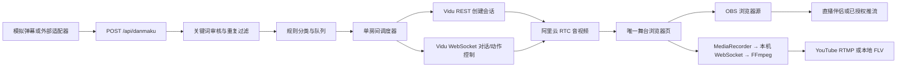

# 02 ai-live-avatar 源码调研

调查日期：2026-10-25（Asia/Shanghai）。目标：[garycaogan/ai-live-avatar](https://github.com/garycaogan/ai-live-avatar)。固定提交：`5559ec5440c93814737155183dbe832df0b9f215`，最后提交时间 2026-10-19 13:47:27 UTC。

## 01 结论

适合参考或改造成「运营人员控制一个数字人直播间」的验证底座；不是可直接部署的多租户数字人直播平台，也不是可自托管的数字人模型。视频、语音和对话的核心能力依赖 Vidu S2 云服务。我们最值得复用的是弹幕编排、换装状态机、OBS 输出和成本保护的经验。

本报告为 GitHub 插件取证及源码静态阅读。没有执行仓库代码、安装依赖、调用付费模型、验证真实画质、压测或实际开播。README 的“约 6 秒换装”和源码注释的响应延迟均属于作者陈述，不是本次实测。

## 02 证据范围与维护状态

GitHub 插件取得仓库元信息、README、完整递归文件树、最近提交、Release 与 open issues；并按上述提交读取 15 个关键文件，保存在 `docs/research/reference/ai-live-avatar/`。这是一份选定源码快照，不是完整 checkout，不能直接运行。

- 仓库 2026-10-19 创建，2026-10-19 最后推送，调查时未归档；347 stars / 99 forks / 0 open issues，仅为当时快照，不代表生产成熟度。
- API 返回最近 5 个提交，均为 2026-10-19；最早一条是首次公开版。Release 列表为空。
- 完整树没有发现 CI workflow 或锁定依赖文件；`requirements.txt` 仅声明 aiohttp>=3.9、Pillow>=10、numpy>=1.26。
- 有逻辑、工作台及 mock 端到端测试文件，但本次未运行。测试入口明确对接本地 mock，不能替代 Vidu、RTC、OBS 和抖音真实链路验收。
- 信息来源：[仓库 API](https://api.github.com/repos/garycaogan/ai-live-avatar)、[提交列表](https://api.github.com/repos/garycaogan/ai-live-avatar/commits?per_page=5)、[Release 列表](https://api.github.com/repos/garycaogan/ai-live-avatar/releases?per_page=5)、[完整树](https://api.github.com/repos/garycaogan/ai-live-avatar/git/trees/5559ec5440c93814737155183dbe832df0b9f215?recursive=1)。

## 03 实际链路

| 环节 | 代码证明的行为 | 产品含义 |
|---|---|---|
| 服务 | aiohttp 应用中创建单个 LiveRoom；启动入口拒绝非 loopback 地址 | 原始部署边界是本地单运营者，不能改监听地址就当 SaaS |
| 输入 | `/api/danmaku` 接收 user/text/gift/source；没有抖音适配器 | 平台事件接入须另做 |
| 审核 | 去标点、关键词子串、长度限制、按用户+文本去重 | 可做第一道门，但不能覆盖语义诱导和生成输出审核 |
| 路由 | 规则识别聊天、动作、换装、背景/道具等 | 不需要另接 LLM 才能完成基础互动路由 |
| 调度 | 默认 random_recent、20 秒最短间隔、队列 200、普通弹幕 180 秒过期 | 不能承诺每条弹幕实时回应；需要明确抽选和排队反馈 |
| 说话结束 | 使用转写字数估算：0.23 秒/字、上限25秒、间隙0.5秒，回复前先等最多8秒 | 未获得真实语音结束事件；长回复和网络抖动会影响调度 |
| 生成 | REST 创建 Vidu 会话；WS 发送文本、动作、对话和图像切换控制 | 开源部分没有训练权重或本地推理管线 |
| 媒体 | 舞台仅实现 artc，订阅远端音视频，不发布本地麦克风/摄像头 | 此版本是文本驱动直播，不是默认语音连麦产品 |
| 输出 | OBS 图层，或 MediaRecorder 500ms 分块送本地服务、FFmpeg 编码 | 浏览器参与媒体转发，云化时需要独立媒体工作进程 |
| 持久化 | JSON 文件保存角色、素材、任务，进程内保存当前房间/队列 | 需要补数据库、任务幂等和恢复策略 |

代码证据：
- [server.py:39–58 默认值](https://github.com/garycaogan/ai-live-avatar/blob/5559ec5440c93814737155183dbe832df0b9f215/server.py#L39-L58)、[server.py:109–124 单房间](https://github.com/garycaogan/ai-live-avatar/blob/5559ec5440c93814737155183dbe832df0b9f215/server.py#L109-L124)、[server.py:489–490 本地限制](https://github.com/garycaogan/ai-live-avatar/blob/5559ec5440c93814737155183dbe832df0b9f215/server.py#L489-L490)。
- [moderation.py:45–68](https://github.com/garycaogan/ai-live-avatar/blob/5559ec5440c93814737155183dbe832df0b9f215/live/moderation.py#L45-L68)、[session.py:290–347 弹幕处理](https://github.com/garycaogan/ai-live-avatar/blob/5559ec5440c93814737155183dbe832df0b9f215/live/session.py#L290-L347)。
- [vidu.py:55–68 REST](https://github.com/garycaogan/ai-live-avatar/blob/5559ec5440c93814737155183dbe832df0b9f215/live/vidu.py#L55-L68)、[vidu.py:139–176 控制消息](https://github.com/garycaogan/ai-live-avatar/blob/5559ec5440c93814737155183dbe832df0b9f215/live/vidu.py#L139-L176)、[session.py:457–476 人设与会话参数](https://github.com/garycaogan/ai-live-avatar/blob/5559ec5440c93814737155183dbe832df0b9f215/live/session.py#L457-L476)。
- [session.py:58–68 估时](https://github.com/garycaogan/ai-live-avatar/blob/5559ec5440c93814737155183dbe832df0b9f215/live/session.py#L58-L68)、[session.py:854–900 调度](https://github.com/garycaogan/ai-live-avatar/blob/5559ec5440c93814737155183dbe832df0b9f215/live/session.py#L854-L900)。
- [stage.html:351–375 RTC](https://github.com/garycaogan/ai-live-avatar/blob/5559ec5440c93814737155183dbe832df0b9f215/static/stage.html#L351-L375)、[stage.html:418–440 媒体转发](https://github.com/garycaogan/ai-live-avatar/blob/5559ec5440c93814737155183dbe832df0b9f215/static/stage.html#L418-L440)、[broadcast.py:304–332 输出与编码](https://github.com/garycaogan/ai-live-avatar/blob/5559ec5440c93814737155183dbe832df0b9f215/live/broadcast.py#L304-L332)。
- [workbench.py:98–102 JSON 原子替换](https://github.com/garycaogan/ai-live-avatar/blob/5559ec5440c93814737155183dbe832df0b9f215/live/workbench.py#L98-L102)、[workbench.py:193–210 本地存储](https://github.com/garycaogan/ai-live-avatar/blob/5559ec5440c93814737155183dbe832df0b9f215/live/workbench.py#L193-L210)。

## 04 值得借鉴的产品机制及边界

### 换装是完整参考图切换与会话重建

代码先上传整套形象图、创建新 Vidu 会话、等待控制通道 ready，再令舞台切换并退休旧会话。README 的“约 6 秒”没有端到端性能保证。旧新会话短暂重叠可能影响成本；连续对话上下文是否完整保留没有证据，应按会话可能重置设计。[session.py:648–703](https://github.com/garycaogan/ai-live-avatar/blob/5559ec5440c93814737155183dbe832df0b9f215/live/session.py#L648-L703)

背景/道具实时重画默认禁用，代码会转为聊天。作者说明曾出现衣着走样。建议 MVP 只开放已审核的整套形象、有限动作，暂不做任意自然语言换景/拿取物体。[README:18](https://github.com/garycaogan/ai-live-avatar/blob/5559ec5440c93814737155183dbe832df0b9f215/README.md#L18)、[session.py:312–316](https://github.com/garycaogan/ai-live-avatar/blob/5559ec5440c93814737155183dbe832df0b9f215/live/session.py#L312-L316)

### 内容不是逐条即时答复

默认从最近弹幕中抽选，最短间隔 20 秒，暖场在安静45秒后触发。把“实时生成”与“即时回答每个人”区分开。应展示正在回应谁、候选指令、抽选规则和失败反馈；MVP 不要销售无法保障的回应优先权。

README 写“礼物不插队”与默认配置一致，但 queue.py 仍保留 gift_first 两种策略；其模块顶部注释还写礼物插队，不能据此判断当前默认产品行为。[queue.py:15–67](https://github.com/garycaogan/ai-live-avatar/blob/5559ec5440c93814737155183dbe832df0b9f215/live/queue.py#L15-L67)

### 单个生成会话不等于多人分发房间

`claim_stage` 只把 RTC 凭证交给一个舞台页，并通过角色与心跳防止多个页面抢占。不能把此舞台链接直接当万人直播间。若做自有观众端，应独立设计媒体出口、CDN/RTC 分发、观看鉴权与聊天室；若先做抖音开播工具，观众分发由抖音承担。[session.py:799–835](https://github.com/garycaogan/ai-live-avatar/blob/5559ec5440c93814737155183dbe832df0b9f215/live/session.py#L799-L835)

### 有费用与恢复护栏，但不是全天候 SLA

代码每15秒运行 watchdog，默认单场30分钟、3000积分、90秒无人接收画面停止。控制通道有3次重连；可选自动重开，3秒后执行、每小时最多6次，审核或余额问题不自动重开。恢复会调用 start 并重置会话状态，平台级全天预算、跨重开费用累计及故障连续性仍需单独验证。[session.py:752–797](https://github.com/garycaogan/ai-live-avatar/blob/5559ec5440c93814737155183dbe832df0b9f215/live/session.py#L752-L797)、[session.py:1038–1074](https://github.com/garycaogan/ai-live-avatar/blob/5559ec5440c93814737155183dbe832df0b9f215/live/session.py#L1038-L1074)

## 05 依赖与许可

- 开源代码采用 MIT：允许修改/分发/商业使用，但需保留版权及许可声明。这个许可不包括 Vidu、阿里云 RTC SDK、Evolink，也不授权作者的人物形象、音色和录屏。[LICENSE](https://github.com/garycaogan/ai-live-avatar/blob/5559ec5440c93814737155183dbe832df0b9f215/LICENSE)、[README:5](https://github.com/garycaogan/ai-live-avatar/blob/5559ec5440c93814737155183dbe832df0b9f215/README.md#L5)。
- 必需能力：Python/aiohttp 编排、Vidu S2 API、阿里云 RTC Web SDK；使用内置编码或音频处理需 FFmpeg。运行要求来自 README，非本次兼容性测试。
- 阿里云 SDK 下载脚本固定 7.1.9 并校验 SHA-256，仓库没有重分发 SDK。[fetch_vendor.sh](https://github.com/garycaogan/ai-live-avatar/blob/5559ec5440c93814737155183dbe832df0b9f215/tools/fetch_vendor.sh)。
- Evolink 用于图像/素材生成及上传；上传现成形象后可减少该依赖。语音克隆代码要求 Vidu Key，把样本上传后调用 Vidu clone API；缺少转写时还走 Evolink 的转写路径。不要把“可选生图依赖”误解为所有功能都可完全不依赖它。[workbench.py:706–737](https://github.com/garycaogan/ai-live-avatar/blob/5559ec5440c93814737155183dbe832df0b9f215/live/workbench.py#L706-L737)。
- 仓库配置中的模型 ID（含生图与转写模型）只是该集成使用的字符串，并不能证明模型官方可用性或价格；应独立核验供应商。
- README 记载 Vidu 1.5积分/秒、0.03125元/积分，换算168.75元/小时。**这是仓库记载口径，不是本次核实的现价/报价。** 不能据此承诺毛利；还需计入换装重叠、素材、编码、带宽和运营成本。[README:27](https://github.com/garycaogan/ai-live-avatar/blob/5559ec5440c93814737155183dbe832df0b9f215/README.md#L27)。

## 06 产品化缺口与优先级

| 优先级 | 缺口 | 交付前需要的证据 |
|---|---|---|
| P0 | 真实视觉、口型、动作、画面一致性 | 自有授权角色的实录与盲评，不以 README 演示代替 |
| P0 | 抖音输入输出接入 | 目标账号官方接口/玩法资质、推流权限及真实事件链路；仓库未内置抖音弹幕 |
| P0 | 输出失控处理 | 生成侧安全能力、审核事件、人工静音/切备用画面；关键词输入审核不够 |
| P0 | 费用与限额 | 官方现价、账号并发、收费起止、失败计费和退款；会话重启后的全局预算 |
| P0 | 云平台安全隔离 | 身份/权限、租户与房间隔离、密钥托管、短期RTC凭证；原应用按本地边界构建 |
| P0 | 媒体分发 | 用户已确认一期同时包含自有网站与外部直播，需要单独的分发与双端容量测试 |
| P1 | 可靠调度 | 事件ID幂等、过期/取消、房间 actor、持久化、队列背压；实际播放进度校准 |
| P1 | 运营控制台 | 场景预检、资产版本、节目单、告警、事故复盘、成本与互动漏斗 |
| P2 | 长期记忆/复杂才艺/电商 | 单独定义产品与能力验证；README 明确当前不支持跨场记忆、唱歌、带货等 |

抖音部分应引用 [README:96–108](https://github.com/garycaogan/ai-live-avatar/blob/5559ec5440c93814737155183dbe832df0b9f215/README.md#L96-L108) 作为项目接法说明，**不能当作抖音当前官方准入政策的证明**。

## 07 建议如何复用

1. 保留 MIT 声明，以固定提交作为研究分支起点，先完成单角色、单直播间、有限指令的体验验证。
2. 把 ViduClient、房间状态机与输出进程包成供应商适配器；定义 create/stop/sendText/sendAction/changeAvatar/usage/events 能力边界。
3. 第一阶段优先 OBS 输出与人工操作兜底；内置浏览器录制转推流链路作为待实测备选。
4. 首轮PoC同时验证自有网站与外部输出；达到画质、连续性和单位成本门槛后，继续把角色/资产/场次迁移到数据库与对象存储，并补租户隔离、鉴权、幂等与计费。
5. 自有观众平台和抖音开播工作台均纳入一期；它们共享生成编排，但分发、账号和运营系统不同，分别验收。

## 08 原始问题完成度

| 问题 | 状态 |
|---|---|
| 开源项目是模型还是应用 | 已回答：Vidu 云服务上的应用编排 |
| 实现、依赖、许可证、维护快照 | 已回答，边界为固定提交和GitHub返回 |
| 真实性能与画质 | 未验证，需付费实测 |
| 抖音账号可接入性 | 未验证，仓库明确无内置适配 |
| 可直接商用多租户平台 | 已回答：需明显补建；商业服务授权与容量仍需核验 |
